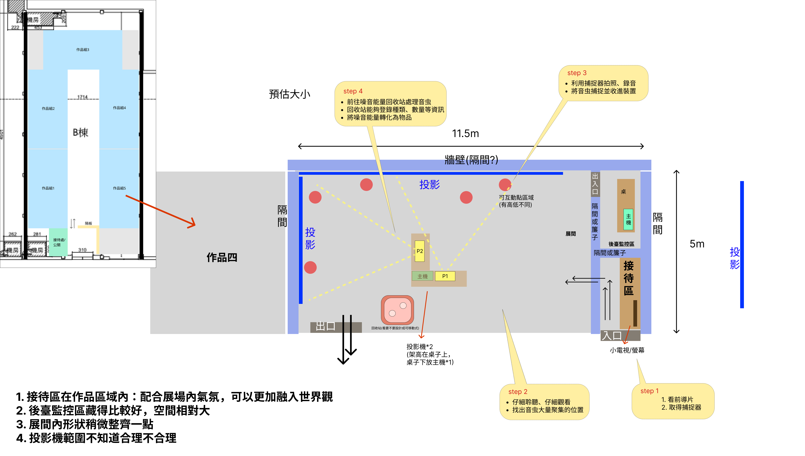
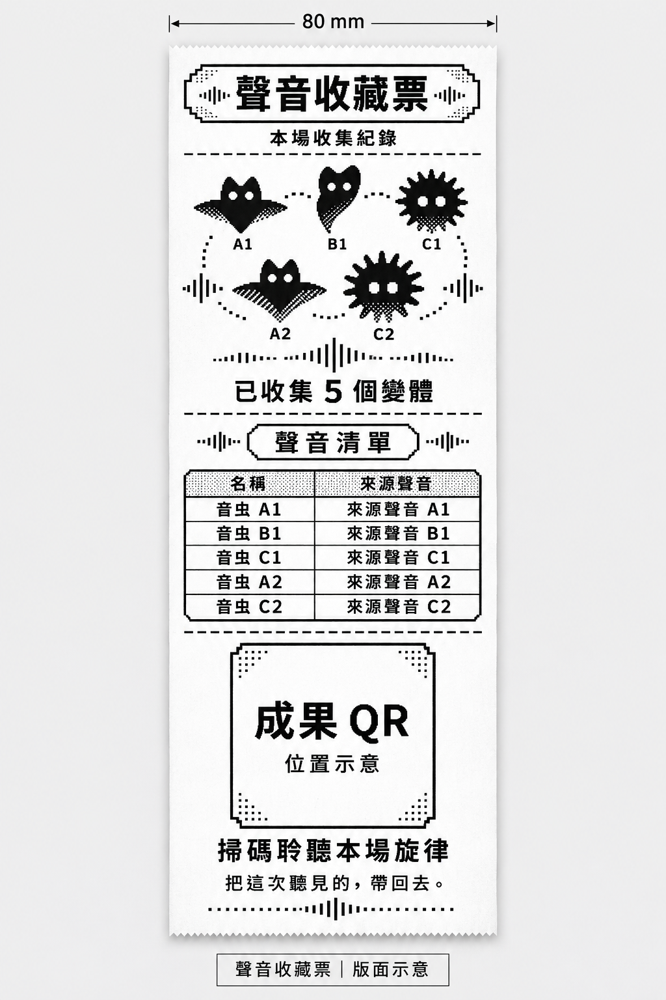

# 音虫互動投影技術架構

日期：2026-11-08

版本：v1.41

用途：供組員了解作品運作方式、設備與分工。本文件描述規劃架構，不代表已完成實作。

- 閱讀順序：本文件 → [技術流程圖](技術流程圖.md)。
- 實作：[開發規格](開發規格.md)；採購：[器材清單](器材清單.md)；來源：[重要連結](重要連結.md)。
- 待決／測試：[待確認與驗證清單](待確認與驗證清單.md)；方案比較：[功能覆蓋](方案對照與功能覆蓋.md)。

## 1. 專案概述與功能範圍

| 項目 | 內容 |
| --- | --- |
| 體驗形式 | 一次一位觀眾，觀看前導後領取無線捕捉器，由遊戲內字幕與操作動畫教學引導操作。 |
| 活動方式 | 在 L 形兩面投影構成的同一展場內自由走動、轉向與探索。 |
| 體驗目標 | 扮演捕蟲人，循聲尋找並收集音虫，將回收能量轉成物品修復城市。 |
| 音虫顯現 | 音虫起初隱藏但持續發聲；觀眾發聲使其短暫顯現，累積捕捉進度則讓外觀依進度線性顯現並保留。 |
| 光罩與捕捉 | 辨識並對準音虫點位後，在該處顯示固定照射光罩（Mask）與進度； 持續對準即可自動捕捉，移開保留進度並收起光罩。 |
| 捕捉聲音 | 隨捕捉進度增加，目標音虫聲音逐漸變小；移開保留對應音量，再對準接續，成功後停聲。 |
| 類型與變體 | 3 個基礎類型各有 3 個變體，共 9 個均納入隨機池；觀眾任選 5 個不同變體，類型可重複。 |
| 隨機出現 | 從已裝燈空閒點位隨機分散生成，開場 3 群；捕捉 1 群後補 1 群，SAN 歸零停止補充。 |
| 群落與 SAN | 每個固定出現區可有一隻或一群，整群算一次捕捉，SAN（遊戲精神值）初始 100，每群扣 20； 捕捉 5 群後歸零完成任務。捕捉器不發聲；捕捉後 SAN > 0 即補 1 群；同時最多存在 3 群。 |
| 回收流程 | SAN 歸零（任務完成）後，到回收座感應 NFC，再於捕捉器螢幕確認回收； 登錄類型、變體與群落數量，轉化物品並修復城市後進入結尾。 |
| 回收站位置 | 固定在開場面向的後方；觀眾轉身後即可找到，不隨視線移動。 |
| 紀念品 | 必做線上感謝信、收集摘要與個人旋律，離場後仍可開啟；每場另交付一張聲音收藏票。 |

## 2. 系統連接架構

| 項目 | 內容 |
| --- | --- |
| 點位與捕捉 | Unity 控制燈控板啟用點位 → 捕捉器相機辨識紅外線 → 經展場 Wi-Fi 回報 Unity → 投影、捕捉器螢幕與震動同步回應。 |
| 觀眾發聲 | 現場麥克風 → 音訊介面 → Unity 判斷有效發聲 → 目前探索區的既有音虫短暫顯現。 |
| 到站回收 | 回收座讀取捕捉器 NFC → 通知 Unity 到站 → 捕捉器螢幕開放確認 → Unity 結算並播放雙牆修復演出。 |
| 成果交付 | Unity 結算 → 本機保存 → 電腦 USB 列印收藏票／現場螢幕顯示同一 QR → 手機開啟 Next.js 紀念品頁； 成果另行背景上傳。 |

- **本機串接服務（Gateway）**是展場電腦上的程式，透過 WebSocket 連接捕捉器、回收座與 Unity，並以有線方式連接燈控板； 也負責管理頁、成果保存及上傳。

Unity 統一決定捕捉、SAN 與回收結果，捕捉器依結果更新畫面與震動。即時互動在展場區域網路完成，網際網路連線中斷只延後成果上傳。

## 3. 主要開發軟體

| 軟體／技術 | 用途 |
| --- | --- |
| Unity、C# | 音虫、固定點位光罩、捕捉、SAN、雙投影、聲音、回收與城市修復 |
| PlatformIO、C/C++ | 開發捕捉器、固定燈控板與 NFC 回收座程式，整合相機、螢幕、震動及紅外線編碼 |
| LVGL | 製作觸控螢幕介面，以頁籤、滑動及虛擬按鈕操作 |
| Node.js、TypeScript、WebSocket | 開發本機串接服務，連接裝置、Unity 與管理頁 |
| Next.js、React、TypeScript | 製作線上紀念品、成果 API 與工作人員管理頁 |
| Vercel Hobby | 部署 Next.js 線上紀念品與成果 API，預製素材隨網站版本發佈；原型使用免費額度 |
| SQLite、Neon Free（PostgreSQL） | 本機保存成果，雲端原型使用免費資料庫 |
| Web Audio API | 讓網頁上的多個旋律聲部同步播放 |
| Blender、聲音工具、Git／Git LFS | 製作美術、音檔並管理檔案版本 |

接腳、裝置通訊與資料格式見[開發規格](開發規格.md)。

## 4. 設備與展場配置

- 原圖供空間配置參考，操作以本文件為準。
- 圖示估算範圍約 **11.5 × 5 公尺**：長牆與側牆構成 L 形投影； 右側為接待與後台，中央為 P1／P2 投影設備，回收座位於初始面向後方、靠出口側。

| 設備 | 用途 |
| --- | --- |
| Windows 主機、獨顯及管理螢幕 | 執行 Unity、串接服務、音訊與管理介面 |
| 兩面主投影、幕面與支架 | 城市場景、音虫、能量轉化與城市修復 |
| 無線捕捉器（2～3 支輪替，每場啟用 1 支） | ESP32-S3 觸控螢幕整合板、PAJ7025R3 紅外線相機、震動與內建充電電池； 顯示 SAN、進度與回收確認 |
| 各點紅外線燈、驅動及固定燈控板 | 在音虫固定出現點輸出可辨識的閃爍編碼 |
| NFC 回收座 | 捕捉器貼被動式標籤，座端讀取器與 ESP32 回報到站 |
| 分享器、主機有線網路及網際網路連線 | 本地互動與雲端成果同步 |
| 麥克風、音訊介面及喇叭 | 收觀眾發聲，播放城市、音虫與劇情聲音 |
| 電源、充電設備、支架及線材 | 設備供電與布線；行動電源僅於充電時接上 |

原型先配置長牆兩點、側牆一點。板型、數量、台灣購買來源與參考價格見[器材清單](器材清單.md)。

## 5. 點位識別、發聲顯現與捕捉

| 步驟 | 處理內容 |
| --- | --- |
| 1. 建立點位 | 每個音虫出現區對應一顆紅外線燈。Unity 建立初始群落，隱藏外觀、播放聲音並啟用該點燈。 |
| 2. 循聲與發聲 | 觀眾循聲走動，自然呼喚或說話，使目前探索區的既有音虫短暫顯現，不必先精準瞄準。 |
| 3. 辨識與對準 | 捕捉器相機讀取光點的閃爍編碼，辨認點位及所屬牆面，再依光點與相機中心的偏移判斷是否對準。 |
| 4. 累積與接續 | 有效對準後，固定點顯示光罩，投影與捕捉器顯示相同進度，音虫依進度逐漸顯現。 移開或換群收起光罩，保留原群進度與外觀，再對準同群接續。 |
| 5. 捕捉成功 | 整群收走、停止該群聲音並關閉點位燈，SAN 扣一次，捕捉器更新畫面並震動。捕捉後 SAN > 0 即補 1 群；同時最多存在 3 群。 |

- 此方式辨認固定點位及對準程度，無法追蹤捕捉器完整位置，因此不提供隨手掃過整面牆的連續光罩。
- 紅外線燈隨群落存在啟用，識別閃爍不影響投影明暗；音虫暫時隱藏時燈仍運作。

- 有效發聲後用 3 秒逐漸淡入，接著用 1 秒淡出；已有捕捉進度則保留相應外觀。
- 顯現動畫與捕捉計時分開；辨識或連線失效時收起光罩、暫停捕捉，保留進度與對應外觀。

## 6. 聲音、回收與紀念品

| 環節 | 運作方式 |
| --- | --- |
| 循聲與數量 | 全場同時最多 3 群；捕捉 1 群後補 1 群。SAN 歸零停止補充；不另設低音量背景群落。 |
| 聲音回饋 | 只降低被捕捉群落的聲音，與同群保留進度同步；其他群落及城市環境聲不隨之降低。 |
| 聲音處理 | 校正現場背景音，再依音量及持續時間判斷有效發聲；不辨識說話內容、不要求大喊 |
| 防止重複觸發 | 一次發聲只回應一次，確認停聲且冷卻結束後才再接受；持續聲音不延長顯現 |
| 到站確認 | 回收座讀取本場捕捉器的 NFC，螢幕才開放「確認回收」；標籤只識別裝置，SAN 與收集資料由主機管理 |
| 回收演出 | 點選確認 → 登錄類型、變體與群落數量 → 能量轉化為物品 → 兩面主投影呈現城市修復 |
| 線上紀念品 | 掃現場成果 QR 開啟感謝信、摘要與個人旋律；每個已收集變體啟用一個預製聲部，完成時以 5 個變體組合旋律 |
| 聲音收藏票 | 本機保存後由電腦透過 USB 列印本場 5 個變體的黑白組合圖、名稱／來源聲音清單與同一成果 QR； 每場一張，失敗可補印 |

- 探索時持續播放循聲線索；循聲、對準捕捉及回收等操作採字幕搭配動畫引導；發聲步驟僅用字幕說明。
- 教學為觀看示範，不計正式數據。
- SAN 歸零（任務完成）後，停止捕捉、發聲顯現與新群落啟用，進入回收。
- NFC 感應後可移開再確認，資格保留到本場回收或結束；換備機須重新感應。
- 確認後顯示處理中並停用按鈕，重複感應或點按不重複結算。

收藏票印表機優先借用具 USB 與自動裁刀的 80 mm 機型，搭配相容紙捲；電腦直接控制列印、送紙及裁切，不另加 Arduino／ESP32。

圖樣與名稱為示例；正式票面由本場成果產生可掃碼 QR。

## 7. 美術與網頁交付需求

| 項目 | 交付內容 |
| --- | --- |
| 城市與雙牆畫面 | 各牆比例、接縫、固定出現區、點位光罩與進度、能量轉化及修復前後畫面 |
| 音虫 | 3 個基礎外形，各做 3 個配色／局部造形變體；共用同類動作，各變體分別配置來源聲音與聲部； 發聲／進度顯現及捕捉動畫 |
| 實體安裝 | 紅外線燈固定與走線、捕捉器外殼、NFC 感應位置 |
| 捕捉器介面 | 像素風 SAN、搜尋、對準、進度、成功、失效、電量及回收確認；觸控頁籤／滑動切頁； 收藏卡片顯示圖像、名稱及來源聲音 |
| 聲音 | 城市、音虫、劇情、回收及結尾音效；旋律聲部使用相同節拍、拍號、循環長度與起點 |
| 線上紀念品 | 手機版感謝信、摘要、旋律播放、QR，以及載入、錯誤與保存說明 |
| 聲音收藏票美術 | 80 mm 紙寬；5 個已收集變體的黑白組合圖、名稱／來源聲音清單與成果 QR；變體在黑白下仍可辨識 |

旋律配方與素材版本一併保存，確保離場重開仍是同份成果。

## 8. 場次與資料流程

| 步驟 | 處理內容 |
| --- | --- |
| 1. 開場 | 工作人員檢查點位燈、編碼、收音、回收座及保存服務，從備機中選定一支捕捉器開始本場，其他待機。 |
| 2. 中途 | 管理頁可暫停、恢復、中止及監看。換備機時停用舊機，保留 SAN、收集與各群進度，清除目前瞄準及到站狀態； 新機重新感應 NFC。 |
| 3. 結束 | Unity 固定本場收集、修復結果與旋律配方，Gateway 確認本機保存成功。 完成結尾及成果 QR 交付後才重置，開放下一場。 |

- 成果會背景上傳；網際網路連線中斷先保存並交付相同連結，網路恢復後補傳，補傳前網頁顯示尚未就緒。
- 重置不刪成果、待上傳資料或列印工作。
- 管理頁可查看裝置連線、電量、SAN、回收與同步狀態，執行單燈／NFC 檢查及補印。
