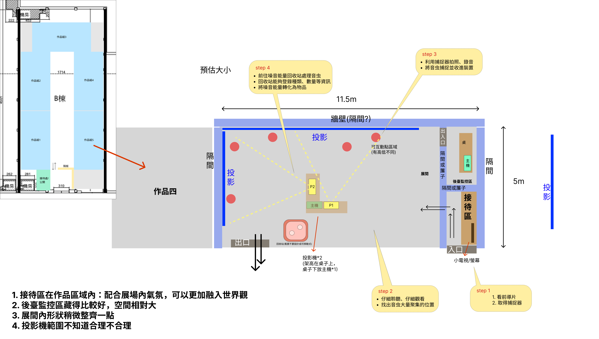

# 音虫互動投影開發規格

日期：2026-11-08

版本：v1.41

用途：固定出現點紅外線識別、NFC 回收、無線捕捉器與必要線上紀念品的開發及驗收。

- 先讀[技術架構](技術架構.md)了解作品，再依本文件實作各模組；資料傳遞可對照[技術流程圖](技術流程圖.md)。
- 本文件是開發規劃，不代表功能已實作或硬體已通過測試。
- 工具與零件參考見[重要連結](重要連結.md)，需求討論、選型與驗證集中於[待確認與驗證清單](待確認與驗證清單.md)。

## 1. 功能與遊戲狀態

- 本版使用自製 ESP32-S3 無線捕捉器、紅外線相機、觸控 LCD 與震動馬達，在 L 形雙投影間自由走動。
- 每個固定出現點對應一顆紅外線燈，點位編碼對應 point_id／wall_id。

### 群落、顯現、進度與 SAN

9 個變體均納入本場隨機池，由觀眾任選 5 個不同變體完成，類型可重複。開場 3 群；每捕捉 1 群即補 1 群，SAN 歸零停止補充。

| 規則 | 內容 |
| --- | --- |
| 群落單位 | 每場單人。point_id 是固定出現區；每點同時最多一個群落，可為單隻或一群，整群只算一次捕捉。<br>個體維持固定小範圍內的活動，類型、變體及判定範圍由配置管理。 |
| 類型與變體 | 先以 3 個基礎類型、每類 3 個變體規劃，共 9 個變體；<br>同類共用基礎外形，以配色或局部造形區分，每個變體都有不同來源聲音與預製聲部。<br>本場可遇到相同類型，但不重複同一變體；收集 5 個不同變體（5 群）完成任務。<br>同群可含多個同變體個體，仍只算一群；暫時隱藏、再顯現或重新對準不算新的出現。 |
| 本場變體去重 | Unity 保存「本場已出現變體集合」；初始化與捕捉後補出群落時，都先排除集合內變體，啟用成功才記入。<br>捕捉／移除群落不清除此集合；暫停、重連及換備機保留，僅本場結束／重置後清除。<br>每次從本場未出現變體中隨機抽取；9 個都有出現機會，單場不保證全部生成。 |
| 建立群落 | 初始化或捕捉結算後補出群落時，建立 target_instance_id／revision、<br>初始隱藏、播放群落聲音並啟用對應紅外線識別。群落存在與畫面顯現分開；短暫現形與隱藏都不建立新身分。 |
| 發聲顯現 | 發聲讓目前探索區仍存在的音虫短暫顯現。沒有捕捉進度時，其效果會逐漸消退回隱藏；<br>發聲不修改捕捉進度、數量或 SAN。 |
| 累積捕捉 | 對準後按累積有效時間提高捕捉進度，音虫依進度連續線性顯現。<br>移開、換群、遮擋、暫停或追蹤／連線無效時，保留原群進度及對應顯現程度；再次對準同群就繼續。捕捉不需按鈕。 |
| 捕捉音量 | 該群音量隨進度降低；移開保留對應音量，再對準接續。成功後停聲；新群以自己的原始音量開始。 |
| 捕捉結算 | 按 session_id＋target_instance_id 保存進度；<br>首次建立 capture_attempt_id，暫停／恢復沿用同筆。<br>只有 Unity 驗證累積完成後才關閉可捕捉狀態、整群收走、停群落聲音／該點燈，收集加一次、SAN 扣一次、UI／震動回饋。<br>捕捉器及捕捉成功不播放捕捉器音效，結算 SAN 後，大於 0 才補 1 群。 |
| 清除與新進度 | 成功／移除／回收結算／本場結束／重置才清除該群進度與顯現基準。同點重新啟用屬新群落，新進度起始為 0；<br>舊收集變體／旋律資料不回寫。 |
| SAN 與結束 | SAN 為 `max(0, 100 - 成功捕捉次數 × 20)`。<br>成功捕捉 5 群後 SAN 歸零，即完成捕捉任務並進入 Return；<br>停止捕捉、發聲觸發及新群落啟用，回收確認畫面顯示 SAN 0。<br>精神啃食就是扣值，器具損害以震動呈現，不另計噪音傷害、耐久或降低操作能力。 |

### 隨機出現與數量控制

| 項目 | 採用規則 |
| --- | --- |
| 開場 | 從 9 個變體隨機選 3 個不同變體，分散生成；起初隱藏並各自發聲。 |
| 同時存在 | 最多 3 群；隱藏中也算存在，不另設背景群落。 |
| 捕捉後補充 | 成功移除 1 群並扣 SAN；若 SAN > 0，立即隨機補出 1 個本場未出現變體。 |
| 生成位置 | 從已裝燈的空閒點位抽選。三燈原型同時全占用時，抓 1 群只能在該空位補出；<br>正式若需換位置，配置超過 3 個燈位。 |
| 身分與進度 | 新群使用新身分、進度 0；已捕捉的同一變體不重新出現。每個變體都有抽中機會，單場不保證遇到全部 9 個。 |
| 停止條件 | SAN 歸零進 Return，不再補充；暫停／失效期間不生成，恢復時核對既有群落。 |
| 去重 | 同次成功捕捉只結算、扣 SAN 與補出一次；重送不重複生成。補充由 Unity 處理，不是捕捉器發聲造成。 |

### 場次流程

遊玩時長只作內容量與接待估算；正式任務以 SAN 歸零完成並進入回收，不設 5 分鐘倒數或超時結束。

```text
待機 → 前導／領取捕捉器 → 驗證並建立場次 → 教學 → 循聲探索
→ 觀眾發聲：既有音虫短暫現形 → 有效對準：累積捕捉進度／依進度顯現
  ├─ 移開／換群 → 保留該群進度及對應顯現程度 → 再對準接續
  ├─ SAN > 0 且處於 Active → 繼續探索
  └─ SAN 歸零（任務完成） → Return／停止捕捉 → NFC 感應
→ 螢幕「確認回收」 → 固定清單／登錄類型、變體與群落數量
→ 能量轉化物品 → 城市修復 → 本機保存／結尾／成果 QR → 重置 → EXHIBIT_READY
```

- 開始由本機管理端要求，Unity 初始化完成才開放本場操作；同時只允許一場與一套啟用中的輸入。
- 前導說明背景與任務，循聲、對準捕捉及回收等操作採字幕搭配動畫引導；發聲步驟僅用字幕說明。

- 教學以字幕與動畫播放操作示範，觀眾觀看即可；發聲步驟僅用字幕說明。
- 示範使用展示資料，不寫入正式 SAN、捕捉進度、收藏、旋律或成果。
- 教學結束後才啟用正式探索。

- SAN 歸零（任務完成）即進入 Return，停止捕捉、發聲觸發與新群落啟用，取消尚未執行的群落生成事件，保留已確認紀錄並引導正常回收；<br>回收結算後直接結尾。
- 中止場次不標為成功成果；本機保存與清場確認完成後才開下一場。

### 結束與重置

| 步驟 | 處理內容 |
| --- | --- |
| 1 | Unity 固定本次成果、result_id／唯讀 token 及旋律配方並寫入持久化暫存；<br>Gateway 在同一本機資料庫交易中保存同份成果、token 與同步工作，確認寫入成功且結尾、成果 QR 交付完成後才重置。 |
| 2 | 標記場次完成、撤銷裝置操作權，清除裝置上的待提交操作與本場 SAN 顯示。 |
| 3 | Unity 停用本場所有點位燈並取得燈控確認，清空音虫、Mask、發聲短暫效果、待執行生成事件、SAN、<br>收集清單、捕捉進度與顯現基準、已感應及已回收狀態，恢復待機場景與聲音。 |
| 4 | Unity 回報 `EXHIBIT_READY`，本機服務確認捕捉器、燈控板及回收座就緒後，才釋放名額並依管理設定開放下一場。 |
| 5 | 中途離場、啟動失敗或逾時中止時，撤銷控制權再執行重置；未完成場次不標為成功成果。 |

成果、待同步佇列與列印工作按場次獨立保存，遊戲重置不刪除它們。雲端同步與列印可背景續作；本機保存或重置失敗時暫停入場。

## 2. 部署、軟體與設備

### 本地互動與必要線上成果

```text
Unity → Gateway → USB／串口 → 固定燈控板 → 驅動電路 → 各點紅外線發射燈
                                ↕ 燈控狀態與執行回報
紅外線光點 → PAJ7025R3 → SPI → 捕捉器 ESP32-S3
                                ├─ 觸控 LCD／震動
捕捉器外殼：被動式 NFC 標籤（獨立貼附，不接 ESP32，不需電池）
捕捉器 ESP32-S3 ↔ 展場 Wi-Fi／WebSocket ↔ Gateway ↔ 本機 WebSocket ↔ Unity

捕捉器標籤 → 回收座 NFC 讀取器 → I²C／UART → 回收座 ESP32
                                                      ↕ Wi-Fi／WebSocket
                                                    Gateway
觀眾聲音 → 現場麥克風／音訊介面 → Unity 分析 → 既有音虫短暫顯現
Unity 預製城市／音虫／劇情／回收／結尾音訊 → 現場喇叭
Unity 兩組虛擬 Camera／Display 輸出 → L 形兩面主投影（探索、回收、轉化與城市修復）
Gateway → SQLite／事件紀錄／成果 outbox／Windows 列印
Gateway → HTTPS → Vercel Next.js 成果 API → Neon PostgreSQL／版本化素材
觀眾手機 → HTTPS → Next.js 線上紀念品網頁（必做）
```

- 主要即時通訊使用展場 Wi-Fi WebSocket，主機走 Ethernet；<br>固定燈控板以 USB／串口連 Gateway。
- Gateway 分別管理捕捉器、燈控板及回收座。
- 網際網路連線不參與捕捉結算，雲端成果服務負責離場後的觀看。

### 軟體與責任

| 模組 | 規劃 |
| --- | --- |
| Unity 6 受支援 LTS、C#、URP | Windows、音虫群落與點位狀態、SAN、捕捉／回收、雙投影與聲音 |
| 捕捉器韌體（控制板上的程式） | PlatformIO、C/C++，相機 SPI、光點取樣、點位辨識、觸控回收確認、LCD、電量及震動 |
| 捕捉器觸控 UI | LVGL，整合電容觸控、像素風狀態畫面、頁籤／虛擬按鈕及滑動切頁 |
| 固定燈控韌體 | 以 PlatformIO 開發；各點閃爍編碼輸出、啟用控制、狀態回報及失聯安全關閉 |
| NFC 回收座韌體 | 以 PlatformIO 開發；I²C／UART 讀取標籤、讀取事件／移開回報與去重 |
| OpenFIRE ESP32 | 相機驅動、畸變修正與回饋的實作參考；本案另行實作閃爍編碼解讀 |
| Node.js LTS、TypeScript | Gateway、固定設備連線、場次、事件檢查、同步及列印 |
| Next.js App Router、React、TypeScript | 必做的線上紀念品網頁及成果 API；另於展場部署本機管理頁 |
| WebSocket、JSON | 即時雙向事件 |
| SQLite／PostgreSQL | 本機成果、待上傳佇列、捕捉器標籤對照／雲端成果 |
| Web Audio API | 成果頁依共同時間軸播放預製音軌，先由觀眾點擊播放 |
| Blender、聲音工具、Git／Git LFS | 素材與版本管理 |

- 三個裝置端韌體專案均使用 PlatformIO，以各自的 `platformio.ini` 管理板卡、框架、函式庫版本及燒錄設定；<br>框架與驅動須對應實際板型，不把通用 ESP32-S3 範例直接視為實際整合板的設定。

捕捉器依 Unity 回傳更新 LCD 上的 SAN／捕捉狀態及震動；現場聲音由 Unity 輸出至展場音響。OpenFIRE 為相機驅動與追蹤實作的參考。

### 設備組成

- 捕捉器主板／螢幕優先評估 Waveshare ESP32-S3-Touch-LCD-2.8 V2；<br>Sunton 4827S043 系列保留為備選，兩者不混用板級設定。
- 機身內建充電電池與充電／保護／電源轉換電路，整合板已具備的功能不重複外接；<br>行動電源僅於充電時接上，不納入外殼。
- 其他包含展場主機與雙投影、各點發射燈與燈控板、NFC 回收座、音訊設備、網路及供電。

### 候選板接腳分配

- 適用 **Waveshare ESP32-S3-Touch-LCD-2.8 V2，240×320，<br>SKU 27690**，不適用 2.8B／2.8C。
- 以下依原廠接腳表、電路圖與 V2 範例核對；外接 SPI 分配是本案接線提案，並非已完成硬體驗證。

| 功能 | GPIO／連接 | 說明 |
| --- | --- | --- |
| PAJ7025R3 SCK | GPIO18 | 12PIN 接口 IO18；另建相機 SPI 實例 |
| PAJ7025R3 MOSI | GPIO15 | 12PIN 接口 IO15 |
| PAJ7025R3 MISO | GPIO44 | 12PIN 接口 RXD，改作相機輸入 |
| PAJ7025R3 CSB | GPIO43 | 12PIN 接口 TXD，改作相機片選，韌體啟動後設為非選取高態 |
| PAJ7025R3 供電／共地 | 3V3／GND | 依 R3 模組規格接供電及四線 SPI；不可接 5V 訊號，實際轉接板接頭依樣品核對 |
| DRV2605L SCL／SDA | GPIO10／GPIO11 | 與板上 IMU／RTC 共用 I²C，DRV2605L 位址 0x5A，不衝突；<br>採 I²C 內部觸發，外部觸發腳不使用 |
| DRV2605L 供電／馬達 | 3.3V 相容供電／共地；馬達接驅動板輸出 | 選用相容模組，SDA／SCL 上拉不得高於 3.3V；馬達不直接接 GPIO |
| 內建 ST7789 顯示 | SCK 40／MOSI 45／CS 42／DC 41／RST 39／背光 5 | 原廠 Arduino 範例使用 `SPIClass LCDspi(FSPI)`；<br>相機使用獨立 SPI 主機，避免重設顯示 SPI |
| V2 CST3530 觸控 | SDA 1／SCL 3／INT 4／RST 2，位址 0x58 | 使用獨立觸控 I²C；與外部 GPIO10／11 的 I²C 分開初始化 |
| 原生 USB | GPIO19／20 | 保留燒錄／USB CDC 日誌；<br>GPIO43／44 改接相機後，不再使用該 UART 接口作序列裝置或 UART 日誌 |

- 四個引出的 GPIO15／18／43／44 足以安排相機 SPI；震動共用現有 I²C；<br>板上音訊功能不啟用，喇叭不接入捕捉器。
- GPIO10／11 連有板上器件，不能改作相機 SPI。
- 原廠範例的 FSPI 與觸控匯流排初始化需整合到 PlatformIO 專案，<br>不能直接套用 Sunton 設定或 V1 的 CST328 驅動。

- GPIO15／18 同時接到 SD 卡座的 D2／D1；<br>接相機時，SD 卡須停用或沿用原廠 V2 範例的 **1-bit SDMMC**，不得改為 4-bit。
- 介面素材可使用內建 Flash 或 1-bit SD 卡讀取。

- 依據：[原廠接腳表](https://docs.waveshare.com/ESP32-S3-Touch-LCD-2.8)、[原廠電路圖](https://files.waveshare.com/wiki/ESP32-S3-Touch-LCD-2.8/ESP32-S3-Touch-LCD-2.8.pdf)、[V2 範例](https://files.waveshare.com/wiki/ESP32-S3-Touch-LCD-2.8/ESP32-S3-Touch-LCD-2.8-V2-Demo.zip)（`Display_ST7789.h/.cpp`、<br>`Touch_CST3530.h`、`I2C_Driver.h`）、[PAJ7025R3 資料表](https://www.codico.com/media/productattach/p/i/pixart_paj7025r3_-_productbrief_2461050_4.pdf)、<br>[DRV2605L 資料表](https://www.ti.com/lit/ds/symlink/drv2605l.pdf)。
- 整機驗證統一見討論清單。

## 3. 場次建立與設備使用

- 準備 2～3 支捕捉器供充電、維修與備用，每場只啟用一支。
- 每支捕捉器保留簡單的 device_id 與 NFC tag_uid 對照；燈控板與回收座使用固定連線角色。

| 步驟 | 處理內容 |
| --- | --- |
| 1 | 啟動 Gateway、Unity、音訊與管理頁，確認捕捉器、燈控及 NFC 回收座連線正常，點位碼表一致。 |
| 2 | 工作人員選定本場捕捉器並按開始；<br>Unity 初始化成功後建立 session_id，回傳 SAN 與場次狀態。<br>未就緒或已有場次時不啟動第二場。 |
| 3 | Gateway 只轉送本場啟用捕捉器的操作；其他捕捉器保持待機。<br>裝置連線使用預先配對設定，管理頁限工作人員使用。 |
| 4 | 斷線時暫停捕捉，Unity 保留各群落已確認的進度；<br>重連後同步狀態、丟棄舊觀測，取得新鮮且有效的對準資料後接續。斷線期間不增加進度。 |
| 5 | 換備機時暫停操作，由管理端指定接手機並關閉舊機操作連線；<br>保留 SAN、收集紀錄及各群落進度，清除目前瞄準狀態及 NFC 已感應狀態。新機需重新感應回收座。 |
| 6 | 結束或中途離場後先保存必要資料、清場重置，再開放下一場。成果頁只有查看功能。 |

## 4. 固定點位識別、發聲顯現與捕捉

- point_id 對應 wall_id、實體燈位及輸出通道／編碼。
- 相機連續讀取固定光點的亮暗編碼與中心偏移，判斷點位及對準程度；本方案不持續追蹤捕捉器完整位置與方向。
- 只有點位辨識及對準有效時，Unity 才在該點顯示固定 Mask，不推算整面牆上的任意照射落點。

| 步驟 | 處理內容 |
| --- | --- |
| 1 | Unity 由初始化或捕捉結算後的 GROUP_SPAWN 在空閒點啟用本場未出現變體，建立身分／<br>版本、初始隱藏、播放群落聲音並要求啟用點位燈；收到燈控確認才接受捕捉。<br>發聲顯現和進度顯現都不改變燈的啟用狀態。 |
| 2 | 捕捉器由狀態快照取得點位當前群落身分／版本；<br>持續回報本場、點位、目標版本、樣本時間／序號、編碼／校正版本、中心偏移及有效性。<br>光點只表示固定位置，不包含種類或群落身分。 |
| 3 | Unity 檢查本場啟用機、Active 階段、SAN、群落版本、樣本新鮮度與對準後才累積該群時間；<br>首次建立 capture_attempt_id，再對準沿用同筆。過期或有歧義的觀測不增加進度。 |
| 4 | 有效對準時，固定點顯示 Mask／進度；投影與 LCD 讀同一份 Unity 進度。<br>音虫依進度提高顯現程度，外觀動畫不阻塞計時。 |
| 5 | 移開、換群或失去辨識時收 Mask，保留進度及對應顯現基準，再對準同群接續；<br>正常編碼暗段不直接視為失去目標，由有效觀測與編碼週期判斷，缺資料不補計時間。 |
| 6 | 達標且群落仍有效才標記已捕捉、整群移除、停群聲音與該點燈、扣 SAN 一次、更新 LCD／震動。<br>殘留光點不能再次結算；不播放捕捉器音效；結算 SAN 後，大於 0 才補 1 群。 |
| 7 | 捕捉結算後可在空閒點補出新 target_instance_id／revision；<br>不覆蓋已存在群落，使用新的進度及顯現基準，固定燈／點位編碼不隨種類改變。 |

### 捕捉進度與聲音

| 項目 | 採用規則 |
| --- | --- |
| 目標聲音 | 捕捉進度越高，該群聲音越小；其他群落與城市環境聲維持原混音。 |
| 原型音量曲線 | `capture_gain = 1 - capture_progress`，進度與係數皆為 0～1。 |
| 聲源輸出 | 該群原始音量乘以捕捉音量係數；距離、方向及總混音仍依原有空間音訊處理。 |
| 移開／中斷 | 保留同群進度及對應音量；再對準接續變小，不恢復原音量。暫停期間不累積進度。 |
| 發聲顯現 | 只改變顯現效果，不恢復或重設已降低的目標音量。 |
| 成功／新群 | 捕捉完成後停聲並移除；補出的新群進度為 0，使用自己的原始音量。 |
| 資料來源 | 音量係數由 Unity 依已保存的進度計算，不另存獨立音量進度或增加裝置音訊通訊。 |

### 發聲顯現與捕捉進度

- 捕捉進度與持續顯現基準都以 0～1 表示，`progress_visibility = capture_progress`，採連續線性顯現；<br>例如進度 30% 對應 30% 的顯現基準。移開後兩者保留，短暫發聲效果仍按 max 規則另行合成。

- VOICE_REVEAL 有效觸發後，發聲顯現效果用 **3 秒**由 0 淡入至 1，達到峰值後立即用 **1 秒**淡出至 0，全段 **4 秒**；<br>從有效觸發起算。此時間軸與累積捕捉的 3 秒分開，僅改變短暫發聲效果，捕捉進度顯現基準保留。
- 發聲效果原型採線性時間包絡：觸發後 `0 ≤ t < 3` 時為 `t / 3`；<br>`3 ≤ t < 4` 時為 `4 - t`；`t ≥ 4` 時為 0。最終外觀仍取發聲效果與捕捉進度基準的較高值。

- 發聲作用於目前探索區仍存在的群落，不需先精準命中音虫。Unity 偵測有效聲音後，短暫提高音虫的顯現程度；<br>其效果隨時間消退，不增加群落數量，也不修改捕捉進度。
- 捕捉進度對應一個持續保留的顯現基準。累積進度越高，音虫越完整；<br>移開、換目標或中斷時保留該基準，再對準同群接續。
- 顯示合成規則為 `最終顯現程度 = max(發聲顯現效果, 捕捉進度對應程度)`。<br>沒有捕捉進度時，純發聲效果消退後回到隱藏；已有進度時只消退到該進度對應程度，不整體隱藏。
- Mask 與場景進度只在有效對準時顯示；移開後收起 Mask，不清除群落進度與已累積的顯現程度。<br>群落聲音與紅外線識別持續存在；只有有效對準時累積進度，顯現動畫不阻塞計時。
- 首次發聲、重複發聲、聲音淡出、重新對準都不建立新群落；<br>只有場次初始化或捕捉結算後補充建立新的 target_instance_id。

## 5. 裝置、Unity 與線上紀念品串接

| 模組 | 職責 |
| --- | --- |
| 捕捉器 ESP32-S3 | 光點取樣與中心偏移、點位識別、觸控回收確認、LCD、電量、震動與操作事件 |
| 固定燈控板 | 各點閃爍編碼、啟用控制、設定版本與執行回報、失聯關閉 |
| NFC 回收座 ESP32 | 讀取標籤 UID、回報讀取／移開與健康狀態 |
| Gateway | 固定設備連線、本場捕捉器與 tag_uid 對照、事件檢查、狀態同步、outbox 及列印 |
| Unity | 群落生命週期與點位啟用、捕捉、SAN、回收、投影及聲音；事件排入主執行緒 |
| 本機管理頁 | 開始／暫停／中止、切換備機、燈控與 NFC 狀態檢查、重置及補印 |
| 雲端 Next.js | 必做的個人紀念品網頁、成果 API 與旋律播放，不轉送現場遊戲命令 |

- 事件路徑：捕捉器／回收座／燈控 → Gateway → Unity → Gateway → 對應裝置。
- 相機只傳光點與識別資料，不傳完整影片。
- 裝置與燈控失聯不得由自己推算 SAN 或完成回收。

- 中心偏移以校正後的相機視野座標表示，範圍與正負方向在 schema 固定，與整牆座標無關。
- 依裝置時間與主機時間的對應、樣本序號及傳輸延遲檢查資料新鮮度，不直接比較不同裝置的原始時鐘，也不把接收時間當成取樣時間；<br>自動捕捉回覆對應 capture_attempt_id、最新 revision、成功／原因、SAN 與收集紀錄。
- 回饋需冪等，避免重送重複震動或更新畫面；捕捉器本體不發聲，成功只更新 LCD 與震動，不播放捕捉器音效。

- 此處 schema 指訊息欄位與格式，revision 指狀態更新序號；<br>「冪等」表示同一事件重送時，仍只執行一次。
- 例如同一次成功捕捉的訊息重傳，不能再扣 SAN、再震動或再增加收集紀錄。

NFC 讀取事件回報 tag_uid、事件序號與時間，由 Gateway 對照本場啟用的捕捉器。重連時丟棄舊場次暫存事件。

## 6. 聲音與 NFC 回收站

### 聲音來源與發聲顯現

觀眾本人發聲觸發顯現；展出流程不設工作人員替代發聲的提示按鈕。

- 全場同時最多存在 3 群音虫；不另外保留尚未成為線索的背景群落。城市環境聲另外混音。

- 開場生成 3 群，各自播放可循聲定位的聲音；隱藏中的群落也計入同時存在上限。
- 捕捉後先移除該群並扣 SAN；若 SAN > 0，立即從未出現變體隨機補 1 群，維持最多 3 群。

| 來源／操作 | 資料與作用 |
| --- | --- |
| 城市與音虫聲音 | 場景／群落聲源與種類，讓觀眾在音虫隱藏時先循聲探索 |
| 觀眾發聲 | 現場麥克風／音訊介面送入 Unity，分析音量與持續時間，觸發既有群落短暫顯現 |
| 捕捉器對準 | 累積該群進度，外觀逐漸顯現、聲音逐漸降低；移開保留外觀與對應音量 |
| 捕捉成功 | 整群收走、停該群聲音、SAN 扣一次、UI／震動；捕捉器不發聲 |
| 群落補充 | 初始化／捕捉結算後在空位生成群落，觀眾發聲不觸發 |
| 回收／結尾 | 城市修復演出及依種類組合的預製聲部旋律 |

```text
觀眾發聲 → 麥克風 → Unity 音量／持續時間分析 → VOICE_REVEAL
         → 目前探索區既有音虫短暫顯現 → 隨時間回落至捕捉進度顯現基準
有效對準 → 捕捉進度累積 → 外觀逐漸顯現／該群聲音逐漸降低；移開後保留進度、外觀與對應音量
成功捕捉 → 整群收走／停該群聲音／SAN 扣一次 → UI／震動
初始化 3 群／捕捉結算後 SAN > 0 → 空位隨機補出未出現變體 → 初始隱藏／群落聲音播放
```

目前探索區由 Unity 場景／任務段落設定；不根據麥克風音量推算觀眾位置或指向。麥克風負責收音，點位識別仍由捕捉器完成。

### 收音、去重與群落生成

- 開始前校正背景音；使用平滑、持續時間、觸發／解除門檻與冷卻，降低旁觀者、工作人員、鄰攤及系統播放的誤觸。<br>只判斷聲音強度／持續時間，不做語意辨識、不要求預設台詞，也不要求大喊。
- VOICE_REVEAL 僅作用於本場 Active 階段、目前探索區仍存在的目標。<br>輸入為音量／持續時間，輸出為既有群落的顯現效果，不回傳原始錄音，不新增群落、不扣額外 SAN。
- 每次有效發聲只觸發一段有限時長效果，持續聲音或重送不刷新效果；確認有效停聲且冷卻完成後，才接受下一次發聲。<br>缺少收音資料不算停聲，捕捉進度與對應顯現基準均保留。
- 城市、音虫、劇情及回收／結尾仍有聲音；捕捉器及捕捉成功不播放捕捉器音效。<br>系統音訊不可當作新的觀眾發聲，輸入抑制／耳機與混音處理誤觸。
- GROUP_SPAWN 由 Unity 群落管理器處理：開場最多 3 群；每次成功捕捉結算後 SAN > 0 才補 1 群。<br>驗證本場、Active、空閒位置、存在數少於 3 與變體未出現；新 target_instance_id／revision、進度 0。<br>同一事件重送回傳原結果，不重抽變體或重複補出；觀眾發聲不觸發生成。
- 同點同時最多一個群落；有多個外觀個體仍算整群一次捕捉。<br>回收結算開始後停止探索，取消尚未執行的群落生成事件。
- 暫停、失焦、追蹤／連線無效或回收階段不接受發聲顯現輸入；保留各群捕捉進度與顯現基準。<br>人聲只在執行端即時分析，不保存／上傳原始錄音。

### NFC 設備配置

- 每支捕捉器底部貼被動式 NFC 標籤，tag_uid 對照其 device_id，用來區分 2～3 支捕捉器。
- 標籤無需接捕捉器電路、不加電池，不儲存 SAN、收集清單或成果。

NFC 讀取器裝在回收座，由固定供電 ESP32 以 I²C／UART 讀取，再經 Wi-Fi／WebSocket → Gateway → Unity。

### 回收操作資料流

```text
NFC 標籤 → 讀取器 → 回收座 ESP32 → Gateway → Unity 記錄本場「已感應」
螢幕「確認回收」觸控事件 → ESP32 → Wi-Fi／Gateway → 回收確認事件
→ Unity 檢查本場捕捉器、可回收階段、已感應且尚未回收
→ 回收結算 → 修復演出 → Gateway 保存成果 → 線上紀念品
```

- 回收分成「NFC 確認到站」與「螢幕觸控確認執行」兩步。
- Unity 記住本場已感應後，觀眾可移開再點按捕捉器螢幕「確認回收」；<br>按下時檢查本場狀態，才結算一次並進入結尾。
- 已感應狀態保留到回收或本場結束，換備機時清除；捕捉仍由持續瞄準自動完成。

### 到站與回收

- 回收站固定在開場面向的後方，不隨觀眾轉頭移動；結尾引導觀眾轉身前往。

| 步驟 | 處理內容 |
| --- | --- |
| 1 | SAN 歸零（任務完成）後進入「前往回收站」，LCD 與投影引導。 |
| 2 | 回收座讀取標籤，經 ESP32、Gateway 回報；Unity 確認標籤屬於本場啟用捕捉器，且目前可回收。 |
| 3 | Unity 將本場 `nfc_confirmed` 設為 true，回傳 RECYCLE_AUTHORIZED，<br>捕捉器以 LVGL 自動顯示回收確認畫面及「確認回收」觸控按鈕。觀眾可移開捕捉器，狀態保留至回收或本場結束。 |
| 4 | 觀眾點按捕捉器螢幕「確認回收」，送出 RECYCLE_REQUEST；<br>Unity 檢查本場捕捉器、可回收階段、已感應且尚未回收。 |
| 5 | Unity 立即將本場標記為已回收、關閉再次結算並固定收集清單，依固定清單登錄各類型、變體與群落數量；<br>Unity 依回收結果控制噪音能量轉化為物品、用於修復城市，由兩面主投影呈現。<br>並保存線上成果、處理收藏票列印，直接進入結尾。 |
| 6 | 重複感應不重複執行回收，重複點按不重複結算；新場次、重置或換備機時清除已感應狀態。<br>讀取器掉線時不能新增感應確認，但已取得的狀態不因移開或掉線取消。 |

回收資格以本場的已感應狀態表示。

NFC 只作識別與近距離到站，不供應捕捉器充電。

### 回收演出

- 回收座靠近出口，提供 NFC 感應；硬體包含天線、讀取器、控制板及維修空間。
- 回收流程為「登錄類型、變體與群落數量 → 噪音能量轉化為物品 → 修復城市」。
- 種類與數量取自 Unity 已固定的收集清單，不寫入 NFC 標籤；<br>群落數量是整群成功捕捉次數，不推算個體數。
- Unity 控制物品轉化與城市修復動畫，統一由兩面主投影呈現，與探索場景共用場次狀態。

## 7. 展場、投影與美術整合



### 投影與光路

- Unity 同一遊戲狀態以 Camera／Display 輸出到兩面主牆。
- 各牆音虫與回收共用單一場次。
- 美術提供輸出比例、接縫及互動範圍；技術組完成幾何校正、拼接與表面對位。

### 美術與硬體交付

| 交付 | 規則 |
| --- | --- |
| 雙牆正式輸出與場景 | wall_id、比例、解析度、內容版本、互動區與接縫 |
| 分層素材 | 城市、音虫、環境動態、能量轉化物品、特效及城市修復動畫分開管理 |
| 固定點與燈控配置 | point_id、wall_id、群落固定活動範圍、發射燈、驅動通道、安裝高度、設定版本及線路 |
| 音虫群落 | 種類、群落外觀、固定小範圍內快速不規則運動、初始隱藏、發聲短暫顯現／進度對應顯現、群落生成／移除、整群捕捉與成功演出 |
| 正式對位資料 | 投影幾何校正後，出現點仍須與實體發射燈對齊；個體活動維持於點位固定小範圍內；<br>各點提供 Mask 位置、大小、柔邊及捕捉進度樣式 |
| 裝置外殼與 UI | 紅外線視野、握持、電容觸控 LCD、散熱、天線及維修；顯示搜尋、已定位、處理中、成功、失效、低電與到站狀態 |
| NFC 回收座 | 讀取器天線、感應面標示、捕捉器標籤位置與靠近方向、外觀及維修通路 |
| 聲音與線上紀念品 | 預製城市／音虫／劇情／回收／結尾音效、同速度節拍音軌、手機版感謝信／收集摘要／旋律播放及 QR 版面；<br>聲音收藏票 |

### 捕捉器觸控與頁面技術

- 候選板採電容觸控，使用 PlatformIO、C/C++ 與 LVGL 整合顯示及觸控驅動；<br>依實際板型固定函式庫與 LVGL 版本。
- 以頁籤／虛擬按鈕提供可見的切頁入口，可搭配水平滑動；<br>LVGL Tabview 可處理分頁及切換動畫，不另加切頁用旋轉編碼器或實體按鍵。
- 介面維持像素風，觸控切頁不改變 Unity 管理的 SAN、收集清單與回收資格。

- 切頁輸入在捕捉器本機處理；需要改變遊戲狀態的操作仍交 Unity 檢查。
- 回收確認使用螢幕觸控按鈕，不另設實體確認開關。
- NFC 感應前顯示「請靠近回收站」，收到 Unity 的本場有效授權後才顯示「確認回收」；<br>點按後停用該按鈕並顯示「回收處理中」。
- 失聯時停用提交，重連後依 Unity 狀態快照恢復畫面，拒絕要求時顯示原因並依本場資格決定是否重新開放；<br>不能繞過 NFC 已感應與單次回收檢查。
- 收藏分頁只呈現本場已收集變體，每張卡片顯示「音虫圖像、名稱、來源聲音」三項，不列單卡群數。
- 具體版面、點按／滑動區域及捕捉期間的切頁行為見討論清單。

## 8. 線上紀念品與聲音收藏票

### 必要網頁範圍

- Next.js 線上紀念品網頁為正式交付，每場另交付一張聲音收藏票；印表機故障時仍須提供線上成果。
- 使用者經成果 QR Code／連結進入 /results/:token，不需安裝程式或登入；離場後仍可開啟。

| 畫面／功能 | 必要內容 |
| --- | --- |
| 個人成果 | 感謝信、成功捕捉次數、收集類型／變體／群落摘要、修復結果及版本化美術 |
| 個人旋律 | 明確播放／暫停與載入狀態；觀眾點擊啟用聲音，依共同時間軸播放 |
| 分享與保存 | 可複製成果連結、加入書籤或用瀏覽器分享 |
| 狀態處理 | 音檔載入失敗、服務離線、成果未同步／尚未就緒、連結無效／過期 |
| 手機相容 | 手機版排版、iOS Safari／Android Chrome 的播放與重開；非捕捉用相機頁 |
| 保存資訊 | 以長期保留為目標，依正式服務政策顯示保存說明或到期資訊 |

成功捕捉次數代表收走的群落次數，不能直接標為音虫個體總數。若美術／規則另有群內數量資料才另列個體數，避免成果虛構統計。

### 個人旋律

- 3 個基礎類型各有 3 個變體；<br>每個變體分別對應不同來源聲音及一個預製聲部，共配置 9 個來源聲音與 9 個聲部。
- 每場收集 5 個不同變體，依實際組合啟用 5 個聲部；同類型的不同變體仍是不同聲部。
- 不同變體組合可形成不同旋律，相同組合沿用同一配方。
- 音軌統一速度（BPM）、拍號、循環長度與起點，在同一時間軸播放。
- 保存旋律配方版本（recipe_version）、音軌版本及編排資料，讓同一成果離場重開時保持相同旋律。

預製音軌與播放為線上紀念品的必要功能。

### 保存、發布與 QR 交付

- outbox 是保存在本機資料庫的「待上傳佇列」；token 是成果網址中的隨機代碼，用來開啟唯讀成果頁。
- 兩者都由程式處理，觀眾只需掃描成果 QR Code。

| 步驟 | 處理內容 |
| --- | --- |
| 1 | Unity 完成回收結算後固定成果、result_id、不可猜測的唯讀 token 及旋律配方，<br>先寫入本機持久化暫存，再將同份快照交給 Gateway。<br>Gateway 在同一 SQLite 交易保存成果、token、配方、outbox 與列印工作，回覆 RESULT_SAVED。<br>本機暫存或資料庫保存失敗不得進入正常重置；<br>保存重試沿用相同 result_id 與 token，不建立第二份成果。 |
| 2 | Gateway 以認證 HTTPS 上傳，雲端依 result_id 冪等寫入；<br>原型預製音軌置於隨網站部署的版本化靜態資源。服務回覆後標示發布成功。 |
| 3 | 結尾交付本場成果 QR Code，聲音收藏票也使用同一連結。列印異常時，觀眾仍可從現場螢幕掃碼保存。 |
| 4 | 網際網路連線中斷時現場仍保存並交付固定 token 的連結，outbox 復線後補傳。<br>雲端尚無該 token 時，頁面可提示「成果尚未就緒或連結無效，請稍後重試」，不假裝已知本機未上傳的成果。 |
| 5 | 遊戲重置不刪除成果或 outbox；觀眾掃碼不取得遊戲控制權。成果服務獨立於展場電腦運作，以長期保留為目標；<br>成果資料、旋律配方與對應音軌版本一併保存，維持舊連結及播放內容可用。 |

### 原型線上部署

| 項目 | 原型採用方式 |
| --- | --- |
| 網站與成果 API | [Vercel Hobby](https://vercel.com/docs/plans/hobby) 部署 Next.js，使用個人／非商業原型的免費額度 |
| 成果資料庫 | [Neon Free](https://neon.com/docs/introduction/plans) 提供 PostgreSQL，保存成果、唯讀 token、收集摘要及旋律配方 |
| 預製音軌與美術 | 隨網站部署至版本化 `public/assets/<版本>/`；更新時保留既有成果需要的素材版本 |
| 本機服務 | Unity、Gateway、SQLite 與管理頁留在展場電腦；即時互動不依賴雲端 |
| 上傳與讀取 | Gateway 經認證 HTTPS 上傳，Next.js API 冪等寫入 Neon；<br>觀眾只用 token 讀取成果，資料庫憑證留在伺服器 |
| 成果網址 | 使用固定 Production 網址，紙票與螢幕使用同一 token，保留既有成果連結 |
| 原型備份 | 保留本機 SQLite 成果、票面與版本素材；原型測試完成後匯出備份 |

- `public` 只放部署前準備的素材；每場動態成果存 Neon，本機列印票面由 Gateway 保存。
- 免費服務的額度與休眠喚醒以官方方案為準；驗證首次載入、上傳重試及網站用量。

### 聲音收藏票與 USB 列印

- 取得方式：優先借用；<br>核對借用型號的 80 mm 紙寬、自動裁刀、USB、Windows 11 驅動、電源及線材。

- 每場交付一張 80 mm 紙寬的黑白聲音收藏票。
- 上方以本場收集的 5 個變體組成主圖，下方列出各變體的名稱與來源聲音，底部放同一成果的 QR Code，<br>掃碼開啟 Next.js 感謝信、摘要與個人旋律。

- 主圖使用預製黑白圖像，由 Gateway 依固定成果排版組合；同一成果固定組合順序並保存票面，補印沿用原圖。
- 黑白圖像以輪廓、眼形或紋理區分同類變體，清單保留名稱與來源聲音。

[聲音收藏票版面示意](assets/紀念品示意/聲音收藏票_2026-11-08.png)

| 步驟 | 處理內容 |
| --- | --- |
| 1 | Unity 固定本場成果並完成本機保存後，Gateway 依相同 result_id／token 產生票面；<br>保存票面圖像及版面版本，補印沿用原圖與網址。圖像、清單及 QR 均取自同一固定成果，避免混用不同場次。 |
| 2 | 結尾交付階段，由 Gateway 將票面送至 Windows 列印佇列，透過 USB 連接具自動裁刀的感熱印表機，完成列印、送紙與裁切。<br>觀眾在出口取票。 |
| 3 | 每份成果在本機保存時預設建立一筆持久化列印工作，記錄待列印、已送出及失敗狀態；管理端可查看及補印。<br>Windows 接受工作不代表觀眾已取票，出紙異常或狀態不明時由工作人員核對，不因重送自動多印。 |
| 4 | 缺紙、卡紙或 USB 斷線時保留工作及成果；現場螢幕仍交付相同 QR。<br>修復後由管理端補印，不重新結算、不重播遊戲，也不阻塞正常的線上成果交付。<br>完成結尾、本機保存及成果 QR 交付後可重置，列印工作不隨場次清除。 |

- 紙票輸出由電腦直接控制印表機，不另設 Arduino／ESP32、NFC 寫入器或出物馬達。
- 設備含印表機、相容紙捲、電源與 USB 線，外殼保留出紙口、換紙及維修空間。

## 9. 通訊介面與資料模型

### 必要識別資料

| 資料 | 用途 |
| --- | --- |
| device_id／tag_uid | 區分 2～3 支捕捉器；只接受本場啟用機及其 NFC 標籤 |
| session_id | 區分每場紀錄，拒絕上一場的延遲事件 |
| point_id | 辨識固定光點；設定檔對應牆面、燈通道與閃爍編碼 |
| target_instance_id／capture_attempt_id | 分別記錄本次生成的群落、該群本場捕捉紀錄；<br>暫停／恢復沿用同筆，同點新群落重新計算進度，同次成功只扣一次 SAN 並更新 UI／震動，不發聲；SAN > 0 時補 1 群 |
| 音虫類型／變體設定 | 3 個基礎類型共用模型與動作，每類 3 個配色／局部造形變體；<br>各變體分別對應名稱、來源聲音、收藏圖像及一個聲部；點位不綁定類型 |
| 本場已出現變體集合／收集卡片資料 | Unity 排除本場重複變體；已收集變體保存圖像、名稱與來源聲音；總捕捉群數另存，供介面與成果使用 |
| 存在群落集合／生成數量 | Unity 統一計數，上限 3 群；隱藏群落也算存在。捕捉移除後才補出，不累積額外背景群落。 |
| capture_progress／progress_visibility／voice_reveal | 同群捕捉進度、與進度相等的線性顯現基準及短暫發聲效果；最終外觀取兩者較高值，移開不清除前兩者 |
| capture_gain（派生值） | `1 - capture_progress`；只作用於該群聲源，從既有進度重建，不另存可分歧狀態。 |
| result_id／唯讀 token | 同一成果上傳與重開使用同一份紀錄及連結 |

不同編號代表不同用途，不要求每台設備都使用全部欄位。燈控只需點位與啟用狀態，NFC 座端只需回報讀到的標籤；群落種類、SAN、回收與成果統一在主機管理。

- 例如捕捉器 01 的標籤只用於選機與回收驗證；A01 的紅外線編碼表示音虫出現點。
- A01 換一群音虫後，點位編碼不變，但 Unity 會建立新的群落紀錄，避免沿用前一群的捕捉進度。

### 主要事件

| 方向 | 事件 | 最少必要內容／作用 |
| --- | --- | --- |
| 管理端 → Gateway／Unity | SESSION_START／PAUSE／RESET | 選用捕捉器、開始／暫停／重置 |
| Unity → 燈控（經 Gateway） | POINT_STATE_SET／ACK | point_id、啟用／停用與執行確認 |
| 捕捉器 → Unity（經 Gateway） | POINT_OBSERVATION／POINT_LOST | 本場、點位、目標版本、樣本序號／時間、中心偏移與辨識有效性 |
| Unity → 捕捉器 | CAPTURE_PROGRESS／CAPTURE_RESULT／STATE_SNAPSHOT | 群落身分、累積有效時間／進度、暫停狀態、結果、SAN、收集摘要與目前階段 |
| Unity 內部 | VOICE_REVEAL | 本場、目前探索區及既有目標；短暫顯現，不改捕捉進度／SAN／群落數量 |
| Unity 群落管理器 → 群落系統 | GROUP_SPAWN | 初始化或有效捕捉結算後提出；驗證 Active、SAN > 0、空位、3 群上限及本場未出現變體；同次捕捉不重複補出。 |
| 回收座 → Unity（經 Gateway） | NFC_TAG_SEEN | tag_uid、事件序號／時間；確認本場已感應 |
| Unity → 捕捉器 | RECYCLE_AUTHORIZED | 本場到站授權；LVGL 自動顯示回收確認畫面與觸控按鈕 |
| 捕捉器 → Unity（經 Gateway） | RECYCLE_REQUEST | 本場螢幕觸控確認事件；Unity 檢查已感應及尚未回收 |
| Unity → Gateway | RESULT_READY | 固定的本場成果快照 |
| Gateway → Unity | RESULT_SAVED | 本機保存成功；結尾與 QR 交付完成後才重置 |
| Gateway → 雲端 | RESULT_UPLOAD／ACK | 同一 result_id 重試上傳，不新增另一份成果 |

- 持續觀測最新優先，過期樣本不累積進度；同點換新群落時清除舊進度，等待裝置同步新目標版本後再捕捉。
- 成功捕捉、SAN、震動、群落補充、回收與列印都不能因訊息重送而重複執行。
- 觸控確認送出後立即停用按鈕，重送仍使用同一次操作識別；結算由 Unity 確認後才回饋裝置。

### 資料分工

- 設定檔保存捕捉器與 NFC 標籤對照、點位／牆面／燈通道／閃爍編碼、相機校正與素材設定。
- Unity 保存本場選用捕捉器、SAN、群落存在與畫面顯隱狀態、<br>各 target_instance_id 的累積捕捉時間、進度顯現基準、暫停狀態及發聲短暫效果、收集紀錄、<br>`nfc_confirmed` 與是否已回收；Gateway 保存成果、待上傳佇列與收藏票列印狀態。

重置清除本場暫存狀態，不刪除設備設定、已存成果或待上傳工作。一般觀眾人聲、影片與移動軌跡不預設保存。

## 10. 異常與備援

| 情況 | 處理 |
| --- | --- |
| 無光點／被擋／超出發光或相機視角 | 依辨識有效期限確認失去目標後暫停、保留該群進度並隱藏 Mask；再次有效對準同一群後接續，不沿用舊樣本 |
| 同時看見多個光點 | 已識別的多點屬正常情況；只有目標選擇不明、編碼無效或反射無法區分時拒絕捕捉 |
| 編碼中的正常暗段 | 不直接視為音虫移除；由解碼有效性與樣本期限判定是否仍可維持目標，缺資料不累積進度 |
| 點位識別無效／燈控失聯 | 撤銷鎖定；燈控 watchdog 關燈，未知狀態不接受捕捉 |
| 群落移除／已捕捉／同點新群落生成 | 驗證 target_instance_id 及版本，拒絕舊要求，不重複扣 SAN |
| 光點還亮但 Unity 已令群落不可捕捉 | 拒絕捕捉並重試停燈／檢查 ack，不把實體燈當遊戲真相 |
| 捕捉器掉線／重啟 | 保留場次與 Unity 已確認的各群進度，暫停累積；重綁、同步快照並取得新鮮對準後接續 |
| 備機接手 | 管理端停用舊機操作連線、啟用新機，保留各群進度，清除目前瞄準及已感應狀態 |
| 重複開始／多機同時操作 | 只開放一場及一支捕捉器；重複開始不另建場次 |
| NFC 錯誤標籤／未知 UID／多標籤干擾 | 不開放回收，提示移開其他物品並重新感應 |
| NFC 移開 | 更新標籤目前是否在座旁；本場「已感應」紀錄保持有效 |
| NFC 事件過期／重播／座端斷線 | 拒絕舊事件；座端斷線時不能新增已感應狀態，已確認的本場狀態仍保留 |
| 場次結束／重置／備機接手 | 清除已感應狀態；已開始的回收只結算一次 |
| 同一標籤持續感應 | 保持本場已感應狀態；回收仍等待螢幕觸控確認，已回收則不再次結算 |
| SAN 歸零（任務完成） | 正常停止捕捉、進入 NFC 回收引導 |
| 低電／電源瞬降 | 提醒工作人員，備機轉移或中止，保留已確認紀錄 |
| 系統音效誤觸收音 | 調整擺位、輸入抑制、平滑與發聲門檻，降低非觀眾聲音誤觸發顯現 |
| 網際網路連線斷線／雲端同步失敗 | 現場照常，outbox 保留；同一 token 復線後發布，網頁提供尚未就緒提示及重試 |
| 網頁音軌／播放失敗 | 提示點擊、重試及音量；感謝信與收集摘要仍可查看 |
| Unity 當機 | 依最後確認快照安全恢復，否則中止；先關燈，不用 LCD 本地數值重建成果 |
| 重置／本機保存失敗 | 暫停下一場，確認關燈與資料後由管理端排除 |
| 印表機故障 | 線上成果仍必須交付，收藏票可補印 |

備用捕捉器需同韌體、相機及瞄準校正，標籤 UID 預先登錄。重置不刪除已存成果、outbox 及標籤設備對照；但須清除本場選用捕捉器、已感應與已回收狀態。

## 11. 管理功能

- 管理頁顯示本場使用哪支捕捉器、設備連線與電量、啟用點／目前群落、燈控執行確認（ack）、瞄準點與偏移、<br>SAN、NFC 已感應／已回收、待上傳成果及列印狀態。
- 提供開始、暫停、中止、切換備機、單燈檢查、NFC 狀態檢查、重置及補印，僅供已登入的工作人員使用。

- 啟動順序包含 Gateway、固定燈控、回收座、音訊、Unity 及管理頁。
- 編碼設定版本不一致、板卡未就緒或無法確認全燈停用，不開放新場次。
- 日誌保留版本與錯誤，不記錄完整憑證。

## 12. 開發文件與分工

| 文件／產出 | 內容 |
| --- | --- |
| 遊戲規則與狀態機 | 固定點群落、各群進度暫停／恢復與清除條件、整群捕捉／每次 SAN、觀眾發聲短暫顯現／捕捉進度保留外觀／群落生成、時長與結尾 |
| 點位設定 | 點位、燈通道、wall_id、活動範圍、啟用版本及設定 |
| 電路與韌體 | PlatformIO 專案／板卡與依賴版本、相機 SPI、LED 驅動、固定燈控、LCD／震動、NFC、電源、配對與版本 |
| API／事件協定 | schema、群落身分、時間、ack、revision、去重、心跳、錯誤與復原 |
| NFC 回收座規格 | 捕捉器／標籤對照、已感應狀態、螢幕觸控確認、單次結算及外殼安裝 |
| 線上紀念品開發文件 | Next.js 頁面／API、成果模型、配方／音軌、token、outbox、發布／保存／過期與手機測試 |
| 美術聲音交付 | 雙牆固定點對位、群落／動畫、幕材／支架、LCD、網頁及紙本素材 |
| 展場操作手冊 | 接待、標籤登錄、點位設定、NFC、備機、充電、關燈、重置、備份及補印 |

- 建議目錄：firmware/catcher、firmware/ir-controller、<br>firmware/recycle-station、unity、gateway、web、server、<br>shared、docs。
- shared 管理 schema、point_id、版本與設定；金鑰及觀眾成果不進版本庫。

- 開發分工：Unity／投影、捕捉器與固定燈控／同步、NFC／硬體電源、Gateway／資料、<br>Next.js 線上成果與本機管理頁、聲音及美術。
- 網頁不是附加宣傳頁，而是必要的觀眾成果功能。

### 功能驗收條件

- 下表是既定規則的驗收標準，不是待決策項目。
- 通過結果依實作測試紀錄；必要實機測試見[待確認與驗證清單](待確認與驗證清單.md)。

<details>
<summary>展開功能驗收表</summary>

| 功能 | 驗收條件 |
| --- | --- |
| 教學與正式數據 | 教學只播放示範，發聲步驟僅字幕；展示資料不寫入正式 SAN、進度、收藏、旋律或成果。 |
| 任務與 SAN | 9 個變體均納入隨機池，同場不重複同一變體；成功捕捉 5 群後 SAN 由 100 歸零，每群扣 20；<br>回收不依 5 分鐘倒數。 |
| 固定點捕捉 | 依配置累積有效對準時間；分開保存各群進度，失去識別收起固定點 Mask 並暫停；辨識閃爍不改投影明暗。 |
| 顯現與捕捉進度 | 發聲效果 3 秒淡入、1 秒淡出；持續顯現基準與捕捉進度線性相等，最終取兩者較高值；移開、換群或中斷保留。 |
| 捕捉音量 | 隨同群進度降低，移開／恢復後維持相同係數；發聲不重設音量，其他群不受影響，新群原始音量不繼承舊值。 |
| 循聲與數量 | 全場同時最多 3 群；捕捉 1 群後補 1 群。SAN 歸零停止補充；不另設低音量背景群落。 |
| 發聲觸發 | 同一段發聲只觸發一次；有效停聲與冷卻都完成才重備，缺資料不算停聲；持續聲音／重送不延長效果。 |
| 群落生成 | 初始化最多 3 群；捕捉結算後 SAN > 0 才補 1 群。驗證空位、3 群上限、未出現變體及事件去重；新群進度 0。 |
| 觸控與回收 | 切頁在捕捉器本機處理；NFC 確認本場捕捉器後，螢幕才開放確認；移開保留資格，換備機／重置清除；<br>回收只結算一次。 |
| 收藏卡片 | 只呈現本場已收集變體的圖像、名稱、來源聲音；不列單卡群數，同類不同變體可分別收藏。 |
| 事件與重連 | 只接受本場啟用輸入及新鮮資料；過期事件不計時，重送不重扣 SAN、震動、啟用群落、回收或列印。 |
| 成果保存 | 固定同一 result_id／token／配方；本機持久化成功才正常重置，outbox 復線補傳；<br>RESULT_SAVED 不等於雲端已發布。 |
| 線上紀念品 | 每個已收集變體啟用一個聲部；BPM／拍號／循環起點同步；相同成果重開沿用配方與素材版本，音訊失敗仍可讀摘要。 |
| 收藏票與列印 | 本場 5 變體黑白組合圖＋名稱／來源聲音清單＋同一成果 QR，每場一張；保存票面後列印、補印沿用；<br>重置保留列印工作，故障仍可交付線上成果。 |
| 結束與重置 | SAN 歸零進 Return，停止捕捉／發聲觸發／群落啟用；成果保存、結尾與 QR 交付後才重置；<br>中止不標成功。 |

</details>

## 13. 來源與技術參考

### 專案資料

- [世界觀](https://docs.google.com/document/d/1UPgab6DDWDEvj7d_XypOyjKA11wd0t6zCan4WgU-vFs/edit?tab=t.wns34nf8p8p2)
- [大概念](https://docs.google.com/document/d/1UPgab6DDWDEvj7d_XypOyjKA11wd0t6zCan4WgU-vFs/edit?tab=t.nkyen1qay9nx)
- [互動流程圖](https://www.figma.com/board/j93T69TyTOM0QT6mHK8DeO/?node-id=109-228)
- [展場配置原圖](assets/展場配置_2026-10-29.png)：11.5 × 5 公尺為預估尺寸。

### 開發依據

- [OpenFIRE ESP32](https://github.com/alessandro-satanassi/OpenFIRE-Firmware-ESP32)：相機驅動、廣角修正及無線的參考；固定點身分識別由本案處理。
- [PAJ7025R3 原廠資料表](https://www.codico.com/media/productattach/p/i/pixart_paj7025r3_-_productbrief_2461050_4.pdf)：SPI、多光點資訊及電氣規格。
- [PAJ7025R3 樣品包](https://www.codico.com/en/paj7025r3-sample-kit-cdc)：標示視角與採購參考；樣品包不等同完整 ESP32 開發套件。
- [Espressif ESP-NOW](https://docs.espressif.com/projects/esp-idf/en/stable/esp32s3/api-reference/network/esp_now.html)：裝置間無線通訊文件。
- [Sunton 板卡定義](https://github.com/rzeldent/platformio-espressif32-sunton)：板型設定與接腳資料參考。
- [Sunton 顯示器驅動](https://github.com/rzeldent/esp32-smartdisplay)：LVGL 顯示介面實作參考。
- [Espressif SPI LCD](https://docs.espressif.com/projects/esp-idf/en/stable/esp32s3/api-reference/peripherals/lcd/spi_lcd.html)
- [Espressif RGB LCD](https://docs.espressif.com/projects/esp-idf/en/stable/esp32s3/api-reference/peripherals/lcd/rgb_lcd.html)：RGB 平行介面顯示器文件。
- [MDN WebSocket](https://developer.mozilla.org/en-US/docs/Web/API/WebSockets_API)
- [Unity 多顯示器](https://docs.unity3d.com/6000.0/Documentation/Manual/MultiDisplay.html)
- [Unity Microphone.Start](https://docs.unity3d.com/6000.0/Documentation/ScriptReference/Microphone.Start.html)
- [Unity Audio Mixer](https://docs.unity3d.com/6000.0/Documentation/Manual/AudioMixer.html)
- [MDN 媒體播放](https://developer.mozilla.org/en-US/docs/Web/API/HTMLMediaElement/play)
- [Node.js 支援版本](https://nodejs.org/en/about/previous-releases)
- [Unity 6 版本資訊](https://unity.com/releases/unity-6)
- [Next.js App Router](https://nextjs.org/docs/app)

- [ESP32-S3 GPTimer](https://docs.espressif.com/projects/esp-idf/en/stable/esp32s3/api-reference/peripherals/gptimer.html)：硬體計時器文件。
- [DFRobot Gravity NFC 模組 DFR0231-H](https://www.dfrobot.com/product-1917.html)：回收座模組資料，I²C／UART 與 ESP32 相容說明。
- [Adafruit PN532 函式庫](https://learn.adafruit.com/adafruit-pn532-rfid-nfc/arduino-library)：讀取相容標籤與接線參考，核對實際模組介面。
- [NXP NTAG213／215／216](https://www.nxp.com/products/NTAG213_215_216)：被動式 NFC Type 2 標籤資料。
- [NXP PN532 產品狀態](https://www.nxp.com/products/rfid-nfc/nfc-hf/nfc-readers/nfc-integrated-solution:PN5321A3HN)：原廠產品狀態。
- [NXP PN7160](https://www.nxp.com/products/PN7160)：控制器資料。

完整連結分類見[重要連結](重要連結.md)。
