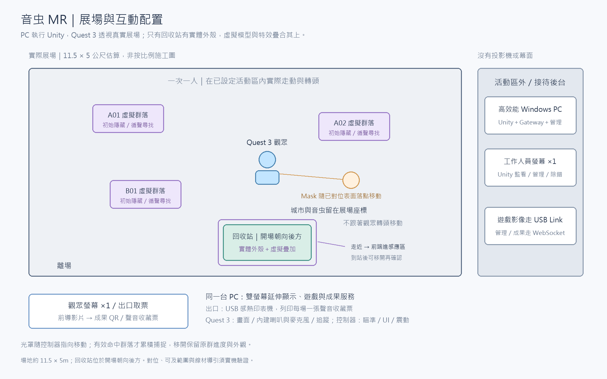
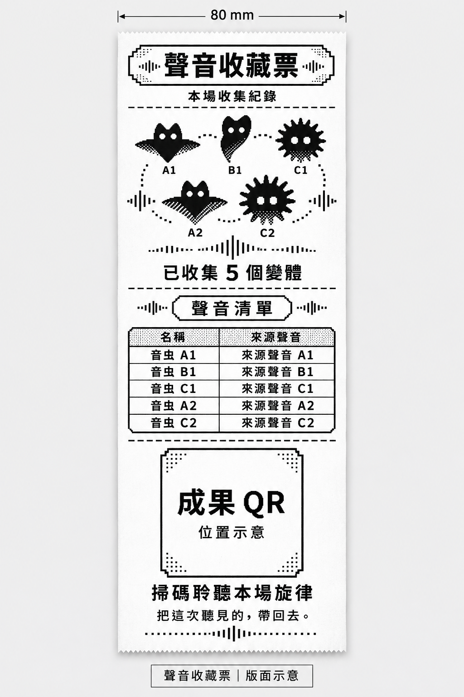
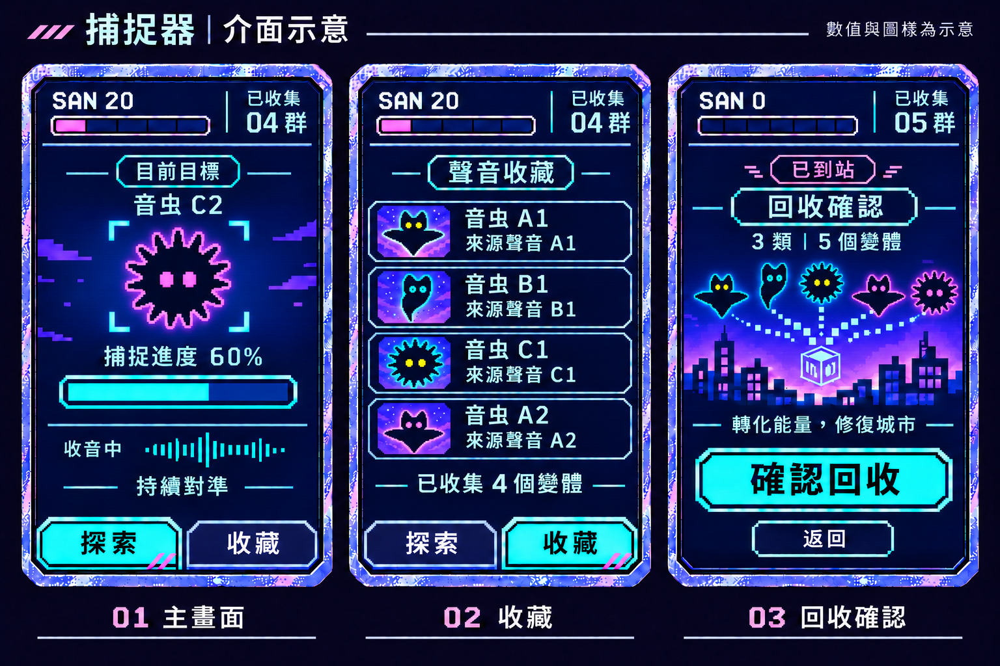

# 音虫 MR｜技術架構

日期：2026-11-08｜版本：MR v0.24

- 用途：供組員了解作品、設備與分工。
- 規劃由 **Windows 電腦執行 Unity，Meta Quest 3 顯示畫面並追蹤頭部與控制器**； 實機驗證項目見討論清單。

- 閱讀順序：本文件 → [技術流程圖](技術流程圖.md)。
- 實作：[開發規格](開發規格.md)；採購：[器材清單](器材清單.md)；來源：[重要連結](重要連結.md)。
- 待決／測試：[待確認與驗證清單](待確認與驗證清單.md)；方案比較：[功能覆蓋](方案對照與功能覆蓋.md)。

## 1. 專案概述與功能範圍

| 項目 | 內容 |
| --- | --- |
| 體驗形式 | 一次一位觀眾，透過 Quest 3 看見真實展場與疊加的虛擬城市、音虫，以控制器操作虛擬捕捉器。 遊戲內容量以約 5 分鐘規劃，依 SAN 歸零進回收；不設倒數，不含配戴、開場與教學。 |
| 活動方式 | 觀眾在同一已設定的實際活動區內走動、轉身，移動以 1:1 對應畫面；虛擬內容留在指定展場位置。 |
| 體驗目標 | 扮演捕蟲人，循聲尋找並收集音虫，將回收能量轉成物品修復城市。 |
| 音虫顯現 | 音虫起初隱藏但持續發聲； 觀眾發聲使前方互動範圍內的多群音虫短暫顯現，累積捕捉進度則讓外觀依進度線性顯現並保留。 |
| 光罩與捕捉 | 照射光罩（Mask）隨控制器指向在已對位的場景表面移動；同群累積有效對準 3 秒即可自動捕捉，移開保留進度。 |
| 捕捉聲音 | 隨捕捉進度增加，目標音虫聲音逐漸變小；移開保留對應音量，再對準接續，成功後停聲。 |
| 類型與變體 | 3 個基礎類型各有 3 個變體，共 9 個均納入隨機池；觀眾任選 5 個不同變體，類型可重複。 |
| 隨機出現 | 從有效出現區隨機分散生成，開場 3 群；捕捉 1 群後補 1 群，SAN 歸零停止補充。 |
| 群落與 SAN | 每個固定出現區可有一隻或一群，整群算一次捕捉，SAN（遊戲精神值）初始 100，每群扣 20； 捕捉 5 群後歸零完成任務。捕捉器不發聲；捕捉後 SAN > 0 即補 1 群；同時最多存在 3 群。 |
| 回收流程 | SAN 歸零（任務完成）後，到設有實體外殼的回收站確認回收，登錄類型、變體與群落數量，演出能量轉化及城市修復，再進入結尾。 |
| 回收站位置 | 固定在開場面向的後方；觀眾轉身後即可找到，不隨視線移動。 |
| 紀念品 | 必做線上感謝信、收集摘要與個人旋律，離場後仍可開啟；每場另交付一張聲音收藏票。 |

## 2. 系統連接架構

| 項目 | 內容 |
| --- | --- |
| 遊戲互動 | Quest 3 回報頭部與控制器動作 → 電腦 Unity 判斷瞄準、捕捉與回收 → 頭戴顯示畫面、播放聲音，控制器震動。 |
| 觀眾發聲 | 頭戴內建麥克風 → 電腦消除遊戲回音並判斷有效發聲 → Unity 讓既有音虫短暫顯現。 |
| 成果交付 | Unity 結算 → 本機保存 → 電腦 USB 列印收藏票／觀眾螢幕顯示同一 QR → 手機開啟 Next.js 紀念品頁； 成果另行背景上傳。 |

- **Quest Link** 使用現有 USB 資料線連接電腦與頭戴。
- **本機串接服務（Gateway）**是展場電腦上的程式，透過 WebSocket 與 Unity、管理頁交換資料， 處理成果保存、上傳及收藏票列印。

- 即時互動由 Unity 在展場電腦判斷。
- 展場 Wi-Fi 暫時無法上網時，遊戲與紙票列印照常，成果先存電腦、恢復連線後補傳； Quest 3 與電腦的 USB 連線中斷時則暫停互動。

## 3. 主要開發軟體

| 軟體／技術 | 用途 |
| --- | --- |
| Unity 6.3 LTS（6000.3.19f1）、C#、URP | 城市場景、光罩、捕捉、SAN、聲音、回收與修復；同時管理活動區邊界 |
| OpenXR 1.16.1、XR Interaction Toolkit 3.3.2 | 取得頭部／控制器動作，操作虛擬介面與震動 |
| Meta Horizon Link、Meta XR Core SDK 207.0 | 連接 Quest 3，整合真實環境透視（Passthrough）等功能 |
| 回音消除（AEC）與人聲偵測（VAD） | 處理麥克風輸入，降低遊戲聲音被誤認為觀眾發聲的情況 |
| Node.js、TypeScript、WebSocket | 開發本機串接服務，連接 Unity 與管理頁 |
| Next.js、React、TypeScript | 製作線上紀念品、成果 API 與工作人員管理頁 |
| Vercel Hobby | 部署 Next.js 線上紀念品與成果 API，預製素材隨網站版本發佈；原型使用免費額度 |
| SQLite、Neon Free（PostgreSQL） | 本機保存成果，雲端原型使用免費資料庫 |
| Web Audio API | 讓網頁上的多個旋律聲部同步播放 |
| Blender、聲音工具、Git／Git LFS | 製作模型、動畫及音檔，管理檔案版本 |

套件設定、輸入模擬與展場對位實作見[開發規格](開發規格.md)；電腦透視執行方式的驗證見[待確認清單](待確認與驗證清單.md)。

## 4. 設備與展場配置

- 圖為功能配置，非施工尺寸。
- 布展時設定活動區、音虫出現區與回收站位置，用控制器手動對齊外殼的基準、朝向及尺寸。
- 每場前檢查疊合，外殼搬動或重新定位後重新對齊。
- 只有回收站有實體外殼，其他虛擬內容不需實體模型。

| 設備 | 用途 |
| --- | --- |
| Quest 3、Touch Plus 控制器及腕帶 | 頭戴畫面、頭部／手部追蹤、虛擬捕捉器及震動，一次一套 |
| Windows 電腦（技嘉平台電馭游俠 II）、鍵盤／滑鼠 | 主機內含 Windows 11 Home 64 位元； 執行 Unity、Gateway 及管理頁，採雙螢幕延伸顯示 |
| 觀眾螢幕（1 台） | 接待區播放前導影片，結尾顯示同一場成果 QR |
| 工作人員螢幕（1 台） | Unity 遊戲監看、管理與錯誤紀錄；開發時顯示 Editor／Console |
| USB 資料線／Link 線（已有） | 沿用現有線材連接頭戴與電腦，無須另購 |
| 線材固定／導引配件 | 將線材引離活動區，減少拉扯與繞腳 |
| Quest 3 內建喇叭／麥克風 | 播放音虫與劇情聲音、收觀眾發聲，無須另購 |
| 展場共用 Wi-Fi（可連網際網路） | 電腦連網與成果上傳，使用場地提供的網路 |
| USB 感熱印表機、80 mm 紙捲及出紙口 | 電腦直接列印聲音收藏票並自動裁切 |
| 原廠充電與配戴配件、備用 AA 電池、清潔用品 | 充電器、面罩及頭帶隨套裝；另備輪替電池與清潔耗材 |
| 實體回收站外殼與對位基準 | 供虛擬模型、介面及轉化效果疊加對齊 |

光罩依已對位的虛擬場景或手動設定的牆面、地面計算落點；相機透視畫面本身不會自動提供可照射表面。

原型先配置 6 個候選出現區，同時最多 3 群。器材數量與候選型號見[器材清單](器材清單.md)。

## 5. 空間、發聲顯現與捕捉

| 步驟 | 處理內容 |
| --- | --- |
| 1. 循聲尋找 | 音虫在展場指定區域活動並發聲，觀眾循聲走動、轉向尋找。 |
| 2. 發聲確認 | 自然呼喚或說話，使觀看方向前方互動範圍內的多群既有音虫短暫顯現，不必先精準瞄準。 |
| 3. 對準捕捉 | 控制器指向有效且未被遮擋的群落，就累積有效對準時間，達 3 秒完成捕捉；過程顯示進度，音虫依進度線性顯現； 一次判斷一群，不必逐隻瞄準。 |
| 4. 移開再接續 | 光罩跟著控制器照向新的對位表面，原群進度與對應外觀保留；再對準同群就繼續。 |
| 5. 捕捉成功 | 整群與其聲音消失，SAN 扣一次，虛擬螢幕更新並提供控制器震動。捕捉後 SAN > 0 即補 1 群；同時最多存在 3 群。 |

- 光罩照到一般表面時也會顯示，但不累積捕捉進度；沒有表面落點或互動暫停時收起。
- 有效發聲後用 3 秒逐漸淡入，接著用 1 秒淡出；已有捕捉進度則保留相應外觀。
- 顯現動畫與捕捉計時分開；失焦、斷線、追蹤失效、對位失效或越界時，暫停但保留進度。

## 6. 聲音、回收與紀念品

| 環節 | 運作方式 |
| --- | --- |
| 循聲與數量 | 全場同時最多 3 群；捕捉 1 群後補 1 群。SAN 歸零停止補充；不另設低音量背景群落。 |
| 聲音回饋 | 只降低被捕捉群落的聲音，與同群保留進度同步；其他群落及城市環境聲不隨之降低。 |
| 聲音處理 | 使用遊戲播放聲音作參考消除回音，再判斷人聲、音量及持續時間；不辨識說話內容 |
| 防止誤觸發 | 一次發聲只回應一次，確認停聲且冷卻結束後才再接受；收音或回音處理失效時暫停發聲功能 |
| 到站確認 | 觀眾實際靠近回收站外殼，將虛擬捕捉器前端放入已對齊的感應區，螢幕才開放「確認回收」；遠處照射不算到站 |
| 回收演出 | 點選確認 → 登錄類型、變體與群落數量 → 能量轉化為物品 → 虛擬城市及回收站外殼上的疊合畫面呈現修復效果 |
| 線上紀念品 | 摘下頭戴後掃觀眾螢幕 QR，開啟感謝信、摘要與個人旋律； 每個已收集變體啟用一個預製聲部，完成時以 5 個變體組合旋律 |
| 聲音收藏票 | 本機保存後由電腦透過 USB 列印本場 5 個變體的黑白組合圖、名稱／來源聲音清單與同一成果 QR； 每場一張，失敗可補印 |

- 探索時持續播放循聲線索；循聲、對準捕捉及回收等操作採字幕搭配動畫引導；發聲步驟僅用字幕說明。
- 教學為觀看示範，不計正式數據。
- SAN 歸零（任務完成）後，停止捕捉、發聲顯現與新群落啟用，進入回收。
- 到站後可移開再確認，資格保留到本場回收或結束；重新校正或換裝置須重新到站，重複確認不重複結算。

收藏票印表機優先借用具 USB 與自動裁刀的 80 mm 機型，搭配相容紙捲；電腦直接控制列印、送紙及裁切，不另加 Arduino／ESP32。

圖樣與名稱為示例；正式票面由本場成果產生可掃碼 QR。

## 7. 美術、聲音與網頁交付

| 項目 | 交付內容 |
| --- | --- |
| 場景 | 固定在展場位置的虛擬城市、可接收光罩的對位表面、回收站外殼尺寸與基準、修復前後畫面 |
| 音虫與光罩 | 3 個基礎外形，各做 3 個配色／局部造形變體；共用同類動作，各變體分別配置來源聲音與聲部； 發聲／進度顯現、捕捉動畫與動態光罩／進度提示 |
| 捕捉器介面 | 開場可選左右手握持，另一手游標＋扳機操作； 像素風主畫面顯示 SAN、已收集群數、目前目標與進度，收藏卡片顯示本場已收集變體的圖像、名稱及來源聲音； 到站後顯示回收確認，不顯示位置雷達 |
| 聲音 | 城市、音虫、劇情、回收及結尾音效；旋律聲部使用相同節拍、拍號、循環長度與起點 |
| 網頁與紙本 | 手機版感謝信、摘要、旋律播放／暫停、QR，以及載入、錯誤與保存說明；每場一張聲音收藏票 |
| 聲音收藏票美術 | 80 mm 紙寬；5 個已收集變體的黑白組合圖、名稱／來源聲音清單與成果 QR；變體在黑白下仍可辨識 |

捕捉器介面示意：主畫面、收藏分頁與回收確認。

音虫名稱、來源聲音代號與圖樣為示例；回收頁 SAN 固定為 0。

電量無法讀取時顯示「未知」。素材需在實際展出程式中檢查效能、介面可讀性與聲音方向；旋律配方與素材版本一併保存，確保離場重開仍是同份成果。

## 8. 場次、保存與展場操作

| 步驟 | 處理內容 |
| --- | --- |
| 1. 開場 | 工作人員檢查活動區、外殼對位、追蹤、音訊、電量、頭戴連線與保存服務，再開始單一場次。 |
| 2. 中途 | 管理頁可暫停、恢復、中止及監看；暫停或換備機時保留 SAN、收集與各群進度。 換機後重新對位，回收時須重新到站；不另開新場或重複扣值。 |
| 3. 結束 | Unity 固定本場收集、修復結果與旋律配方，Gateway 確認本機保存成功。 完成結尾及成果 QR 交付後才重置，開放下一場。 |

- 成果會背景上傳；暫時無法上網時先存在電腦並交付相同連結，恢復連線後補傳。
- 補傳完成前，手機可能需稍後重試才能開啟成果。
- 重置不刪成果、待上傳資料或列印工作。
- 管理頁另提供活動區、對位與光罩檢查及補印；監看同一場遊戲，不另外啟動第二場。
