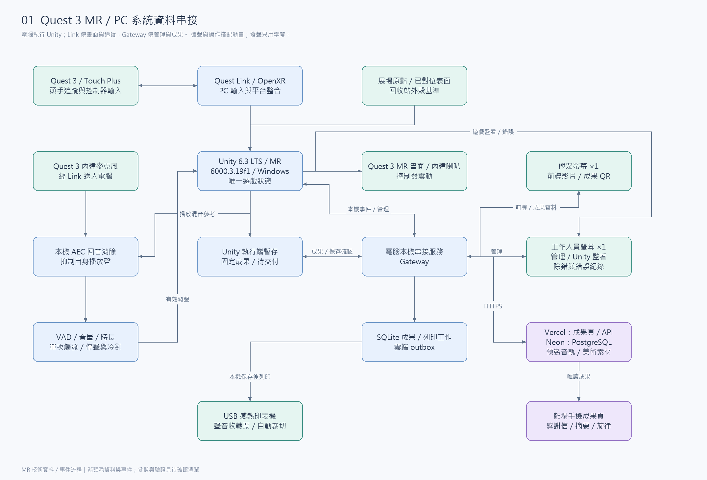
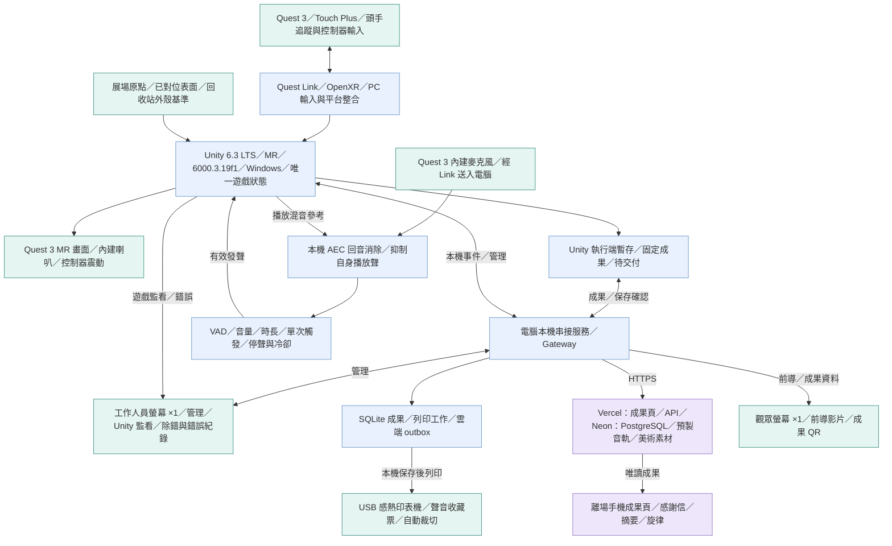
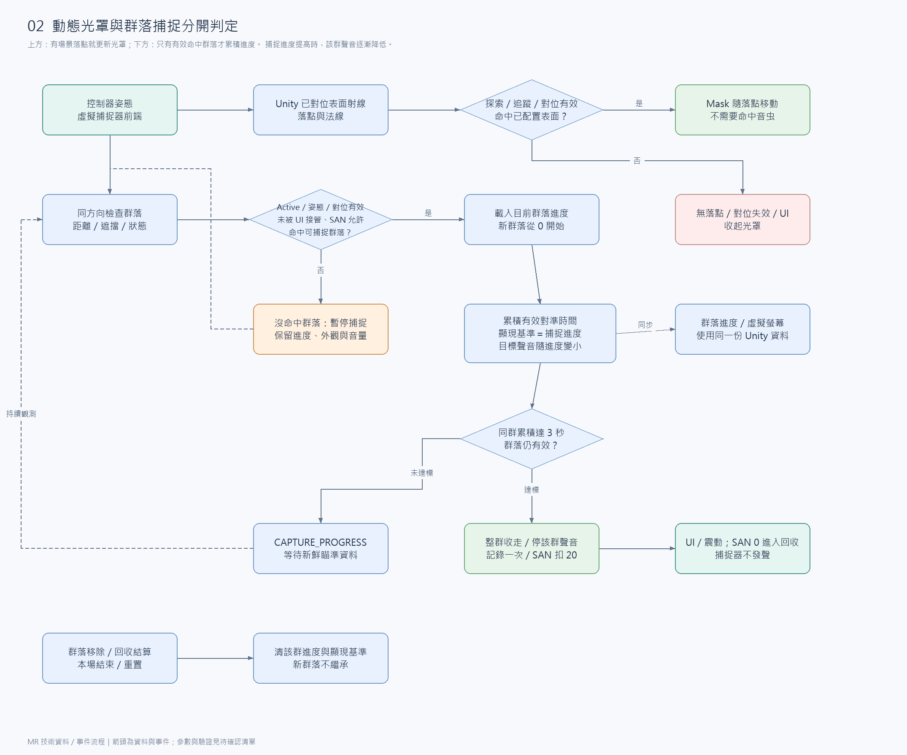
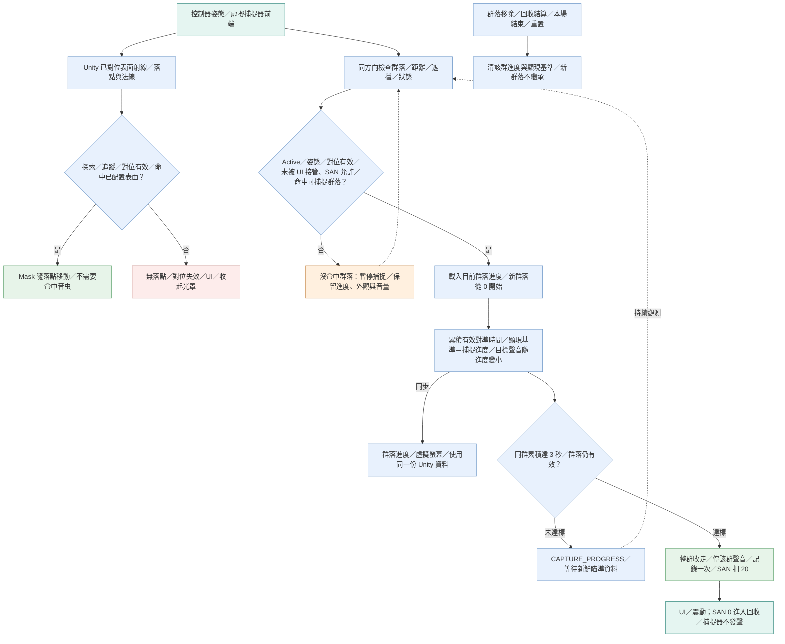
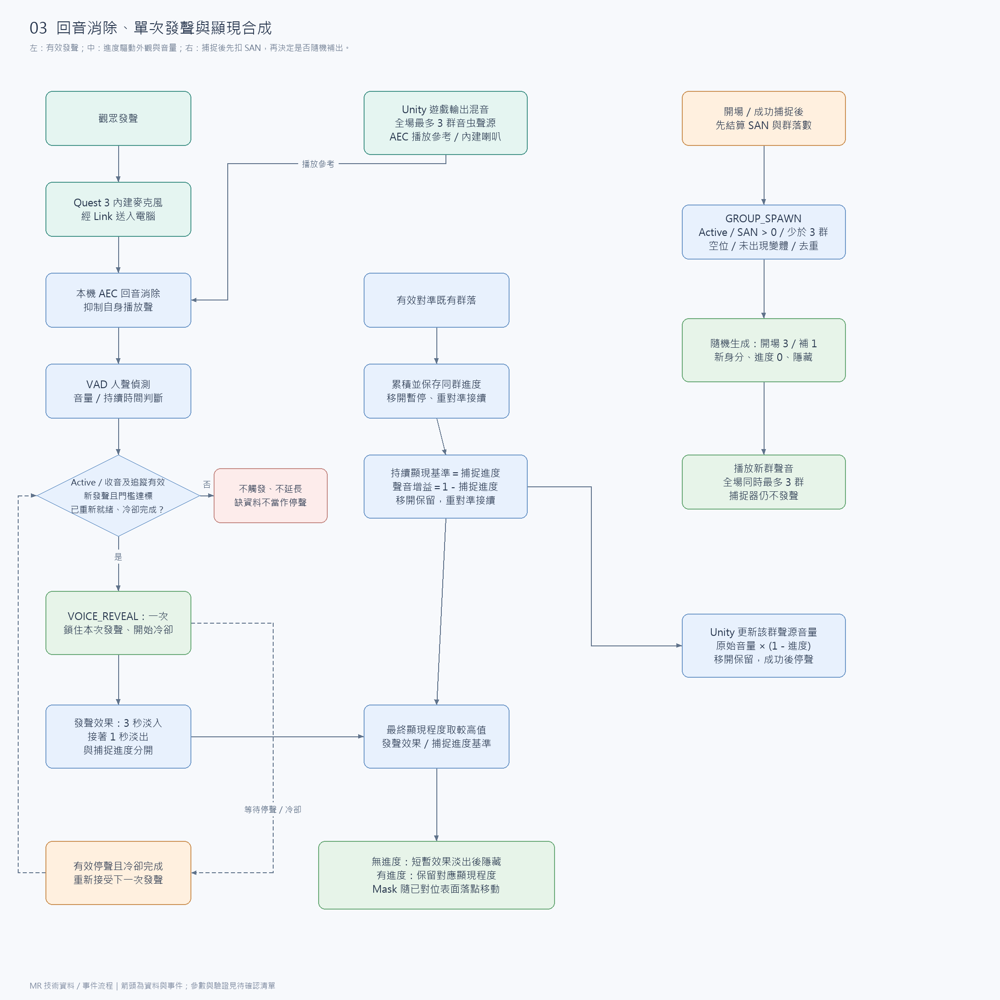
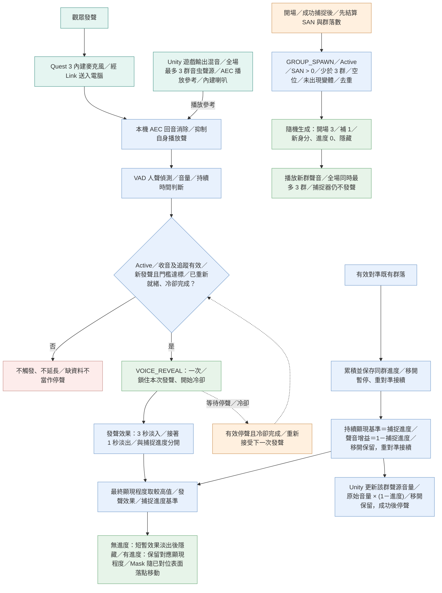
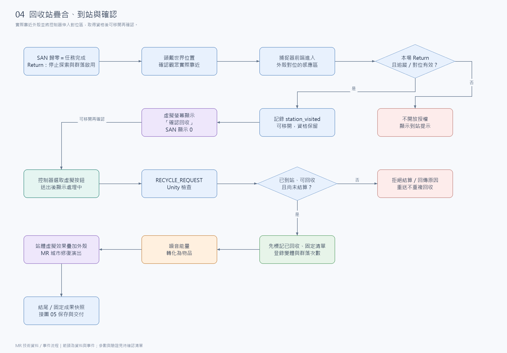
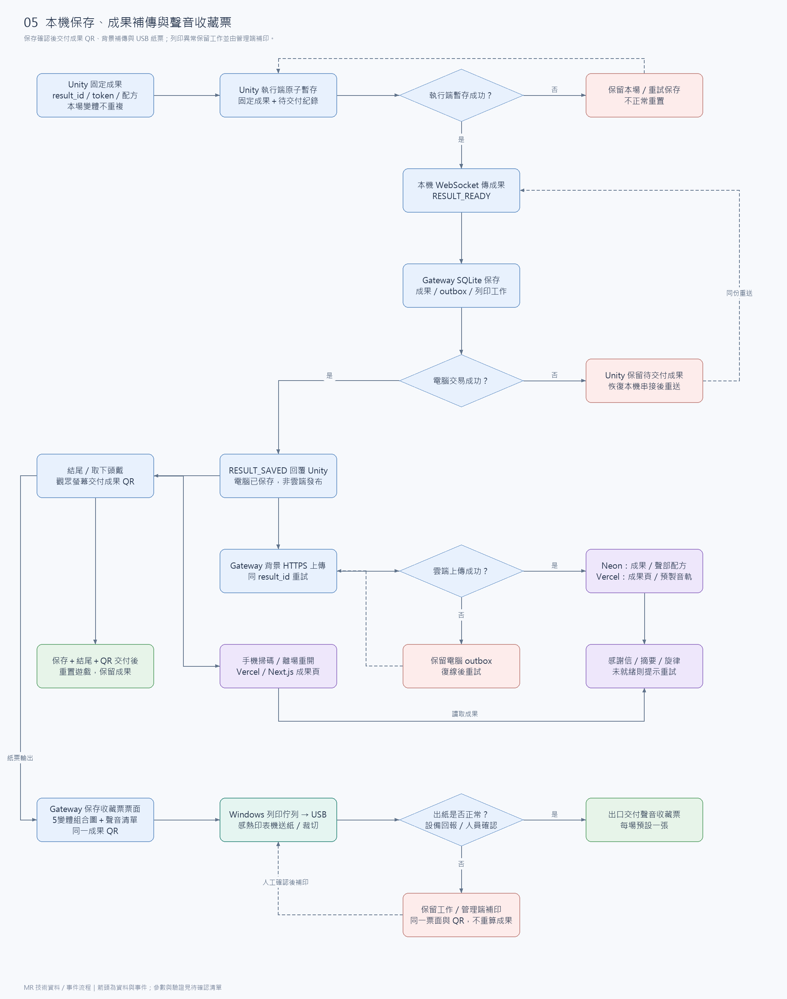
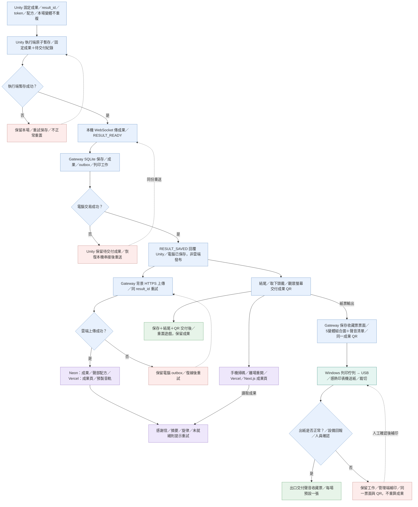

# 音虫 MR｜技術資料與事件流程圖

日期：2026-11-08｜版本：MR v0.24

- 依[技術架構](技術架構.md)與[開發規格](開發規格.md)繪製：技術資料／事件流程，非觀眾任務圖。
- 從各圖左上起點沿箭頭讀，順序為 **01 → 02 → 03 → 04 → 05**。

| 閱讀重點 | 內容 |
| --- | --- |
| 箭頭 | 實線：資料／事件；虛線：重試／持續觀測；雙向：來回通訊。 |
| Unity／Gateway | Unity：唯一遊戲狀態；Gateway：電腦上的本機串接服務。 |
| 群落／SAN | 群落為一隻或一群，整群算一次捕捉；SAN 為遊戲精神值。 |
| outbox／token | outbox：待上傳佇列；token：唯讀成果網址代碼。 |

| 閱讀重點 | 內容 |
| --- | --- |
| 資料路徑 | 畫面與追蹤走 USB Quest Link；管理與成果走本機 WebSocket。成果另行背景上傳。 |
| 收集規則 | 3 類 × 3 變體，共 9 個均納入隨機池；任選 5 個不同變體，類型可重複。每個變體對應一個來源聲音及聲部。 |
| 操作教學 | 循聲與其他操作用字幕搭配動畫；發聲步驟僅用字幕。 |
| 聲音配置 | 全場同時最多存在 3 群，隱藏中也計入；抓 1 群補 1 群，SAN 歸零停止。 |

未定參數見[待確認清單](待確認與驗證清單.md)，跨方案核對見[功能覆蓋](方案對照與功能覆蓋.md)。圖為規劃，非實機驗證。

## 1. Quest 3 MR／PC 系統資料串接

| 閱讀重點 | 內容 |
| --- | --- |
| 從哪裡讀 | 左上 Quest 3／控制器 → USB Link／XR Runtime → 電腦 Unity。<br>下方接本機暫存、Gateway／SQLite 與線上紀念品。 |
| 雙螢幕 | 同一 PC 延伸顯示：觀眾端播放前導／成果 QR；工作人員端顯示管理頁、Unity 監看與錯誤。<br>影像不經 Gateway。 |
| 收音與播放 | Quest 3 內建喇叭播放；完整輸出混音供 AEC 參考。<br>麥克風經本機 AEC、VAD 與單次觸發控制後驅動顯現。 |
| 空間 | 展場對位資料固定虛擬內容與可照射表面；只有回收站對齊實體外殼。 |
| 教學 | 循聲、對準捕捉及回收用字幕搭配動畫；發聲只用字幕。 |
| 收藏票 | 電腦透過 USB 感熱印表機輸出；5 個變體組合圖＋名稱／來源聲音清單＋同一成果 QR。<br>每場一張，不另加控制板；印表機優先借用。 |
| 線上原型 | Vercel Hobby 提供網站／API，Neon Free 保存成果；預製素材版本化部署。<br>SQLite、管理與即時互動留在本機。 |



[SVG](assets/技術流程圖/01.svg) · [PNG](assets/技術流程圖/01.png) · [Mermaid 原始碼](assets/技術流程圖/01.mmd)

<details>
<summary>展開 Mermaid 原始碼</summary>



</details>

## 2. 動態光罩與群落捕捉分開判定

| 閱讀重點 | 內容 |
| --- | --- |
| 從哪裡讀 | 左上控制器姿態分成兩路：場景射線更新光罩；另一條檢查群落與捕捉條件。 |
| 動態 Mask | 探索中命中已對位的虛擬城市／手動表面代理就顯示，不必先照到音虫；依落點與法線移動。 |
| 透視限制 | 相機透視畫面不直接當作碰撞表面；光罩落點依對位資料計算。 |
| 捕捉判定 | 另驗證群落、遮擋、SAN、活動範圍與有效輸入；同群累積有效對準 3 秒完成捕捉。 |
| 進度外觀 | 顯現基準與進度線性相等；移開後保留進度與外觀，Mask 仍跟著新落點。 |
| 收起光罩 | 無落點、追蹤／連線失效、暫停或 UI 接管時收起；MR 另須對位有效。 |
| 成功與後續 | 整群移除、停該群聲音，收集／SAN 各結算一次並震動。SAN > 0 隨機補 1 群；歸零停止並進 Return。 |
| 音量回饋 | 只降低目前被捕捉群落的聲音；係數為 1－捕捉進度。移開後保留，再對準接續；成功停聲，新群以自己的原始音量開始。 |



[SVG](assets/技術流程圖/02.svg) · [PNG](assets/技術流程圖/02.png) · [Mermaid 原始碼](assets/技術流程圖/02.mmd)

<details>
<summary>展開 Mermaid 原始碼</summary>



</details>

## 3. 回音消除、單次發聲與顯現合成

| 閱讀重點 | 內容 |
| --- | --- |
| 左側：發聲 | 麥克風＋完整播放混音 → AEC → VAD／音量／持續時間 → VOICE_REVEAL，作用於前方範圍內多群。<br>通過本場條件後，一段發聲只觸發一次。 |
| 再接受發聲 | 確認有效停聲且冷卻完成才重新就緒；缺資料不算停聲，持續聲音／回音不刷新顯現。 |
| 中間：外觀合成 | 發聲效果以 3 秒由 0 淡入至 1，立即以 1 秒淡出至 0；與 0～1 線性捕捉進度取較高值。<br>無進度回隱藏，有進度保留基準。 |
| 變體去重 | 初始化／群落補充均排除本場已出現變體；捕捉／移除不清集合，暫停／重連保留，本場結束／重置才清除。 |
| 右側：補充 | 開場最多 3 群。成功捕捉先移除該群及扣 SAN；SAN > 0 才從本場未出現變體補 1 群，歸零則進回收。 |
| 隨機與去重 | 從有效空閒區域隨機生成，使用新群身分／進度。同次捕捉重送不重複補出；觀眾發聲不生成音虫。 |
| 中間：聲音輸出 | 同群捕捉進度同時驅動外觀與音量；顯現基準＝進度，聲音增益＝1－進度。音量與進度一起保留，發聲效果不重設音量。 |



[SVG](assets/技術流程圖/03.svg) · [PNG](assets/技術流程圖/03.png) · [Mermaid 原始碼](assets/技術流程圖/03.mmd)

<details>
<summary>展開 Mermaid 原始碼</summary>



</details>

## 4. 回收站疊合、到站與確認

| 閱讀重點 | 內容 |
| --- | --- |
| 起點：Return | SAN 初始 100，每群扣 20；捕捉 5 群後歸零完成任務，停止捕捉、發聲觸發與群落啟用。 |
| 站體位置 | 固定在開場面向後方，不隨觀眾轉頭移動；到站後仍須選取確認回收。 |
| 到站 | 頭戴位置確認實際靠近外殼，捕捉器前端進入對位感應區；不使用 NFC。 |
| 確認資格 | 本場到站後顯示虛擬螢幕確認；可移開再選取，資格保留至回收／結束，重校準／換機清除。 |
| 結算順序 | 點選後顯示處理中；Unity 驗證並先標記已回收，再固定清單、登錄類型／變體／群落次數。<br>重讀／重按／重送不重複結算。 |
| 演出 | 轉化物品並修復城市；回收站模型與演出對齊實體外殼。 |



[SVG](assets/技術流程圖/04.svg) · [PNG](assets/技術流程圖/04.png) · [Mermaid 原始碼](assets/技術流程圖/04.mmd)

<details>
<summary>展開 Mermaid 原始碼</summary>

```mermaid
flowchart TD
  returning["SAN 歸零＝任務完成／Return：停止探索與群落啟用"]
  near["頭戴世界位置／確認觀眾實際靠近"]
  zone["捕捉器前端進入／外殼對位的感應區"]
  valid{"本場 Return／且追蹤／對位有效？"}
  deny["不開放授權／顯示到站提示"]
  auth["記錄 station_visited／可移開，資格保留"]
  screen["虛擬螢幕顯示／「確認回收」／SAN 顯示 0"]
  click["控制器選取虛擬按鈕／送出後顯示處理中"]
  request["RECYCLE_REQUEST／Unity 檢查"]
  check{"已到站、可回收／且尚未結算？"}
  reject["拒絕結算／回傳原因／重送不重複回收"]
  commit["先標記已回收、固定清單／登錄變體與群落次數"]
  convert["噪音能量／轉化為物品"]
  repair["站體虛擬效果疊加外殼／MR 城市修復演出"]
  result["結尾／固定成果快照／接圖 05 保存與交付"]
  returning --> near
  near --> zone
  zone --> valid
  valid -->|"否"| deny
  valid -->|"是"| auth
  auth --> screen
  screen -->|"可移開再確認"| click
  click --> request
  request --> check
  check -->|"否"| reject
  check -->|"是"| commit
  commit --> convert
  convert --> repair
  repair --> result
  style returning fill:#e8f1fd,stroke:#7099c9
  style near fill:#e8f1fd,stroke:#7099c9
  style zone fill:#e8f1fd,stroke:#7099c9
  style valid fill:#e8f1fd,stroke:#7099c9
  style deny fill:#fdeceb,stroke:#c58b86
  style auth fill:#e8f1fd,stroke:#7099c9
  style screen fill:#eee7fb,stroke:#9a7ac7
  style click fill:#e5f5f1,stroke:#459489
  style request fill:#e8f1fd,stroke:#7099c9
  style check fill:#e8f1fd,stroke:#7099c9
  style reject fill:#fdeceb,stroke:#c58b86
  style commit fill:#e7f4e9,stroke:#69a977
  style convert fill:#fff0df,stroke:#cc9154
  style repair fill:#eee7fb,stroke:#9a7ac7
  style result fill:#e8f1fd,stroke:#7099c9
```

</details>

## 5. 本機保存、成果補傳與聲音收藏票

| 閱讀重點 | 內容 |
| --- | --- |
| 從哪裡讀 | Unity 固定成果、<br>result_id／token／配方 → 執行端暫存 → Gateway 以 SQLite 交易保存成果、<br>outbox 與列印工作。 |
| 本機保存 | RESULT_SAVED 只代表電腦保存。結尾、本機保存與現場成果 QR 交付完成才重置；<br>成果、待同步與列印工作保留。 |
| 背景補傳 | 斷網仍交相同固定連結；恢復後依同 result_id 補傳。<br>Next.js 提供感謝信／摘要／旋律，尚未就緒則提示重試。 |
| 個人旋律 | 9 個變體均納入隨機池，任選 5 個且類型可重複；<br>每個已收集變體啟用一個預製聲部，保存組合／音軌版本，相同組合沿用配方。 |
| 固定票面 | 本場 5 個變體的預製黑白圖像組成主圖；下方列名稱／來源聲音，底部為同一 QR。<br>保存版面版本及票面，補印一致。 |
| USB 列印 | 現場 QR 交付階段，由 Gateway → Windows 列印佇列 → USB 印表機送紙／裁切。<br>每場一張，不另加 Arduino／ESP32。 |
| 出紙異常 | 缺紙、卡紙、USB 斷線或狀態不明，由管理端核對補印；不重複結算。紙票異常仍交現場螢幕 QR。 |
| 線上原型 | Vercel Hobby 提供網站／API，Neon Free 保存成果；預製素材版本化部署。<br>SQLite、管理與即時互動留在本機。 |



[SVG](assets/技術流程圖/05.svg) · [PNG](assets/技術流程圖/05.png) · [Mermaid 原始碼](assets/技術流程圖/05.mmd)

<details>
<summary>展開 Mermaid 原始碼</summary>



</details>
