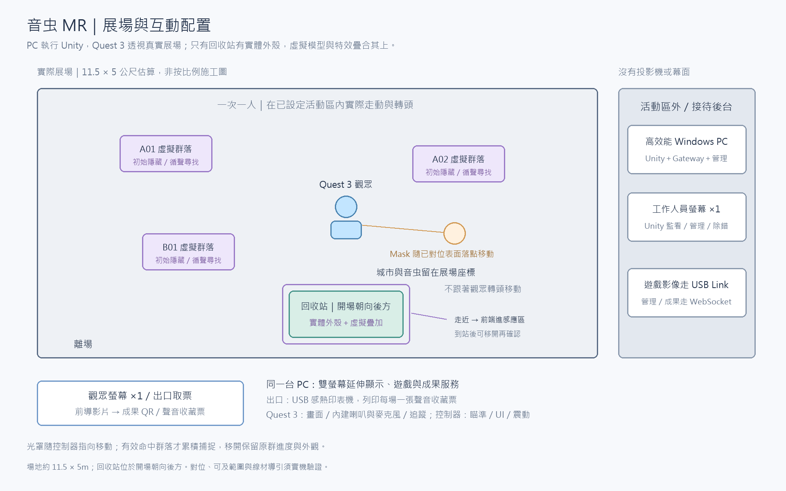

# 音虫 MR｜開發規格

日期：2026-11-08｜版本：MR v0.24

- 適用：Windows Unity＋Meta Quest 3／Touch Plus 的單人 MR。
- 本文件整理本方案已確認的遊戲規則、設備與實作介面。
- 先讀[技術架構](技術架構.md)，資料路徑見[技術流程圖](技術流程圖.md)；未定細節集中於[待確認與驗證清單](待確認與驗證清單.md)。
- 本文為規劃，非已完成實作。

## 1. 功能與遊戲狀態

本版以 Quest 3／Touch Plus 追蹤控制器，Unity 射線操作虛擬捕捉器；看見真實展場，只有回收站設實體外殼並疊合虛擬內容。

正式探索內容量以約 **5 分鐘**規劃，不含配戴、開場、教學與清潔；實際時長依捕捉進度，SAN 歸零後進入回收。回收條件維持SAN 歸零（任務完成）。

### 群落、顯現、進度與 SAN

9 個變體均納入本場隨機池，由觀眾任選 5 個不同變體完成，類型可重複。開場 3 群；每捕捉 1 群即補 1 群，SAN 歸零停止補充。

| 規則 | 內容 |
| --- | --- |
| 群落單位 | 每場單人。point_id 是固定出現區；每點同時最多一個群落，可為單隻或一群，整群只算一次捕捉。<br>個體維持固定小範圍內的活動，類型、變體及判定範圍由配置管理。 |
| 類型與變體 | 先以 3 個基礎類型、每類 3 個變體規劃，共 9 個變體；<br>同類共用基礎外形，以配色或局部造形區分，每個變體都有不同來源聲音與預製聲部。<br>本場可遇到相同類型，但不重複同一變體；收集 5 個不同變體（5 群）完成任務。<br>同群可含多個同變體個體，仍只算一群；暫時隱藏、再顯現或重新對準不算新的出現。 |
| 本場變體去重 | Unity 保存「本場已出現變體集合」；初始化與捕捉後補出群落時，都先排除集合內變體，啟用成功才記入。<br>捕捉／移除群落不清除此集合；暫停、重連及換備機保留，僅本場結束／重置後清除。<br>每次從本場未出現變體中隨機抽取；9 個都有出現機會，單場不保證全部生成。 |
| 建立群落 | 初始化或捕捉結算後補出群落時，建立 target_instance_id／revision、<br>初始隱藏、播放群落聲音，保留捕捉 Collider。群落存在與畫面顯現分開；短暫現形與隱藏都不建立新身分。 |
| 發聲顯現 | 發聲讓頭戴觀看方向前方互動範圍內仍存在的多群音虫短暫顯現，不限於最近一群，也不需先精準瞄準。<br>沒有捕捉進度時，其效果會逐漸消退回隱藏；發聲不修改捕捉進度、數量或 SAN。 |
| 累積捕捉 | 同群累積有效對準 **3 秒**完成捕捉，時長由配置管理；按累積有效時間提高捕捉進度，音虫依進度連續線性顯現。<br>移開、換群、遮擋、暫停或追蹤／連線無效時，保留原群進度及對應顯現程度；再次對準同群就繼續。捕捉不需按鈕。 |
| 捕捉音量 | 該群音量隨進度降低；移開保留對應音量，再對準接續。成功後停聲；新群以自己的原始音量開始。 |
| 捕捉結算 | 按 session_id＋target_instance_id 保存進度；<br>首次建立 capture_attempt_id，暫停／恢復沿用同筆。<br>只有 Unity 驗證累積完成後才關閉可捕捉狀態、整群收走、停群落聲音，收集加一次、SAN 扣一次、UI／震動回饋。<br>捕捉器及捕捉成功不播放捕捉器音效，結算 SAN 後，大於 0 才補 1 群。 |
| 清除與新進度 | 成功／移除／回收結算／本場結束／重置才清除該群進度與顯現基準。同點重新啟用屬新群落，新進度起始為 0；<br>舊收集變體／旋律資料不回寫。 |
| SAN 與結束 | SAN 為 `max(0, 100 - 成功捕捉次數 × 20)`。<br>成功捕捉 5 群後 SAN 歸零，即完成捕捉任務並進入 Return；<br>停止捕捉、發聲觸發及新群落啟用，回收確認畫面顯示 SAN 0。<br>精神啃食就是扣值，器具損害以震動呈現，不另計噪音傷害、耐久或降低操作能力。 |

### 隨機出現與數量控制

| 項目 | 採用規則 |
| --- | --- |
| 開場 | 從 9 個變體隨機選 3 個不同變體，分散生成；起初隱藏並各自發聲。 |
| 同時存在 | 最多 3 群；隱藏中也算存在，不另設背景群落。 |
| 捕捉後補充 | 成功移除 1 群並扣 SAN；若 SAN > 0，立即隨機補出 1 個本場未出現變體。 |
| 生成位置 | 從已對齊真實展場的有效出現區隨機分散生成；排除實體外殼、觀眾與通道。 |
| 身分與進度 | 新群使用新身分、進度 0；已捕捉的同一變體不重新出現。每個變體都有抽中機會，單場不保證遇到全部 9 個。 |
| 停止條件 | SAN 歸零進 Return，不再補充；暫停／失效期間不生成，恢復時核對既有群落。 |
| 去重 | 同次成功捕捉只結算、扣 SAN 與補出一次；重送不重複生成。補充由 Unity 處理，不是捕捉器發聲造成。 |

### 場次流程

遊玩時長只作內容量與接待估算；正式任務以 SAN 歸零完成並進入回收，不設 5 分鐘倒數或超時結束。

```text
待機 → 前導／配戴頭戴 → 驗證並建立場次 → 教學 → 循聲探索
→ 觀眾發聲：既有音虫短暫現形 → 有效對準：累積捕捉進度／依進度顯現
  ├─ 移開／換群 → 保留該群進度及對應顯現程度 → 再對準接續
  ├─ SAN > 0 且處於 Active → 繼續探索
  └─ SAN 歸零（任務完成） → Return／停止捕捉 → 近距離到站
→ 螢幕「確認回收」 → 固定清單／登錄類型、變體與群落數量
→ 能量轉化物品 → 城市修復 → 本機保存／結尾／成果 QR／USB 收藏票列印 → 重置 → EXHIBIT_READY
  （重置保留列印工作；列印異常仍交付螢幕 QR，修復後補印）
```

- 開始由本機管理端要求，Unity 初始化完成才開放本場操作；同時只允許一場與一套啟用中的輸入。
- 前導說明背景與任務，循聲、對準捕捉及回收等操作採字幕搭配動畫引導；發聲步驟僅用字幕說明。

- 教學以字幕與動畫播放操作示範，觀眾觀看即可；發聲步驟僅用字幕說明。
- 示範使用展示資料，不寫入正式 SAN、捕捉進度、收藏、旋律或成果。
- 教學結束後才啟用正式探索。

- SAN 歸零（任務完成）即進入 Return，停止捕捉、發聲觸發與新群落啟用，取消尚未執行的群落生成事件，保留已確認紀錄並引導正常回收；<br>回收結算後直接結尾。
- 中止場次不標為成功成果；本機保存與清場確認完成後才開下一場。

## 2. 部署、主要軟體與設備

### PC 執行基線

- 全組統一使用 **Unity 6.3 LTS（6000.3.19f1）＋URP**，執行平台為 **Windows**，<br>Quest 3 以現有 USB Link 線連接電腦。
- XR 與 Meta 套件採下表固定版本；安裝與整合列為技術驗證。

### 固定開發版本

以下為選定的開發基線，安裝與實機整合尚需驗證；版本選擇不列為組員討論題。

| 項目 | 採用版本／設定 |
| --- | --- |
| Unity | 6.3 LTS（6000.3.19f1） |
| URP | 使用此編輯器範本對應的核心套件版本，隨專案鎖定 |
| OpenXR Plugin | 1.16.1；Windows 啟用 OpenXR Provider |
| XR Interaction Toolkit | 3.3.2；控制器、射線、World Space UI 與震動 |
| Input System | 1.20.1 |
| Meta XR Core SDK | 207.0 |
| 無頭戴流程測試 | XRI 3.3.2 的 XR Device Simulator 樣本 |
| 作業系統 | Windows 11 Home、64 位元，主機內含授權及安裝；<br>原型以 25H2 為基線，記錄實際出貨版本並驗證 |
| 顯示卡驅動 | NVIDIA Studio Driver 621.14 WHQL，適用 RTX 5060 Ti 候選機 |
| Link 與頭戴系統 | 正式發行通道；首次取得設備時記錄完整版本與測試結果 |

- 展出主機選定為[技嘉平台電馭游俠 II](https://24h.pchome.com.tw/prod/DSAURK-A900J5PWO)：i5-14400F、RTX 5060 Ti 8GB、32GB RAM、<br>1TB SSD、Wi-Fi，含 Windows 11 Home 64 位元及安裝。
- 主機為組裝整機出貨；收到後依隨附金鑰完成 Windows 啟用。
- 選型完成，採購及實機驗證另行完成。

- 建立 Unity 專案時依本表安裝，將 `ProjectVersion.txt`、<br>`manifest.json` 與 `packages-lock.json` 一併納入 Git；<br>依賴套件使用解析後的鎖定版本。
- 每次變更套件、驅動、Link 或頭戴系統後重新驗證。
- 正式接待前確認使用已測組合；頭戴系統若被更新，記錄新版本並重測。

- 版本依據：[Unity OpenXR](https://docs.unity3d.com/6000.3/Documentation/Manual/com.unity.xr.openxr.html)、[XRI](https://docs.unity3d.com/6000.3/Documentation/Manual/com.unity.xr.interaction.toolkit.html)、[Input System](https://docs.unity3d.com/6000.3/Documentation/Manual/com.unity.inputsystem.html)、[URP](https://docs.unity3d.com/6000.3/Documentation/Manual/com.unity.render-pipelines.universal.html)、<br>[Meta Core 207.0](https://developers.meta.com/vr/downloads/package/meta-xr-core-sdk/)、[Windows 支援版本](https://learn.microsoft.com/en-us/windows/release-health/supported-versions-windows-client)、[NVIDIA 621.14](https://www.nvidia.com/en-eu/geforce/drivers/details/283990/)。

- 編輯器版本記錄於 `ProjectSettings/ProjectVersion.txt`；<br>套件版本由 `Packages/manifest.json` 與 `Packages/packages-lock.json` 管理，<br>一併納入 Git，供組員重現相同開發環境。

```text
Quest 3／Touch Plus ↔ Meta Horizon Link ↔ Windows Unity MR
Quest 3 內建麥克風 → Windows 音訊輸入 → 本機 AEC → VAD／音量／持續時間 → 單次觸發控制 → Unity
Unity 遊戲輸出混音 → AEC 播放參考；遊戲音訊仍由 Quest 3 內建喇叭播放
Unity → Link → Quest 3 畫面／內建喇叭；控制器震動
Unity ↔ localhost WebSocket ↔ Gateway／SQLite ↔ 本機 Next.js 管理頁
Gateway → HTTPS → Vercel Next.js API／Neon PostgreSQL／版本化素材
觀眾手機 → HTTPS → /results/:token
```

| 模組 | 責任 |
| --- | --- |
| Unity 6.3 LTS（6000.3.19f1）、C#、URP、Windows Build Support | 唯一遊戲狀態、雙眼渲染、群落／SAN／回收、音訊及本機暫存 |
| OpenXR、Input System、XR Interaction Toolkit | 頭手姿態、捕捉器射線、UI 選取、追蹤與震動 |
| Meta Horizon Link／Meta XR Core SDK | 頭戴連接與平台整合，含真實環境 Passthrough |
| 展場內容根節點／手動對位 | 展場座標與實體回收站對位 |
| 場景射線／光罩投射 | 已對位的表面代理、落點／法線與動態光罩；群落捕捉另行判斷 |
| Unity Audio／Microphone／Audio Mixer | 城市與音虫聲源、麥克風輸入、遊戲輸出混音與播放參考 |
| 本機 AEC／VAD 音訊處理介面 | AEC 消除自身播放回音；處理後交人聲／音量／時長判斷及單次觸發控制 |
| Node.js LTS、TypeScript、WebSocket | Gateway、管理指令、狀態快照、成果與列印工作 |
| Next.js App Router、React、TypeScript | 必做成果頁／API，以及本機工作人員管理頁 |
| SQLite／PostgreSQL／Web Audio API | 本機與雲端成果、outbox、預製聲部共同時間軸播放 |
| Blender、聲音工具、Git／Git LFS | 模型、動畫、音檔與版本管理 |

- 一台 Windows 展出電腦執行 Unity、Gateway 及管理頁，採雙螢幕延伸顯示：觀眾螢幕播放前導影片，結尾切換為成果 QR；<br>工作人員螢幕顯示管理頁、Unity 遊戲監看與錯誤紀錄。
- 開發時可在工作人員螢幕使用 Editor／Console；正式 MR 依通過驗證的 PC 執行方式監看。
- Unity 與 Gateway 同機時走 localhost；<br>Quest 的影像與追蹤走 Link，不能誤寫成經 Next.js／雲端轉送。
- Gateway WebSocket 只傳管理／狀態／成果，不傳逐幀影片或控制器姿態。

- 沿用現有 USB 資料線，以 USB Link 連接 Quest 3 與電腦，開發與正式展出均採此方式。
- 電腦使用展場共用 Wi-Fi 連網、上傳成果。
- Link 丟失影響互動；單純網際網路連線中斷只影響成果發布。
- 實際執行模式記錄於版本配置，不能用 Editor Play 的成功推定 Windows 執行檔支援。
- MR 先以 Meta XR Core SDK 的 Passthrough 路徑整合；<br>AR Foundation／Unity OpenXR: Meta 的 Editor 與 Windows 建置支援分開核對。
- 房間資料、錨點與 Depth API 按功能需要選用，並保留手動對位／簡化遮擋代理路徑。

- 依固定版本表建立專案，記錄實測 Link／頭戴版本，只啟用一套 Camera Rig；<br>不疊用不同範例的 XR Origin／OVRCameraRig。
- 未借到頭戴時使用模擬器測流程，實際追蹤／音訊／效能以設備驗證。

## 3. 場次、展場對位與追蹤

| 步驟 | 處理內容 |
| --- | --- |
| 1 | 布展時建立真實展場原點、地面及內容根節點，設定各虛擬點位、群落範圍、聲源及活動動線。<br>音虫與城市沒有對應實體模型；它們只需留在指定展場位置。 |
| 2 | 回收站是唯一實體外殼。<br>用控制器指定基準點、正面朝向、尺寸，將虛擬模型、UI、特效與到站 Collider 對齊；<br>保存 layout_id／配置與對位版本。外殼移動後重新對位，不能假設錨點會自動追蹤外殼。 |
| 3 | 每場前檢查內容穩定、模型疊合、追蹤／音訊／權限、Link 與保存服務。房間自動辨識不是每位觀眾的操作；<br>場地配置與玩家場次分開。 |
| 4 | 觀眾在同一已設定活動區內實際走動與轉頭，位置及視角以 1:1 對應。真實障礙物、外殼與禁止內容區需配合動線。 |
| 5 | 管理端開始後，Unity 建立 session_id、初始化 SAN／群落／收集，確認後開放控制器；<br>只接受本場的一套頭戴／控制器。 |
| 6 | 摘頭戴、失焦、Link／頭手追蹤中斷或對位無效時，暫停捕捉、群落生成、遊戲計時與發聲顯現；<br>收起 Mask，保留進度與收集。不將暫停經過時間補入捕捉。 |
| 7 | 重連核對原場次與新鮮姿態；重新對位或備機接手時清目前瞄準與到站資格。<br>布局一致、外殼疊合再次驗證後才接續原群落／進度；不能復原就由管理端中止。 |

房間模型／錨點可協助穩定或持久化，但原型仍需手動對位；Passthrough 畫面不自動提供可靠碰撞。依已建立的真實物件代理判斷遮擋，動態深度遮擋另整合。

連接有效時，暫停遊戲邏輯與計時，仍更新頭部視角及必要提示。USB Link 中斷時先等待連接恢復，不假設電腦能持續更新頭戴畫面；系統邊界保持啟用。

## 4. 瞄準、Mask、發聲顯現與自動捕捉

Mask 是落在已對位場景表面的照射光罩，與群落是否存在、是否顯現及是否正在捕捉分開管理。

| 步驟 | 處理內容 |
| --- | --- |
| 1 | Unity 每幀讀取虛擬捕捉器前端位置與方向，對可照射表面查詢落點及法線。<br>探索中，追蹤與展場對位有效、人在活動範圍內且命中表面時，持續顯示隨指向移動的 Mask，不需先命中音虫。<br>無落點、對位失效、追蹤失效、暫停或 UI 接管時收起光罩。 |
| 2 | 可照射表面來自虛擬城市的已知幾何，或布展時手動配置、對齊真實牆面／地面的表面代理與 Collider。<br>透視影像本身不當作碰撞幾何；房間模型及自動表面資料屬額外整合路徑。 |
| 3 | 同一指向另行檢查群落 Collider、距離、最近有效目標與場景遮擋，一次只選一群。<br>一般表面可顯示光罩，但沒有可捕捉群落就不累積進度；不能穿過已配置的遮擋物捕捉。 |
| 4 | 隱藏群落保留 Collider、聲源及進度。有效發聲可使其短暫現形，光罩本身不直接提高音虫顯現程度。<br>場景光罩查詢與群落查詢分開，避免隱藏群落使光罩停在錯誤表面。 |
| 5 | 有效對準群落時，按 session_id＋target_instance_id 累積時間，<br>首次建立 capture_attempt_id，暫停／恢復沿用。<br>只有 Active、SAN > 0、群落／姿態／對位有效、人在活動範圍且未被 UI 接管時累積；<br>群落側進度與虛擬螢幕使用同一份資料。 |
| 6 | 移開、換群或目標被遮擋時，暫停原群計時並保留進度及對應外觀，Mask 仍跟著新的有效場景落點移動。<br>再對準同群接續，不等待顯現動畫播完才計時。 |
| 7 | 同群累積達 3 秒後再驗證並關閉該群可捕捉狀態，整群收走、停止該群聲音、記錄一次、SAN 扣一次，更新 UI 並震動。<br>捕捉器不發聲，光罩可繼續照向場景，結算 SAN 後，大於 0 才補 1 群。 |
| 8 | 初始化或捕捉結算後可在空閒點啟用本場未出現變體的新群，使用新身分／版本與進度 0，不改寫既有收藏或旋律資料。<br>重連後先核對場次、對位及新鮮姿態，再恢復光罩與捕捉。 |

### 光罩呈現與捕捉進度

- 以場景射線落點與法線驅動光罩投射材質；採 URP Decal 時，接收面需符合非透明材質限制。<br>落點表面、投射方向與外殼模型共用同一展場對位座標。
- Mask 隨有效場景落點移動，不鎖在音虫固定出現點。<br>群落側進度只在有效對準時顯示，已累積的數值與顯現基準仍按群保存。

### 捕捉進度與聲音

| 項目 | 採用規則 |
| --- | --- |
| 目標聲音 | 捕捉進度越高，該群聲音越小；其他群落與城市環境聲維持原混音。 |
| 原型音量曲線 | `capture_gain = 1 - capture_progress`，進度與係數皆為 0～1。 |
| 聲源輸出 | 該群原始音量乘以捕捉音量係數；距離、方向及總混音仍依原有空間音訊處理。 |
| 移開／中斷 | 保留同群進度及對應音量；再對準接續變小，不恢復原音量。暫停期間不累積進度。 |
| 發聲顯現 | 只改變顯現效果，不恢復或重設已降低的目標音量。 |
| 成功／新群 | 捕捉完成後停聲並移除；補出的新群進度為 0，使用自己的原始音量。 |
| 資料來源 | 音量係數由 Unity 依已保存的進度計算，不另存獨立音量進度或增加裝置音訊通訊。 |

### 發聲顯現與捕捉進度

- 捕捉進度與持續顯現基準都以 0～1 表示，`progress_visibility = capture_progress`，採連續線性顯現；<br>例如進度 30% 對應 30% 的顯現基準。移開後兩者保留，短暫發聲效果仍按 max 規則另行合成。

- VOICE_REVEAL 有效觸發後，發聲顯現效果用 **3 秒**由 0 淡入至 1，達到峰值後立即用 **1 秒**淡出至 0，全段 **4 秒**；<br>從有效觸發起算。此時間軸與累積捕捉的 3 秒分開，僅改變短暫發聲效果，捕捉進度顯現基準保留。
- 發聲效果原型採線性時間包絡：觸發後 `0 ≤ t < 3` 時為 `t / 3`；<br>`3 ≤ t < 4` 時為 `4 - t`；`t ≥ 4` 時為 0。最終外觀仍取發聲效果與捕捉進度基準的較高值。

- 有效發聲使觀看方向前方互動範圍內仍存在的多群短暫現形，不需先精準命中，不修改捕捉進度、SAN 或數量。
- `最終顯現程度 = max(發聲顯現效果, 捕捉進度對應程度)`。無進度時，純發聲效果淡出後隱藏；<br>已有進度時回落到該基準，移開、換群或中斷均保留。
- 光罩移動、顯現動畫與捕捉計時分開；沒有有效瞄準資料的時間不計入進度。<br>成功收走／移除、回收結算或場次結束／重置才清除對應群落狀態。
- 發聲、光罩移動、重新對準或暫時隱藏都不建立新群落；只有初始化或捕捉結算後補充建立新身分。

## 5. Unity、Gateway 與網頁串接

- Unity 是遊戲權威；Gateway 不射線判定、不更改 SAN 或收集。
- 管理頁只提出開始／暫停／恢復／中止／重置等指令，等待 Unity 回覆。
- 網路回呼排入 Unity 主執行緒；UI 切頁本機處理，不經 Gateway。

- PC 版 Unity 與 Gateway 使用本機 WebSocket，管理頁需工作人員驗證；<br>依 session_id、revision 與操作識別檢查順序／去重，丟棄過期命令。
- 控制器姿態在 XR Runtime 與 Unity 內處理，不建立每幀 Gateway 請求。
- 一次只接受一套啟用輸入，備用頭戴／控制器不得同時操作。

Gateway 中斷時 Unity 可保留遊戲狀態並暫存成果，結尾等本機保存確認；重連先同步原場次，不自行建立新場次。

音量、控制器與布局只供當下互動；原始觀眾錄音、相機影片、透視影片與逐幀移動軌跡不預設保存或上傳。日誌不記完整憑證。

## 6. 聲音、到站授權與回收確認

### 聲音來源與發聲顯現

觀眾本人發聲觸發顯現；展出流程不設工作人員替代發聲的提示按鈕。

- 全場同時最多存在 3 群音虫；不另外保留尚未成為線索的背景群落。城市環境聲另外混音。

- 開場生成 3 群，各自播放可循聲定位的聲音；隱藏中的群落也計入同時存在上限。
- 捕捉後先移除該群並扣 SAN；若 SAN > 0，立即從未出現變體隨機補 1 群，維持最多 3 群。

| 來源／操作 | 資料與作用 |
| --- | --- |
| 城市與音虫聲音 | 場景／群落聲源與種類，讓觀眾在音虫隱藏時先循聲探索 |
| 觀眾發聲 | 內建麥克風 → AEC → VAD／音量／時長 → 單次觸發控制 → 既有群落短暫顯現 |
| 遊戲播放參考 | 完整輸出混音送 AEC，抑制收音中的自身播放聲；與觀眾發聲分開處理 |
| 捕捉器對準 | 累積該群進度，外觀逐漸顯現、聲音逐漸降低；移開保留外觀與對應音量 |
| 捕捉成功 | 整群收走、停該群聲音、SAN 扣一次、UI／震動；捕捉器不發聲 |
| 群落補充 | 初始化／捕捉結算後在空位生成群落，觀眾發聲不觸發 |
| 回收／結尾 | 城市修復演出及依種類組合的預製聲部旋律 |

```text
遊戲輸出混音 → AEC 播放參考
觀眾發聲 → Quest 3 內建麥克風 → AEC → VAD／音量／持續時間 → 單次觸發控制 → VOICE_REVEAL
         → 前方範圍內多群既有音虫短暫顯現 → 隨時間回落至捕捉進度顯現基準
有效對準 → 捕捉進度累積 → 外觀逐漸顯現／該群聲音逐漸降低；移開後保留進度、外觀與對應音量
成功捕捉 → 整群收走／停該群聲音／SAN 扣一次 → UI／震動
初始化 3 群／捕捉結算後 SAN > 0 → 空位隨機補出未出現變體 → 初始隱藏／群落聲音播放
```

- 以頭戴位置、觀看方向與互動範圍篩選前方仍存在的群落；<br>同一次有效發聲可讓範圍內多群短暫現形，不只選最近一群。
- 方向由頭戴姿態取得，Quest 3 內建麥克風只負責收音，不以音量推算面向或定位音虫。

### 回音消除、有效發聲與單次觸發

- AEC 播放參考包含捕捉進度造成的實際音量衰減，與最終輸出混音一致。

| 項目 | 內容 |
| --- | --- |
| 本機音訊路徑 | Quest 3 內建麥克風經 Link 送入電腦；<br>本機音訊處理模組先做聲學回音消除（AEC），再做人聲活動偵測（VAD）、音量平滑與持續時間判斷。<br>Unity Microphone 負責取得收音，不代表 AEC 已啟用；<br>AEC／VAD 經本機音訊介面整合，不經 Gateway 或雲端逐段判斷。 |
| 播放參考 | 將送往 Quest 3 內建喇叭的遊戲輸出混音提供給 AEC，涵蓋城市、音虫、旁白與其他遊戲音訊；<br>以完成混音與音量調整後的實際輸出作參考，按音訊時間軸對齊播放參考與收音，抑制麥克風收到的自身播放聲。<br>不可只比對音效名稱或單一音軌，也不以一般音量門檻代替 AEC。每幀音訊僅在記憶體處理，不保存或上傳原始錄音。 |
| 有效發聲 | 對 AEC 處理後的訊號，以 VAD、相對背景音門檻與最短持續時間共同判斷；<br>不做語意辨識，不要求預設台詞或大喊。<br>只有本場 Active、前方互動範圍內存在可回應群落、追蹤／連線及收音處理有效時，才允許 VOICE_REVEAL。<br>VAD 不能單獨排除旁白或其他人的說話。 |
| 一次發聲只觸發一次 | 新發聲達標且觸發控制已就緒時，送出一次 VOICE_REVEAL，立即鎖住本次發聲並開始冷卻。<br>必須在有效收音中確認停聲，且冷卻完成，才重新就緒；開場或重新接入音訊時也先確認有效停聲。<br>同一段持續聲音、殘留回音或重送都不刷新／延長顯現。再次有效發聲可啟動新的有限時長效果，不清除捕捉進度；<br>純發聲效果消退到目前捕捉進度的顯現基準。 |
| 階段與恢復 | 暫停、失焦、追蹤／Link 無效、對位失效或回收階段停用發聲觸發；<br>探索時仍持續播放循聲線索，不因遊戲有聲就整段關閉收音。<br>音訊遺失、AEC 參考缺失或處理未就緒不視為停聲，不重新開放觸發；<br>恢復後先取得有效資料並確認停聲，再接受新發聲。這些處理不修改既有捕捉進度、顯現基準、SAN 或群落數量。 |

### 群落生成

- GROUP_SPAWN 由 Unity 群落管理器處理：開場最多 3 群；每次成功捕捉結算後 SAN > 0 才補 1 群。<br>驗證本場、Active、空閒位置、存在數少於 3 與變體未出現；新 target_instance_id／revision、進度 0。<br>同一事件重送回傳原結果，不重抽變體或重複補出；觀眾發聲不觸發生成。
- 同點同時最多一個群落；有多個外觀個體仍算整群一次捕捉。<br>回收結算開始後停止探索，取消尚未執行的群落生成事件。捕捉器及捕捉成功不播放捕捉器音效。

### 到站與確認分兩步

- 回收站固定在開場面向的後方，不隨觀眾轉頭移動；結尾引導觀眾轉身前往。

| 步驟 | 處理內容 |
| --- | --- |
| 1 | SAN 歸零（任務完成）進入 Return，停止新捕捉，UI／場景引導回收。 |
| 2 | 頭戴世界位置投影至地面，確認觀眾實際靠近外殼；同時要求虛擬捕捉器前端進入已對位的站體 Collider。<br>不能只用遠距射線或不隨實際走動改變的 XR Origin 根節點判定。 |
| 3 | 驗證本場、Return 與有效追蹤後設 station_visited=true，<br>產生 RECYCLE_AUTHORIZED，自動顯示虛擬螢幕「確認回收」。<br>捕捉器可移開，資格保留至回收或本場結束；重新校正或換備機清除資格。 |
| 4 | 以控制器射線／UI Select 選取虛擬確認按鈕，送 RECYCLE_REQUEST；<br>停用按鈕並顯示處理中。不另設實體回收按鈕，不以任意扳機直接跳過 UI／到站。 |
| 5 | Unity 再驗證場次、Return、已到站、尚未結算、有效追蹤與對位；<br>先標記已回收再固定清單，登錄各變體及成功群落次數。拒絕時顯示原因，依權威狀態恢復介面。 |
| 6 | 固定清單驅動「能量轉化物品 → 城市修復 → 結尾」。站體虛擬模型及特效疊合實體外殼，其餘城市內容為虛擬。<br>回收結算開始後停止探索與待執行群落生成事件。 |

- 回收重複感應、重複點按或重送只回傳同一結果，不重複修復／產生成果。
- 到站是 Unity 空間判定，不使用 NFC／標籤或充電功能；收集與 SAN 不存控制器內。

## 7. 場景、美術與虛擬介面



| 交付 | 必要內容 |
| --- | --- |
| 展場配置 | 展場座標與實體回收站對位、配置版本、原點／外殼／禁止內容區 |
| 城市素材 | 3D 建築、環境動態、修復前後、能量轉化物品與特效，圖層分開 |
| 點位與音虫 | point_id、朝向、種類、群落範圍／聲源、初始隱藏、局部活動、發聲短暫顯現、進度對應外觀與保留、群落生成／捕捉／移除 |
| Mask／進度 | 已對位表面／Collider、射線落點與法線、柔邊投射材質；群落進度另存並同步 UI |
| 虛擬捕捉器 | 左右手可選、前端起點／朝向、像素主畫面與收藏分頁、SAN／群數／目標／進度／收音／處理中／成功／失效／到站等狀態，不顯示位置雷達 |
| 回收站 | 實體外殼尺寸／朝向／基準、模型疊合及近距離感應區、確認 UI 與修復演出 |
| 聲音／網頁／紙本 | 空間聲音、劇情／回收／結尾音效、共同節拍聲部、手機成果、QR 與聲音收藏票 |

介面視覺參考：[主畫面／收藏／回收確認](assets/介面示意/捕捉器介面示意_2026-11-08_v5.png)。探索頁數值與圖樣為示例，回收頁 SAN 固定為 0。

| 介面項目 | 操作／顯示 |
| --- | --- |
| 慣用手 | 開場可選左手或右手握持虛擬捕捉器，套用對應握持位置、前端方向與介面配置。 |
| 另一手操作 | 另一手控制器以射線游標指向螢幕、按扳機選取，統一操作探索／收藏切頁與到站後的回收確認。 |
| 主畫面 | 虛擬螢幕採 Unity World Space UI：主畫面顯示 SAN、已收集群數、目前目標與捕捉進度。 |
| 收藏分頁 | 收藏分頁只呈現本場已收集變體，每張卡片顯示「音虫圖像、名稱、來源聲音」三項。 |
| 回收確認 | 取得到站資格後顯示「確認回收」。 |
| 顯示範圍 | 不顯示音虫方向、距離或位置雷達；收音與捕捉狀態保留。 |
| UI 接管 | 介面操作期間由 UI 接管輸入，暫停捕捉及 Mask，原群進度與顯現基準保留，結束操作後再恢復瞄準判定。 |

- UI 使用實際可讀的頭戴／控制器電量，來源與更新時間需可辨認；無資料顯示未知，不偽造電量。
- 卡片版面與美術配置見討論清單。
- MR 城市只在頭戴內顯示，不改真實牆面；Passthrough 不自動等於碰撞與遮擋。

依實際執行組合量測雙眼效能、透明材質／粒子、聲音定位及 UI 可讀性；高效能電腦也要實測最重場景。

## 8. 線上紀念品與聲音收藏票

### 頁面與個人旋律

- Next.js 成果頁 `/results/:token` 不需登入或安裝，可離場重開；<br>必備感謝信、成功捕捉次數、類型／變體／群落摘要、修復結果、旋律播放／暫停、載入狀態、複製／分享連結與保存資訊。
- 群落次數不標成音虫個體總數，沒有資料不虛構統計。

- 3 個基礎類型各有 3 個變體；<br>每個變體分別對應不同來源聲音及一個預製聲部，共配置 9 個來源聲音與 9 個聲部。
- 每場收集 5 個不同變體，依實際組合啟用 5 個聲部；同類型的不同變體仍是不同聲部。
- 不同變體組合可形成不同旋律，相同組合沿用同一配方。
- 音軌共用 BPM、拍號、循環長度與起點，以 Web Audio 同一時間軸播放。
- 保存 recipe_version、素材／音軌版本與編排資料，使離場重開仍是同份旋律；<br>各聲部音色與素材見討論清單。

- 手機版驗證 iOS Safari／Android Chrome；由觀眾點擊啟用聲音。
- 音檔載入失敗、播放失敗、服務離線、成果未同步／尚未就緒、無效／過期連結均有狀態與重試；<br>音訊失敗仍能讀感謝信／摘要。
- 長期保留依預算及服務政策顯示保存或到期資訊。

### 保存、發布及交付

| 步驟 | 處理內容 |
| --- | --- |
| 1 | Unity 固定成果快照、result_id、不可猜測唯讀 token 與旋律配方，寫入執行端持久化暫存／待交付檔案；<br>PC 路徑不是頭戴資料夾。重試沿用相同識別與連結，不用 UI 數值重新拼成果。 |
| 2 | Gateway 在同一 SQLite 交易保存成果、token、配方、outbox 與列印工作，成功回覆 RESULT_SAVED。<br>未保存不得正常重置，失敗維持結尾保存狀態並重試。outbox 是本機待上傳佇列。 |
| 3 | Gateway 用認證 HTTPS 上傳，雲端依 result_id 冪等寫入，成功才標記發布。<br>版本化音軌／美術與成果分開儲存但共同維護，舊配方不可因更新素材而失效。 |
| 4 | 觀眾取下頭戴後從觀眾螢幕掃本場成果 QR，聲音收藏票使用同一 token。QR 不只顯示在頭戴內；<br>結尾、電腦保存與 QR 交付完成後才正常重置。 |
| 5 | 網際網路連線中斷仍保存／交付固定連結，outbox 復線補傳；<br>雲端還沒該 token 時顯示「成果尚未就緒或連結無效，請稍後重試」，不假裝知道尚未上傳的本機紀錄。<br>觀眾手機不取得遊戲控制權。 |
| 6 | 遊戲重置不刪成果、待交付檔案、outbox 或列印工作。<br>雲端服務獨立於展場主機長期運作，維護成果、配方、音軌版本及舊網址。 |

### 原型線上部署

| 項目 | 原型採用方式 |
| --- | --- |
| 網站與成果 API | [Vercel Hobby](https://vercel.com/docs/plans/hobby) 部署 Next.js，使用個人／非商業原型的免費額度 |
| 成果資料庫 | [Neon Free](https://neon.com/docs/introduction/plans) 提供 PostgreSQL，保存成果、唯讀 token、收集摘要及旋律配方 |
| 預製音軌與美術 | 隨網站部署至版本化 `public/assets/<版本>/`；更新時保留既有成果需要的素材版本 |
| 本機服務 | Unity、Gateway、SQLite 與管理頁留在展場電腦；即時互動不依賴雲端 |
| 上傳與讀取 | Gateway 經認證 HTTPS 上傳，Next.js API 冪等寫入 Neon；<br>觀眾只用 token 讀取成果，資料庫憑證留在伺服器 |
| 成果網址 | 使用固定 Production 網址，紙票與螢幕使用同一 token，保留既有成果連結 |
| 原型備份 | 保留本機 SQLite 成果、票面與版本素材；原型測試完成後匯出備份 |

- `public` 只放部署前準備的素材；每場動態成果存 Neon，本機列印票面由 Gateway 保存。
- 免費服務的額度與休眠喚醒以官方方案為準；驗證首次載入、上傳重試及網站用量。

### 聲音收藏票與 USB 列印

- 取得方式：優先借用；<br>核對借用型號的 80 mm 紙寬、自動裁刀、USB、Windows 11 驅動、電源及線材。

- 每場交付一張 80 mm 紙寬的黑白聲音收藏票。
- 上方以本場收集的 5 個變體組成主圖，下方列出各變體的名稱與來源聲音，底部放同一成果的 QR Code，<br>掃碼開啟 Next.js 感謝信、摘要與個人旋律。

- 主圖使用預製黑白圖像，由 Gateway 依固定成果排版組合；同一成果固定組合順序並保存票面，補印沿用原圖。
- 黑白圖像以輪廓、眼形或紋理區分同類變體，清單保留名稱與來源聲音。

[聲音收藏票版面示意](assets/紀念品示意/聲音收藏票_2026-11-08.png)

| 步驟 | 處理內容 |
| --- | --- |
| 1 | Unity 固定本場成果並完成本機保存後，Gateway 依相同 result_id／token 產生票面；<br>保存票面圖像及版面版本，補印沿用原圖與網址。圖像、清單及 QR 均取自同一固定成果，避免混用不同場次。 |
| 2 | 結尾交付階段，由 Gateway 將票面送至 Windows 列印佇列，透過 USB 連接具自動裁刀的感熱印表機，完成列印、送紙與裁切。<br>觀眾取下頭戴後在出口取票。 |
| 3 | 每份成果在本機保存時預設建立一筆持久化列印工作，記錄待列印、已送出及失敗狀態；管理端可查看及補印。<br>Windows 接受工作不代表觀眾已取票，出紙異常或狀態不明時由工作人員核對，不因重送自動多印。 |
| 4 | 缺紙、卡紙或 USB 斷線時保留工作及成果；觀眾螢幕仍交付相同 QR。<br>修復後由管理端補印，不重新結算、不重播遊戲，也不阻塞正常的線上成果交付。<br>完成結尾、本機保存及成果 QR 交付後可重置，列印工作不隨場次清除。 |

- 紙票輸出由電腦直接控制印表機，不另設 Arduino／ESP32、NFC 寫入器或出物馬達。
- 設備含印表機、相容紙捲、電源與 USB 線，外殼保留出紙口、換紙及維修空間。

## 9. 事件與資料模型

| 資料 | 用途 |
| --- | --- |
| session_id | 本場唯一識別，拒絕上一場延遲要求 |
| layout_id／配置版本 | 核對展場對位與外殼；不混用不同配置座標 |
| point_id | 虛擬城市／展場中的固定群落出現區 |
| target_instance_id／capture_attempt_id | 當次生成群落／該群捕捉紀錄，暫停沿用、新群重建 |
| mask_hit／capture_target | 目前已對位表面的落點／法線與目前群落目標，逐幀更新且分開判斷，不經 Gateway 轉送 |
| 音虫類型／變體設定 | 3 個基礎類型共用模型與動作，每類 3 個配色／局部造形變體；<br>各變體分別對應名稱、來源聲音、收藏圖像及一個聲部；點位不綁定類型 |
| 本場已出現變體集合／收集卡片資料 | Unity 排除本場重複變體；已收集變體保存圖像、名稱與來源聲音；總捕捉群數另存，供介面與成果使用 |
| 存在群落集合／生成數量 | Unity 統一計數，上限 3 群；隱藏群落也算存在。捕捉移除後才補出，不累積額外背景群落。 |
| capture_progress／progress_visibility／voice_reveal | 同群捕捉進度、與進度相等的線性顯現基準及短暫發聲效果；最終外觀取兩者較高值，移開不清除前兩者 |
| capture_gain（派生值） | `1 - capture_progress`；只作用於該群聲源，從既有進度重建，不另存可分歧狀態。 |
| audio_ready／speech_latched／cooldown_until | 收播與 AEC 處理有效、本次發聲是否已觸發、冷卻截止時間；停聲與冷卻都成立才重備 |
| result_id／唯讀 token／recipe_version | 同一成果保存、補傳、去重、重開與相同旋律 |
| 收藏票版面版本／票面圖像／列印狀態 | 保留同份成果的列印內容，管理待列印、已送出、失敗與人工補印 |
| revision／操作識別 | 狀態順序與去重；只在需要的模組使用，原廠控制器不另貼 NFC 編號 |

| 方向 | 事件／資料 | 作用 |
| --- | --- | --- |
| 管理頁 → Gateway → Unity | SESSION_START／PAUSE／RESUME／ABORT／RESET | 單一場次控制，等 Unity 確認 |
| XR Runtime → Unity | 頭手姿態、追蹤／失焦／Link 狀態 | 應用內更新，不逐幀送 Gateway |
| Unity 內部 | TARGET_ACQUIRED／TARGET_LOST、CAPTURE_PROGRESS／CAPTURE_RESULT | 目標、顯隱、同群累積時間、SAN／收集、UI／震動 |
| Unity 內部 | VOICE_REVEAL | 經 AEC／VAD 與單次觸發控制確認的有效發聲；<br>帶本場／探索區／前方既有群落集合，單次可回應多群、有限時長、不改捕捉進度／SAN／群落數量 |
| Unity 群落管理器 → 群落系統 | GROUP_SPAWN | 初始化或有效捕捉結算後提出；驗證 Active、SAN > 0、空位、3 群上限及本場未出現變體；同次捕捉不重複補出。 |
| Unity 內部 | STATION_VISITED／RECYCLE_AUTHORIZED／RECYCLE_REQUEST | 近距離到站、自動顯示確認、回收單次結算 |
| Unity → Gateway | STATE_SNAPSHOT | 階段、SAN、群落／進度、追蹤／對位、回收、可讀電量與版本 |
| Unity → Gateway | RESULT_READY | 固定成果、token、配方與素材版本 |
| Gateway → Unity | RESULT_SAVED | 已持久化本機保存，不表示雲端已發布 |
| Gateway → 雲端 | RESULT_UPLOAD／ACK | 同 result_id 重試，成功才完成同步工作 |

空間對位事件使原點／外殼與到站區同步更新；未驗證完成前不開放捕捉或回收。

- 瞄準資料使用 XR Runtime 當前幀與有效姿態；過期、重連前殘留或暫停期間資料不計時。
- 若出現非同步外部輸入，固定 schema／時間對應，不直接比較不同裝置原始時鐘。

- Unity 保存即時場次／已出現變體集合／群落／各群進度／SAN／收集／到站／回收；執行端暫存固定成果；<br>Gateway 保存成果、outbox 及收藏票列印。
- 設定檔保存布局、輸入、素材及版本。
- 重送不能重扣 SAN、重複震動、重複啟用群落、重複回收或列印。

## 10. 異常與備援

| 情況 | 處理 |
| --- | --- |
| 移開／換群／目標被遮擋 | 暫停原群捕捉，保留進度及對應外觀；光罩隨新的有效對位表面落點移動，再對準同群接續 |
| 無已配置表面落點／UI 接管／對位失效 | 收起光罩；暫停無效捕捉，不清除已保存進度與顯現基準 |
| 音虫隱藏／新群取代舊群 | 隱藏保留聲源／Collider；新群驗身分與版本，拒絕舊完成事件 |
| 摘頭戴／失焦／Link／控制器追蹤遺失 | 暫停遊戲、捕捉／群落生成，保留已確認狀態；新鮮姿態及原場次核對後恢復 |
| 對位漂移／外殼搬動 | 暫停、重新對位並清到站資格，不能讓錯位內容繼續引導 |
| 備機接手／重新校正 | 停舊輸入，保留群進度／SAN／收集，清瞄準及到站；核對配置再接續 |
| 重複開始／回收／重送 | 只允許一場，回傳原結果，不重扣或重演 |
| 尚未到站／不在 Return | 不開確認或拒絕要求，顯示原因；移開不取消已取得資格 |
| SAN 歸零（任務完成） | 正常停止捕捉、引導回收，不中止或自動結算 |
| 麥克風無資料／音訊權限錯誤 | 顯示未就緒、檢查裝置與路由，不把缺資料當作觀眾安靜 |
| 系統聲音漏入麥克風 | AEC 以實際播放混音作參考，處理後再做 VAD／門檻與單次觸發；同一聲音不延長效果 |
| AEC 參考缺失／音訊處理未就緒 | 停用發聲觸發並顯示收音未就緒，缺資料不算停聲；恢復後確認有效停聲再重備，保留捕捉進度與顯現基準 |
| Gateway／本機通訊中斷 | 保留 Unity 狀態／待交付成果；恢復原場次，結尾等本機保存確認 |
| 網際網路連線／雲端失敗 | 本機成果／outbox 保留，交固定連結並補傳，網頁可重試 |
| Unity 當機／Editor 停止 | 先停入場，讀回已存成果；只依可核對快照恢復，無法恢復則中止，不用 UI 數值造成功成果 |
| 頭戴低電／過熱／控制器電池不足 | 暫停、充電／換機或中止，已存成果不刪除；USB 連接不等於可持續滿電 |
| 保存／重置失敗 | 停止下一場，先排除再回報 EXHIBIT_READY |
| 網頁音軌／列印失敗 | 文字成果可讀、音訊可重試、紙本可補印，不重新結算 |

MR 權限或必要空間資料失效，先停止內容引導；不把一般 VR 串流成功視為 MR 全功能已通過。

## 11. 管理與結束重置

- 管理頁顯示單一場次、啟用頭戴／輸入、Link／追蹤、對位、收音／AEC 就緒、發聲鎖定／冷卻、可讀電量、<br>群落／進度、SAN、到站／已回收、成果保存／同步及收藏票列印狀態。
- 提供開始、暫停／恢復、中止、備機接手、布局檢查、測試點位、重置及補印，限工作人員使用。

**正常重置順序**

| 步驟 | 系統處理 |
| --- | --- |
| 1 | 成果本機保存 |
| 2 | 結尾與頭戴外 QR 交付 |
| 3 | 撤銷本場操作 |
| 4 | 清群落／聲源／Mask／發聲短暫效果／發聲鎖定與冷卻／進度與顯現基準／SAN／收集／待執行生成事件／到站及已回收 |
| 5 | 保留布局／成果／待同步工作 |
| 6 | Unity 回覆 EXHIBIT_READY |
| 7 | 才開下一場 |

- 中止另存必要故障紀錄，不標成功。

- 啟動確認 Gateway／SQLite、音訊、Unity／Link 與管理頁；<br>未知設備／追蹤／布局狀態不開場。
- 監看使用同一遊戲或受支援鏡像；MR 監看是否含透視背景以實測為準。
- 版本、錯誤與重啟程序記錄於操作手冊，不記完整 token／憑證。

## 12. 開發文件與分工

| 產出 | 內容 |
| --- | --- |
| 遊戲狀態機 | 群落存在／顯隱分離、進度保留、整群 SAN、聲音因果、Return／結尾 |
| 空間對位規格 | 展場座標與實體回收站對位、版本、外殼基準及重對位 |
| 輸入與 UI | 原廠控制器、射線、左右手、像素畫面、頁籤／確認及震動 |
| 事件規格 | schema、身分／版本、時間、ack、去重、狀態同步、錯誤／復原 |
| Web 文件 | Next.js 頁面／API、成果、token、配方／音軌、outbox、保存與手機測試 |
| 美術／聲音 | 場景、群落／Mask、回收／修復、空間聲音、聲部與成果素材 |
| 展場手冊 | 執行模式、版本、配戴／清潔、外殼對位、充電、音訊、備機、保存／重置及補印 |
| 功能核對 | [方案對照與功能覆蓋](方案對照與功能覆蓋.md)供比較；本方案規則與細節完整寫於本資料夾 |

- 建議目錄：unity-mr、gateway、web、shared、docs/docs_mr。
- shared 管理事件／規則／素材版本，機密與觀眾成果不進 Git。
- 分工為 XR／對位、遊戲／UI、美術／聲音、Gateway／資料、Next.js 成果與管理。
- 網站是必要成果功能，硬體韌體不列本版必要開發工作。

### 功能驗收條件

- 下表是既定規則的驗收標準，不是待決策項目。
- 通過結果依實作測試紀錄；必要實機測試見[待確認與驗證清單](待確認與驗證清單.md)。

<details>
<summary>展開功能驗收表</summary>

| 功能 | 驗收條件 |
| --- | --- |
| 展場疊合 | 內容留在展場座標；只有回收站對齊實體外殼，手動布局與碰撞代理分開管理；近距到站後才開放確認。 |
| 教學與正式數據 | 教學只播放示範，發聲步驟僅字幕；展示資料不寫入正式 SAN、進度、收藏、旋律或成果。 |
| 任務與 SAN | 9 個變體均納入隨機池，同場不重複同一變體；成功捕捉 5 群後 SAN 由 100 歸零，每群扣 20；<br>回收不依 5 分鐘倒數。 |
| 自動捕捉與 Mask | 同群累積有效對準 3 秒完成；場景 Mask 與群落判定分開，沒命中群落不累積；<br>UI 接管／失效時暫停，保留原進度與外觀。 |
| 顯現與捕捉進度 | 發聲效果 3 秒淡入、1 秒淡出；持續顯現基準與捕捉進度線性相等，最終取兩者較高值；移開、換群或中斷保留。 |
| 捕捉音量 | 隨同群進度降低，移開／恢復後維持相同係數；發聲不重設音量，其他群不受影響，新群原始音量不繼承舊值。 |
| 循聲與數量 | 全場同時最多 3 群；捕捉 1 群後補 1 群。SAN 歸零停止補充；不另設低音量背景群落。 |
| 發聲觸發 | 同一段發聲只觸發一次；有效停聲與冷卻都完成才重備，缺資料不算停聲；持續聲音／重送不延長效果。 |
| 群落生成 | 初始化最多 3 群；捕捉結算後 SAN > 0 才補 1 群。驗證空位、3 群上限、未出現變體及事件去重；新群進度 0。 |
| 控制器與到站 | 開場選慣用手，另一手游標＋扳機操作；到站由頭戴距離與捕捉器前端判定，遠距射線不授權；<br>移開保留資格，重校正／換機清除。 |
| 收藏卡片 | 只呈現本場已收集變體的圖像、名稱、來源聲音；不列單卡群數，同類不同變體可分別收藏。 |
| 事件與重連 | 只接受本場啟用輸入及新鮮資料；過期事件不計時，重送不重扣 SAN、震動、啟用群落、回收或列印。 |
| 成果保存 | 固定同一 result_id／token／配方；本機持久化成功才正常重置，outbox 復線補傳；<br>RESULT_SAVED 不等於雲端已發布。 |
| 線上紀念品 | 每個已收集變體啟用一個聲部；BPM／拍號／循環起點同步；相同成果重開沿用配方與素材版本，音訊失敗仍可讀摘要。 |
| 收藏票與列印 | 本場 5 變體黑白組合圖＋名稱／來源聲音清單＋同一成果 QR，每場一張；保存票面後列印、補印沿用；<br>重置保留列印工作，故障仍可交付線上成果。 |
| 結束與重置 | SAN 歸零進 Return，停止捕捉／發聲觸發／群落啟用；成果保存、結尾與 QR 交付後才重置；<br>中止不標成功。 |

</details>

## 13. 來源與技術參考

- [Meta Link 開發](https://developers.meta.com/vr/documentation/unity/unity-link/)／[Passthrough over Link](https://developers.meta.com/vr/documentation/unity/unity-passthrough-use-over-link/)：執行、開發功能與限制。
- [Unity XR Interaction Toolkit](https://docs.unity3d.com/Packages/com.unity.xr.interaction.toolkit@3.1/manual/index.html)：控制器射線、UI 與震動。
- [Meta 邊界](https://developers.meta.com/vr/documentation/unity/unity-ovrboundary/)／[透視與安全邊界](https://developers.meta.com/vr/design/mr-health-passthrough/)：活動區與系統邊界職責。
- [Unity Microphone](https://docs.unity3d.com/6000.0/Documentation/ScriptReference/Microphone.html)／[Next.js](https://nextjs.org/docs/app)／[Web Audio API](https://developer.mozilla.org/en-US/docs/Web/API/Web_Audio_API)：收音與必要線上成果。

完整連結見[重要連結](重要連結.md)。本機 MR 圖稿為本版依據，Figma 保持既有版本。
