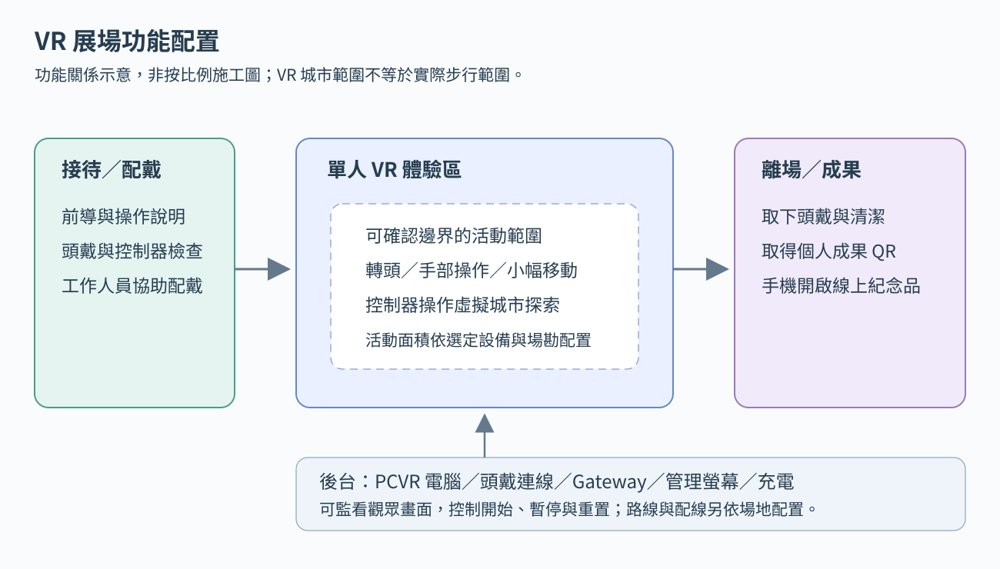

# 音虫 VR｜技術架構

日期：2026-11-03｜版本：VR v0.1

用途：讓組員了解 VR 作品、設備與分工。本文件為開發規劃，並非完成實作或設備驗證。**採電腦連線 VR（PCVR），以 VR 控制器操作虛擬捕捉器與回收站**；選型及需決定的項目集中於[待確認與驗證清單](待確認與驗證清單.md)。

閱讀順序：[本文件](技術架構.md) → [技術流程圖](技術流程圖.md)；實作查[開發規格](開發規格.md)，採購查[器材清單](器材清單.md)，來源查[重要連結](重要連結.md)。

## 1. 專案概述與功能範圍

觀眾扮演捕蟲人，戴上 VR 頭戴裝置，進入受到噪音生物「音虫」影響的城市，循聲探索並收集音虫，最後將噪音能量回收、轉化為物品，修復城市。單次一人，觀眾在虛擬城市移動，不必以實際步行走遍城市。

一隻或一群音虫組成一個「群落」，也是一次捕捉單位。觀眾手中的控制器對應虛擬捕捉器，持續對準同一群落即可自動捕捉；移開或換目標，進度歸零。捕捉成功整群收走、扣一次精神值 SAN，並震動回饋。

作品保留兩種不同因果：**觀眾發聲會擾動既有音虫；成功捕捉則讓捕捉器產生噪音，促成新音虫誕生。**觀眾在處理噪音時也製造新的噪音，透過反覆捕捉與城市變化感受這個循環。

達任務條件或 SAN 限制後前往虛擬回收站，完成到站互動後再按確認，系統登錄種類與群落數量，演出能量轉化及城市修復。結尾提供線上紀念品：感謝信、收集摘要與個人旋律。

## 2. 系統連接架構

```text
VR 頭戴裝置／控制器 → OpenXR → Unity
  頭手姿態、搖桿與按鍵         ├─ 虛擬城市／捕捉／SAN／回收／修復
                            ├─ 頭戴畫面／空間音效／控制器震動
頭戴麥克風 → Unity 音量分析 ─┘

Unity ↔ 本機串接服務（Gateway）→ SQLite 成果／待上傳佇列
                               → HTTPS → 雲端成果 API／資料庫／音軌
觀眾離場後使用手機 → Next.js 線上紀念品
工作人員 → 管理頁／主機監看畫面
```

Unity 直接取得 VR 輸入並決定遊戲狀態；瞄準與捕捉不用先經網路。本機串接服務（Gateway）是展場電腦上的程式，負責管理操作、保存成果與上傳。外網中斷不停止遊戲，成果先存本機，復線後補傳。

## 3. 主要開發軟體

| 軟體／技術 | 用途 |
| --- | --- |
| Unity、C#、URP | 立體城市、音虫、SAN、捕捉、回收與修復 |
| XR Plug-in Management、OpenXR | 接入相容頭戴裝置與控制器；依實際設備設定執行環境與輸入配置 |
| XR Interaction Toolkit、Input System | 手部瞄準、虛擬操作、移動／轉向與震動 |
| Unity Audio、Microphone | 城市空間音效、頭戴收音、音量分析與捕捉噪音 |
| Node.js、TypeScript、WebSocket | 本機串接服務、管理指令、成果保存及同步 |
| Next.js、React、TypeScript | 線上紀念品、成果 API 與本機管理頁 |
| SQLite／PostgreSQL、Web Audio API | 本機保存／雲端成果、個人旋律播放 |
| Blender、聲音工具、Git／Git LFS | 3D、美術與聲音素材、版本管理 |

VR 輸入與移動採用 Unity 的 [XR Interaction Toolkit](https://docs.unity3d.com/Packages/com.unity.xr.interaction.toolkit@3.1/manual/index.html) 與 [OpenXR](https://docs.unity3d.com/Packages/com.unity.xr.openxr@1.14/manual/index.html)；文件中的套件版本網址供查閱，實作時鎖定與專案相容的版本。

## 4. 設備與展場配置



此圖為功能關係示意，不代表實際尺寸或完成場勘。入場接待、VR 體驗、離場領取成果及後台各自安排；實際活動範圍依設備要求與場勘配置。

| 設備 | 用途 |
| --- | --- |
| 相容的 VR 頭戴裝置及原廠控制器 | 顯示城市、追蹤頭手姿態、操作與震動 |
| 符合頭戴設備需求的 Windows 獨顯主機 | 執行 PCVR、Unity、Gateway 與管理端 |
| 相容連線線材／連線設備 | 將 PCVR 畫面、追蹤及音訊與頭戴設備串接 |
| 管理螢幕、鍵盤、滑鼠 | 監看觀眾視角、場次狀態及開始／暫停／重置 |
| 頭戴耳機及麥克風 | 城市聲音、方向線索、觀眾發聲與捕捉噪音 |
| 網路及外網 | 成果上傳、管理頁；與 VR 影像連線分別規劃 |
| 充電、清潔、面罩及線材管理用品 | 連續接待、設備保養與體驗區維護 |

器材詳見[器材清單](器材清單.md)。VR 追蹤與遊戲內判定取代固定紅外線點位及實體 NFC，捕捉器螢幕與回收站都在虛擬城市內呈現。

## 5. 移動、瞄準與捕捉

1. **探索：**頭部轉動直接改變視角；原型採控制器傳送移動與分段轉向，觀眾仍可在體驗區內小幅移動。
2. **瞄準：**Unity 從手中虛擬捕捉器發出偵測射線，檢查是否命中有效群落的捕捉範圍；牆壁等實體場景會阻擋射線。
3. **累積：**同一群落持續有效對準才累積進度，在虛擬捕捉器螢幕呈現 SAN 與進度；移開、換目標或失去追蹤歸零。
4. **結算：**整群消失、收集數加一次、SAN 扣一次，控制器震動，Unity 發出一次捕捉噪音事件。
5. **誕生：**同一次事件安排噪音播放與新群落生成；同一出現區可再次生成不同種類。新群落有獨立捕捉進度。

音虫可在群落範圍內亂動；捕捉判定對應整群範圍，不要求觀眾追逐每隻小個體。VR 使用虛擬空間的頭手座標與碰撞判定，不需要在音虫位置設紅外線燈。

## 6. 聲音、回收與紀念品

| 環節 | 運作方式 |
| --- | --- |
| 觀眾發聲 | 頭戴麥克風送入 Unity，依音量及持續時間擾動既有群落，不生成新音虫 |
| 捕捉噪音 | 捕捉成功後，由同一事件安排頭戴耳機播放噪音及新群落誕生，不等麥克風再收到音效 |
| 到站互動 | 在虛擬回收站，把虛擬捕捉器放進感應範圍；Unity 記錄本場已到站並顯示可確認 |
| 確認回收 | 到站後可移開，再按控制器映射的確認鍵；Unity 檢查資格，固定清單並只結算一次 |
| 轉化與修復 | 登錄種類／群落數量，將噪音能量轉成物品，在 VR 城市內演出修復 |
| 線上紀念品 | 離開頭戴裝置後取得成果 QR，以手機開啟 Next.js 感謝信、收集摘要及旋律；離場後仍可開啟 |
| 列印（選配） | 紙本使用同一成果連結，不影響線上紀念品 |

虛擬到站以遊戲內範圍判定；Unity 記錄本場已到站，資格保留到回收或本場結束，重新定位時清除並要求再次到站。

## 7. 美術、聲音與網頁交付

| 項目 | 交付內容 |
| --- | --- |
| 3D 城市 | 可探索路徑、可傳送地面、阻擋碰撞、方向地標、聲源及修復狀態 |
| 音虫 | 種類、群落範圍、局部亂動、擾動／捕捉／誕生動畫 |
| 虛擬捕捉器 | 握持模型、瞄準方向、像素風 SAN／進度畫面與到站提示 |
| 回收站 | 3D 外觀、感應範圍、物品轉化及城市修復動畫 |
| VR UI | 適當閱讀距離與大小、任務／SAN 提示、教學、暫停及追蹤遺失提示 |
| 聲音 | 具位置的城市線索、擾動／捕捉噪音、各種類預製旋律聲部；聲部共用節拍 |
| 線上紀念品 | 手機版感謝信、摘要、旋律播放、成果 QR 與狀態提示 |

3D 場景需要補足轉頭及移動可見的側面、背面；不能把原先只供固定投影觀看的平面背景直接當成完整 VR 場景。模型、材質、光照、粒子與 UI 均需在頭戴設備內檢視。

## 8. 場次、保存與展場操作

一次一位觀眾。工作人員確認設備、活動範圍、音訊與程式就緒後建立場次；觀眾完成教學再探索。取下頭戴裝置或失去追蹤時，暫停捕捉及生成計時，保留已確認收集；恢復後重新對準。

Unity 完成回收後交付成果，本機服務將成果與待上傳工作一起存入 SQLite，再交付成果 QR。外網中斷仍保存並補傳，雲端尚未收到時成果頁顯示稍後重試。本機保存、結尾與成果交付完成後才清場重置；成果與上傳佇列不隨重置刪除。

管理端顯示場次、追蹤、麥克風、SAN、捕捉、回收及同步狀態。新場次清除遊戲資料與到站資格，並重新確認頭戴定位、控制器及收音；已保存成果持續供觀眾離場查閱。
