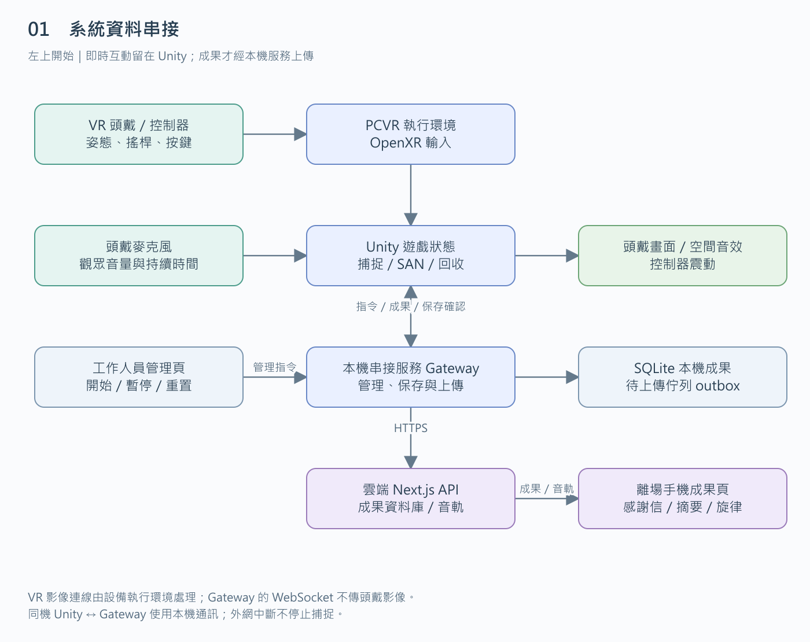
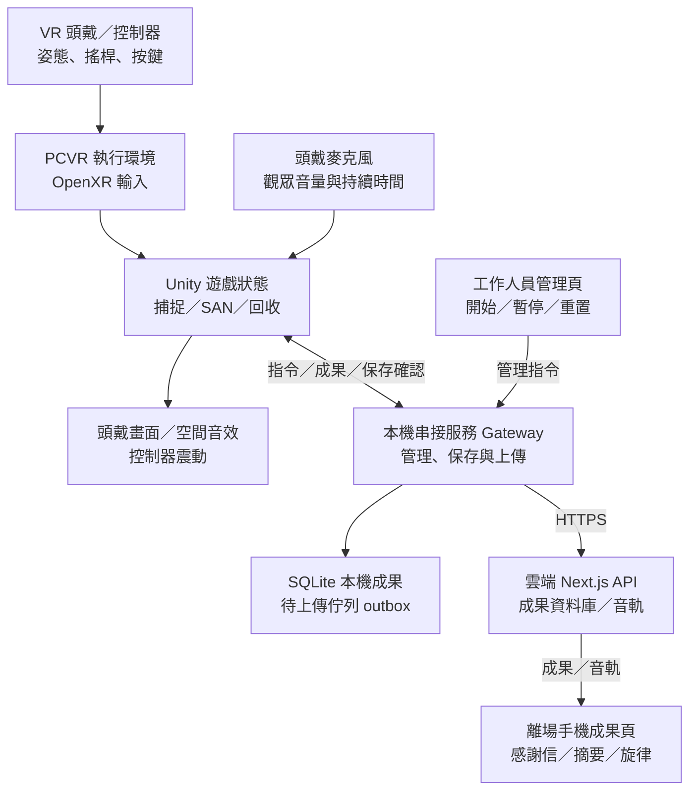
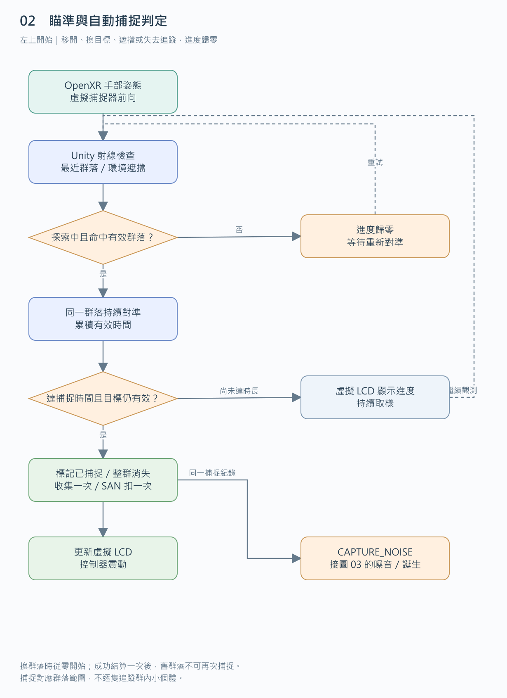
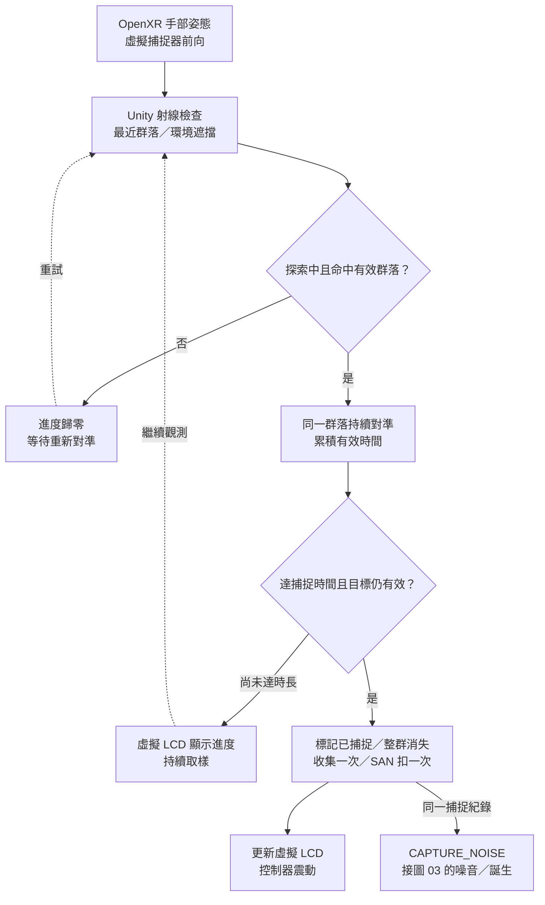
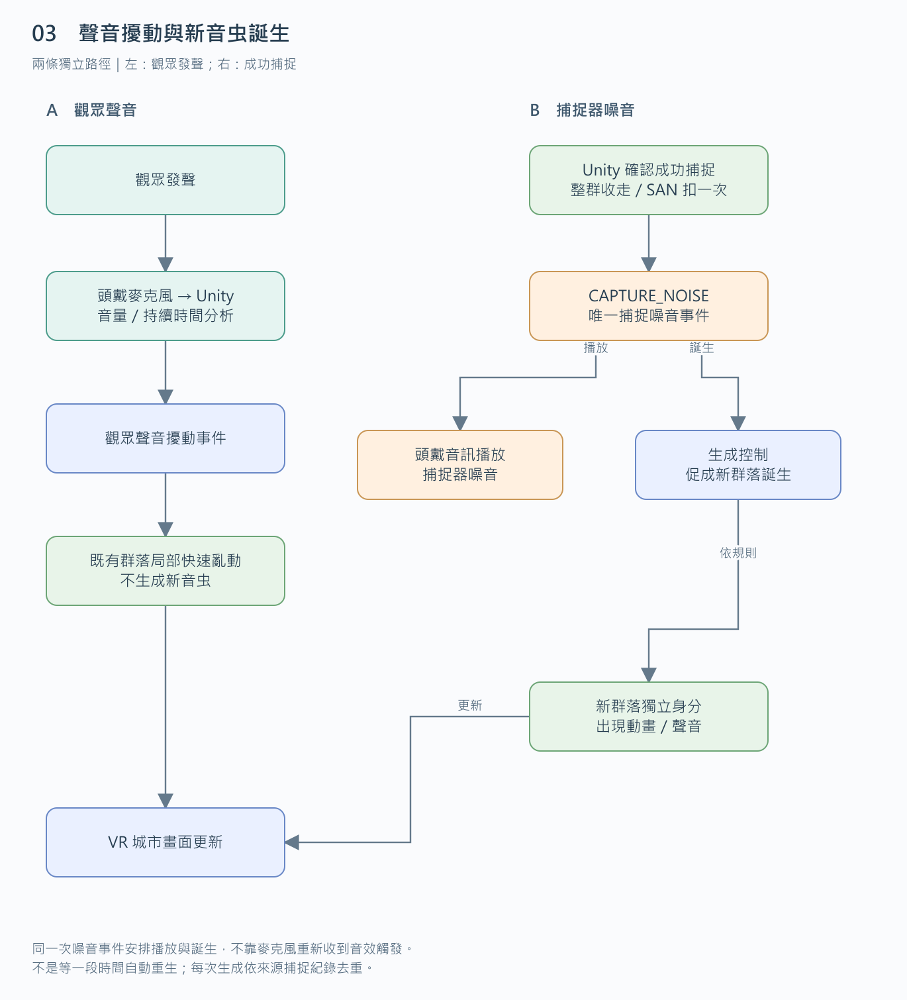
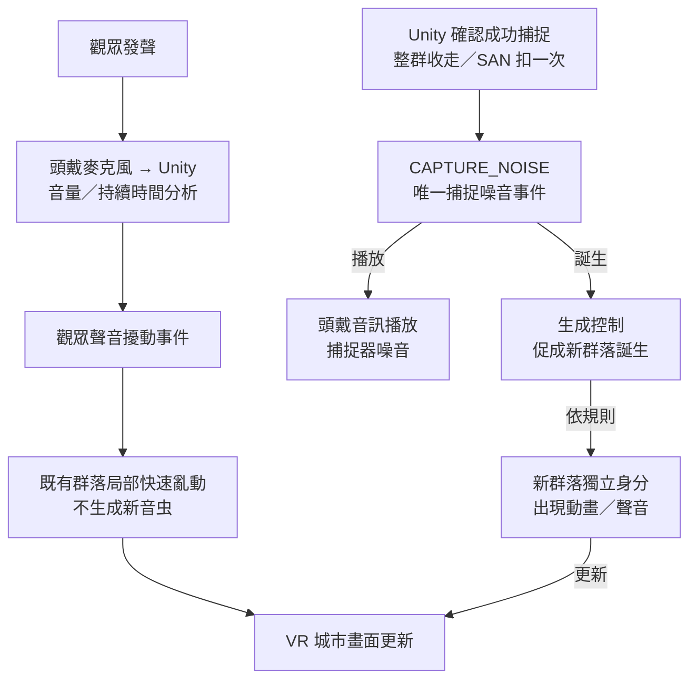
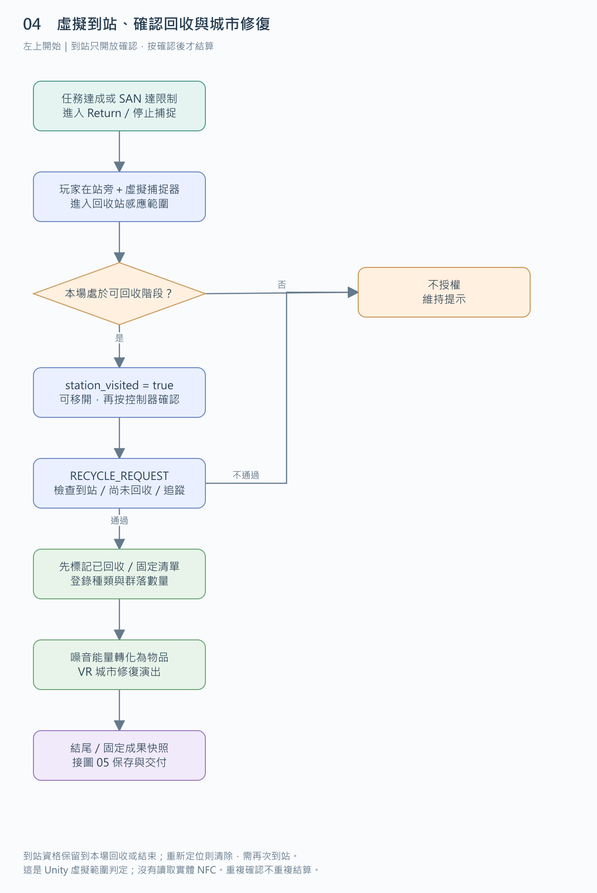
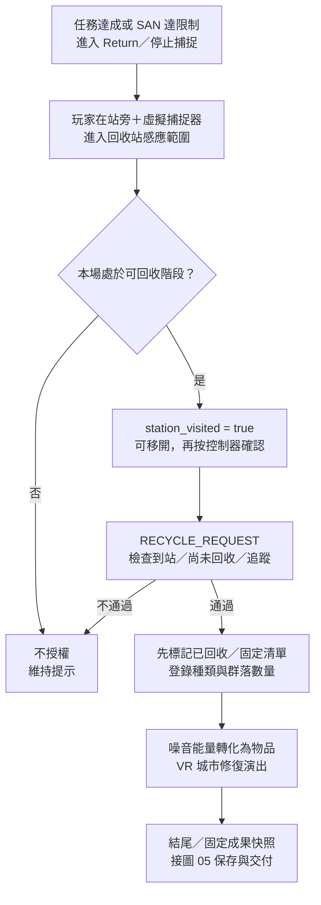
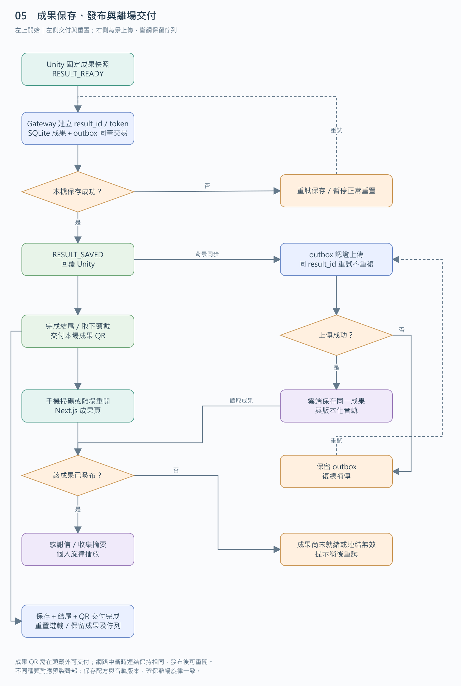
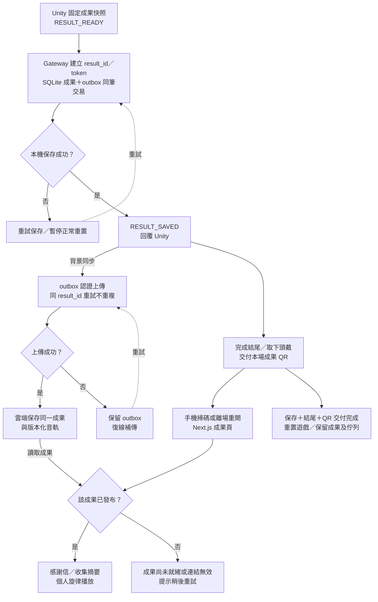

# 音虫 VR｜技術資料與事件流程圖

日期：2026-11-03｜版本：VR v0.1

五張圖依[技術架構](技術架構.md)及[開發規格](開發規格.md)繪製；屬於技術設計，不代表已實作。依 **01 → 02 → 03 → 04 → 05** 閱讀，每張從左上開始，圖 03 分成兩種聲音來源。

箭頭表示程式資料或事件；虛線表示重試／持續觀測。圖中相鄰模組可留在同一 Unity 程式內，不表示每個方塊都要一台設備或一個網路服務。

SAN 是遊戲精神值；群落是一次整群捕捉的單位；Gateway 是本機串接服務；outbox 是待上傳佇列。本圖為 VR 版本，不代表原 FigJam 投影版已同步修改。

## 1. 系統資料串接

OpenXR 將頭手姿態與操作送入 Unity，Unity 直接決定捕捉、SAN、回收與頭戴回饋。Gateway 只處理本機管理、保存與雲端成果；不承接 VR 影像。

[SVG 向量圖](assets/技術流程圖/01.svg) · [PNG 圖片](assets/技術流程圖/01.png) · [Mermaid 原始碼](assets/技術流程圖/01.mmd)

展開 Mermaid 原始碼

## 2. 瞄準與自動捕捉判定

控制器姿態決定虛擬射線，命中有效群落後持續計時。進度中斷歸零；結算一次後更新 SAN、震動與捕捉噪音事件。

[SVG 向量圖](assets/技術流程圖/02.svg) · [PNG 圖片](assets/技術流程圖/02.png) · [Mermaid 原始碼](assets/技術流程圖/02.mmd)

展開 Mermaid 原始碼

## 3. 聲音擾動與新音虫誕生

觀眾聲音只擾動既有群落。成功捕捉的 CAPTURE_NOISE 才同時安排噪音播放及新群落生成，不靠重新收音觸發。

[SVG 向量圖](assets/技術流程圖/03.svg) · [PNG 圖片](assets/技術流程圖/03.png) · [Mermaid 原始碼](assets/技術流程圖/03.mmd)

展開 Mermaid 原始碼

## 4. 虛擬到站、確認回收與城市修復

進入回收階段後，玩家在站旁且虛擬捕捉器進入感應範圍，Unity 記錄已到站。觀眾可移開再按確認，系統只結算一次，登錄種類與群落數量後轉化物品並修復城市。

[SVG 向量圖](assets/技術流程圖/04.svg) · [PNG 圖片](assets/技術流程圖/04.png) · [Mermaid 原始碼](assets/技術流程圖/04.mmd)

展開 Mermaid 原始碼

## 5. 成果保存、發布與離場交付

本機先保存成果及 outbox，再交付固定成果連結並背景上傳。保存、結尾與頭戴外成果交付完成才重置；網路中斷不刪除待同步結果。

[SVG 向量圖](assets/技術流程圖/05.svg) · [PNG 圖片](assets/技術流程圖/05.png) · [Mermaid 原始碼](assets/技術流程圖/05.mmd)

展開 Mermaid 原始碼

相關參數與實機檢查統一見[待確認與驗證清單](待確認與驗證清單.md)。
