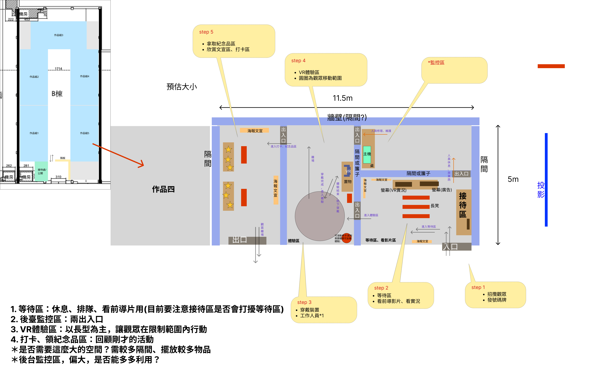
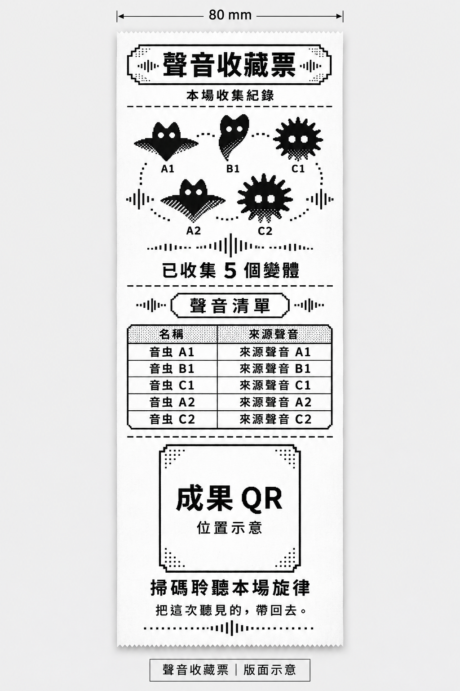
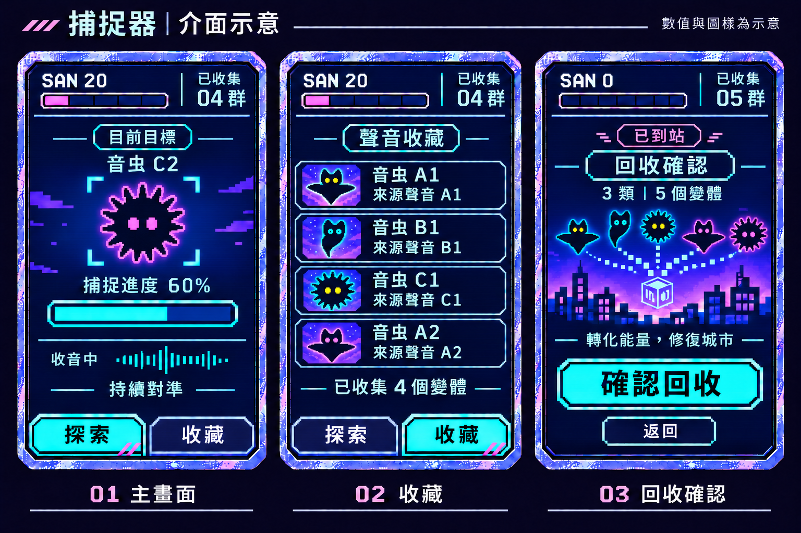

# 音虫 VR｜技術架構

日期：2026-11-22｜版本：VR v0.31

- 用途：供組員了解作品、設備與分工。
- 規劃由 **Windows 電腦執行 Unity，Meta Quest 3 顯示畫面並追蹤頭部與控制器**； 實機驗證項目見討論清單。

- 閱讀順序：本文件 → [技術流程圖](技術流程圖.md)。
- 實作：[開發規格](開發規格.md)／[逐步開發教學](開發文件/README.md)；採購：[器材清單](器材清單.md)；來源：[重要連結](重要連結.md)。
- 待決／測試：[待確認與驗證清單](待確認與驗證清單.md)；方案比較：[功能覆蓋](方案對照與功能覆蓋.md)。

本週音虫、聲音與展後流程依[會議紀錄](https://docs.google.com/document/d/1UPgab6DDWDEvj7d_XypOyjKA11wd0t6zCan4WgU-vFs/edit?tab=t.f5j8j833uf1a)。近期期限依 [11/15 會議紀錄](https://docs.google.com/document/d/1UPgab6DDWDEvj7d_XypOyjKA11wd0t6zCan4WgU-vFs/edit?tab=t.qq4ga3sjxi92)。

## 1. 專案概述與功能範圍

| 項目 | 內容 |
| --- | --- |
| 體驗形式 | 兩套設備輪替，每次僅啟用一套、接待一位觀眾。配戴 Quest 3 後看 VR 短版開場與操作教學；探索按實際回收進度結束。 |
| 活動方式 | 長型虛擬城市從左端入口到右端回收站；部分建物內可探索。真實身體原地轉身，左手搖桿移動角色，右手持虛擬捕捉器。 |
| 體驗目標 | 扮演捕蟲人，循聲尋找並收集音虫，將回收能量化為金色光球，修復城市。 |
| 音虫顯現 | 音虫起初隱藏但持續發聲； 後續規劃可由觀眾發聲使前方音虫短暫顯現，累積捕捉進度則讓外觀依進度線性顯現並保留。 |
| 光罩與捕捉 | 照射光罩（Mask）隨控制器照向場景表面或有效群落；同群累積有效對準 3 秒即可自動捕捉，移開保留進度。 |
| 捕捉聲音 | 隨捕捉進度增加，目標音虫聲音逐漸變小；移開保留對應音量，再對準接續，成功後停聲。 |
| 類型與變體 | 海天使 3 款、海蛞蝓 4 款、魟魚 1 款，共 8 款。每群由同一變體構成。美術交同造型的兩個外觀版本，可共用網格。場景中的正式簡化材質版隨照射進度顯現，捕捉成功後由捕捉器螢幕顯示精緻材質版。 |
| 隨機出現 | 海天使／海蛞蝓全程最多 3 群，雨天加 1 群魟魚，最多 4 群。補群使用未用點位和未出現變體。 |
| 群落與 SAN | SAN 100、每群扣 20。至少捕捉 1 群即可回收，最多 5 群。SAN 歸零停止捕捉與補群。 |
| 回收流程 | 可依已收集數量到站回收，不用收滿。確認後轉成金色光球，粒子量依實收數量調整，搭配城市材質變換。修復期間保留移動與轉向。 |
| 回收站與結尾 | 右端回收。修復完成後走到右端結尾區，進入定點自動淡黑，再由左手打開感謝信。 |
| 紀念品 | 每場一張聲音收藏票，QR 直接開個人成果頁；可前往卡片總覽看其他人的成果。頁面展示項目另定，先用佔位內容。 |

## 2. 系統連接架構

| 項目 | 內容 |
| --- | --- |
| 遊戲互動 | Quest 3 回報頭部與控制器動作 → 電腦 Unity 判斷瞄準、捕捉與回收 → 頭戴顯示畫面、播放聲音，控制器震動。 |
| 觀眾發聲（後續，先不做） | 頭戴內建麥克風 → 電腦消除遊戲回音並判斷有效發聲 → Unity 讓既有音虫短暫顯現。 |
| 成果交付 | Unity 固定本場成果 → Gateway 保存及背景上傳 → 列印收藏票 → 掃 QR 直達個人頁 → 可進總覽看其他成果。 |

- **Quest Link** 使用 USB 資料線連接電腦與頭戴。
- **本機串接服務（Gateway）** 是展場電腦上的程式，連接 Unity，處理成果保存、上傳及收藏票列印；後續選配管理頁再經本機 Next.js 送出操作。
- 教學範例另用本機 HTTP 查詢交票狀態；保存、結尾及交票都成立後，才開放下一場。

- 即時互動由 Unity 在展場電腦判斷。
- 展場 Wi-Fi 暫時無法上網時，遊戲與紙票列印照常，成果先存電腦、恢復連線後補傳； Quest 3 與電腦的 USB 連線中斷時則暫停互動。

## 3. 主要開發軟體

- 開發環境：2 台 Windows、1 台 Mac M3（Apple Silicon）；正式 Quest Link 與 Windows 執行檔整合在 Windows 進行。

- 電腦模擬：鍵鼠模擬頭戴／控制器，沿用遊戲規則。開發時用耳機或喇叭試聽，目前原型只驗證播放。
- Quest Link：接上 Quest 3，驗證追蹤、頭戴喇叭、震動與效能。

| 軟體／技術 | 用途 |
| --- | --- |
| Unity 6.3 LTS（6000.3.19f1）、C#、URP | 城市場景、光罩、捕捉、SAN、聲音、回收與修復；同時管理活動區邊界 |
| OpenXR 1.16.1、XR Interaction Toolkit 3.3.2 | 取得頭部／控制器動作，操作虛擬介面與震動 |
| Meta Horizon Link | 透過 USB 連接 Quest 3，使用 OpenXR 執行電腦版遊戲 |
| 回音消除（AEC）與人聲偵測（VAD），後續規劃 | 處理麥克風輸入，降低遊戲聲音被誤認為觀眾發聲的情況 |
| Node.js 24 LTS、TypeScript、WebSocket、pnpm | 開發本機串接服務，連接 Unity 與管理頁；使用 pnpm 管理套件 |
| Next.js、React、TypeScript、pnpm | web 內製作 home、results、about 與成果 API；管理頁後續選配 |
| Tailwind CSS、Tabler Icons、shadcn/ui | 網頁樣式、圖示與基礎 UI 元件，依功能取用 |
| fetch／Axios | 網頁 HTTP API 呼叫；Unity 與 Gateway 維持 WebSocket |
| Vercel Hobby | 部署 Next.js 線上紀念品與成果 API，預製素材隨網站版本發佈；原型使用免費額度 |
| SQLite、Neon Free（PostgreSQL） | 本機保存成果，雲端原型使用免費資料庫 |
| Web Audio API | 讓網頁上的多個旋律聲部同步播放 |
| qrcode、@resvg/resvg-js | Gateway 依固定成果產生 QR 與 SVG／PNG 票面 |
| Blender、聲音工具、Git／Git LFS | 製作模型、動畫及音檔，管理檔案版本 |

固定套件版本見[開發規格](開發規格.md)。Quest 3 已取得，用嘉的 Windows 電腦首測；**2026/12/22 歸還，寒假無法借用，2027/2/15 起可再借用**。歸還前測 Link／頭手／循聲／介面；寒假用桌面模擬與 Windows Build 開發，頭戴複驗排在 2/15 再借到後。

## 4. 設備與展場配置

圖示為實體場地動線，虛擬長街另行配置。

| 空間項目 | 原型配置 |
| --- | --- |
| 場地外框 | 約 11.5 × 5 公尺，依目前配置圖估算。 |
| 活動圈 | 直徑 3 公尺、半徑 1.5 公尺；外加 0.5 公尺淨空緩衝，共占直徑 4 公尺。 |
| 圓心 | 依 11/14 圖在中央 VR 區標定實體站位。圓心、淨空與隔間尺寸在場勘核定。 |
| 邊界 | 原型距圓心 1.2 公尺開始提示，超過 1.5 公尺暫停互動；實際依伸手、線材及場勘驗證。 |
| 回收站 | 虛擬站體固定於城市右端。角色接近後操作；右端回收站附近另設結尾觸發區。 |
| 群落 | 生成於城市有效出現區，含部分可進入建物；與實體活動安全區分開管理。 |

- 圖為功能配置，非施工尺寸。
- 實體順序為入口接待與前導影片 → 配戴與體驗 → 摘下設備，由工作人員清潔 → 打卡區領印有個人成果網頁 QR Code 的熱感紙成果票、看團隊介紹與製作展示 → 離場。
- 接近邊界先提示，越界暫停互動，由區外工作人員協助。

| 設備 | 用途 |
| --- | --- |
| Quest 3 套裝（含 Touch Plus 控制器與腕帶） | 頭戴畫面、頭部／手部追蹤、虛擬捕捉器及震動；控制器與腕帶隨套裝提供 |
| Windows 電腦（技嘉平台電馭游俠 II）、鍵盤／滑鼠 | 主機內含 Windows 11 Home 64 位元； 執行 Unity、Gateway，採雙螢幕延伸顯示；管理頁後續選配 |
| 觀眾螢幕（1 台） | 接待區播放前導影片 |
| 工作人員螢幕（1 台） | Unity 遊戲監看、管理與錯誤紀錄；開發時顯示 Editor／Console |
| USB 資料線／Link 線（11/20 借到測試用線） | 先用測試線做 USB Link 驗證，記錄接口與穩定性 |
| 線材固定／導引配件 | 將線材引離活動區，減少拉扯與繞腳 |
| Quest 3 內建喇叭／麥克風 | 內建喇叭播放音虫與劇情聲音，麥克風留待發聲功能啟用 |
| 展場共用 Wi-Fi（可連網際網路） | 電腦連網與成果上傳，使用場地提供的網路 |
| USB 感熱印表機、80 mm 紙捲及出紙口 | 電腦直接列印聲音收藏票並自動裁切 |
| 原廠充電與配戴配件、備用 AA 電池、清潔用品 | 充電器、面罩及頭帶隨套裝；另備輪替電池與清潔耗材 |
| 圓形活動區、淨空緩衝與動線標示 | 工作人員在區外看護，設備與旁觀者位於淨空區外 |

[正式音虫與城市配置](開發規格.md#音虫與城市配置)涵蓋 65 × 25 m 的街區。預設 CaptureLab 有 8 個候選點，其中 1 點在左側的灰盒房間。開場固定 1 群在室內、2 群在室外。補群與魟魚登場都使用本場尚未用過的點位。器材數量與候選型號見[器材清單](器材清單.md)。

## 5. 空間、發聲顯現與捕捉

本階段先做循聲與照射顯現。發聲顯現本階段先不做，桌面預覽、頭戴收音、AEC／VAD、教學及實機驗收已列在 [U2 後續流程](開發文件/工作包/U2.md#5-發聲顯現後續規劃本階段先不做)。

| 步驟 | 處理內容 |
| --- | --- |
| 1. 循聲尋找 | 音虫可能在街上或可進入的屋內。屋外仍聽得見室內音虫，但聲音較小、隔牆時較悶。進入該屋後，聲音逐漸恢復清楚。 |
| 後續：發聲確認 | 自然呼喚或說話，使觀看方向前方互動範圍內的多群既有音虫短暫顯現，不必先精準瞄準。 |
| 3. 對準捕捉 | 室內群落需進入該屋才能捕捉。群落在有效距離且沒有遮擋時，累積有效對準 3 秒完成捕捉；進度增加時，音虫逐漸顯現、聲音逐漸降低。 |
| 4. 移開再接續 | 光罩跟著控制器照向新的場景表面，原群進度、對應外觀及音量保留；再對準同群就繼續。 |
| 5. 捕捉成功 | 成功時停聲、扣一次 SAN，更新螢幕並震動。整群退場，精細版模型顯示在捕捉器螢幕上。 |

- 光罩可落在一般場景表面或有效群落上。兩者都沒命中，或互動暫停時收起。只有對準有效群落才累積捕捉進度。
- 後續發聲顯現規則為 3 秒逐漸淡入，接著用 1 秒淡出；已有捕捉進度則保留相應外觀。
- 顯現動畫與捕捉計時分開；XR 輸入失焦、斷線、追蹤失效或越界時，暫停但保留進度。

- 探索第 60 秒來雨，一群魟魚在戶外定點打轉。第 120 秒雨停，未捕捉的魟魚退場。海天使、海蛞蝓的聲源及進度全程保留。

## 6. 聲音、回收與紀念品

| 環節 | 運作方式 |
| --- | --- |
| 循聲與數量 | 海天使／海蛞蝓最多 3 群，SAN 大於 0 時可補未出現變體。雨天加 1 群魟魚，捕捉後同場不再補魟魚。 |
| 聲音回饋 | 只降低被捕捉群落的聲音，與同群保留進度同步；其他群落及城市環境聲不隨之降低。 |
| 聲音處理（後續） | 使用遊戲播放聲音作參考消除回音，再判斷人聲、音量及持續時間；不辨識說話內容 |
| 防止誤觸發（後續） | 一次發聲只回應一次，確認停聲且冷卻結束後才再接受；收音或回音處理失效時暫停發聲功能 |
| 到站確認 | 觀眾在圈內靠近虛擬回收站，將捕捉器前端放入感應區，螢幕才開放「確認回收」；遠處照射不算到站 |
| 回收演出 | 左手確認後登錄實收，以金色光球及建物材質變化呈現城市修復。 |
| 線上紀念品 | 掃紙票 QR 直達個人頁，可進卡片總覽看其他成果；展示項目另定。旋律依實收變體啟用對應聲部。 |
| 聲音收藏票 | 本機保存後由電腦透過 USB 列印本場已收集變體的黑白組合圖、名稱／來源聲音清單與同一成果 QR； 每場一張，失敗可補印 |

- 探索時持續播放循聲線索；循聲、對準捕捉及回收等操作採字幕搭配動畫引導；本階段教學先不包含發聲操作。
- 教學為觀看示範，不計正式數據。
- 達捕捉上限後停止捕捉及補群。可提前到站回收，成功後固定收藏並清除剩餘群落。
- 到站後可移開再確認，資格保留到本場回收或結束；重新校正或換裝置須重新到站，重複確認不重複結算。

收藏票印表機優先借用具 USB 與自動裁刀的 80 mm 機型，搭配相容紙捲；電腦直接控制列印、送紙及裁切，不另加 Arduino／ESP32。

圖樣與名稱為示例；正式票面由本場成果產生可掃碼 QR。

## 7. 美術、聲音與網頁交付

| 項目 | 交付內容 |
| --- | --- |
| 場景 | 單一虛擬城市、遮擋物、可接收光罩的表面、圈內可操作的回收站及修復前後畫面 |
| 音虫與光罩 | 3 個基礎外形，各做 3 個配色／局部造形變體；共用同類動作，各變體分別配置來源聲音與聲部； 照射／進度顯現、捕捉動畫與動態光罩／進度提示 |
| 開信動畫 | 美術交付透明 PNG 影格及幀率；技術組接左手點選、播放和正文顯示。 若網頁採用感謝信，與 VR 共用企劃交付的三版正文。 |
| VR 開場與教學 | 約 15 秒短版開場，簡述身分與任務；接續操作示範動畫與字幕，示範不計正式數據 |
| 捕捉器介面 | 右手持捕捉器。主畫面直接顯示 SAN、捕捉進度與當前目標；左手搖桿移動，左手控制器確認回收及開信。 |
| 聲音 | 城市、音虫、劇情、回收及結尾音效；旋律聲部使用相同節拍、拍號、循環長度與起點 |
| 網頁與紙本 | home 主視覺、results 總覽／個人頁、about 團隊介紹；內容先佔位。紙票保留本場直達 QR，每場一張 |
| 聲音收藏票美術 | 80 mm 紙寬，組合本場實際收藏圖像、來源聲音清單及成果 QR。 |

介面視覺參考。收藏分頁留在後續擴充分頁。

音虫名稱、圖樣與「3 類」為示例；類型數按實際收藏計算，回收頁顯示當時的 SAN。

電量無法讀取時顯示「未知」。素材需在實際展出程式中檢查效能、介面可讀性與聲音方向；旋律配方與素材版本一併保存，確保離場重開仍是同份成果。

## 8. 場次、保存與展場操作

| 步驟 | 處理內容 |
| --- | --- |
| 1. 開場 | 工作人員檢查活動區、追蹤、音訊、電量、頭戴連線與保存服務，再開始單一場次。 |
| 2. 中途 | 目前用 Unity 測試面板暫停／恢復，管理頁後續選配。換機需暫停、重新連接及校正；正常輪替在交票重置後進行。 |
| 3. 結束 | Unity 固定本場收集、修復結果與旋律配方，Gateway 確認本機保存成功。 完成結尾及收藏票交付後才重置，開放下一場；列印異常保留成果與工作，補印後交票。 |

- 成果會背景上傳；暫時無法上網時先存在電腦並交付相同連結，恢復連線後補傳。
- 補傳完成前，手機可能需稍後重試才能開啟成果。
- 重置不刪成果、待上傳資料或列印工作。
- 管理頁用途為工作人員監看、暫停及票務操作；本階段不要求製作。兩套輪替仍是單場系統，不自動切換頭戴。
