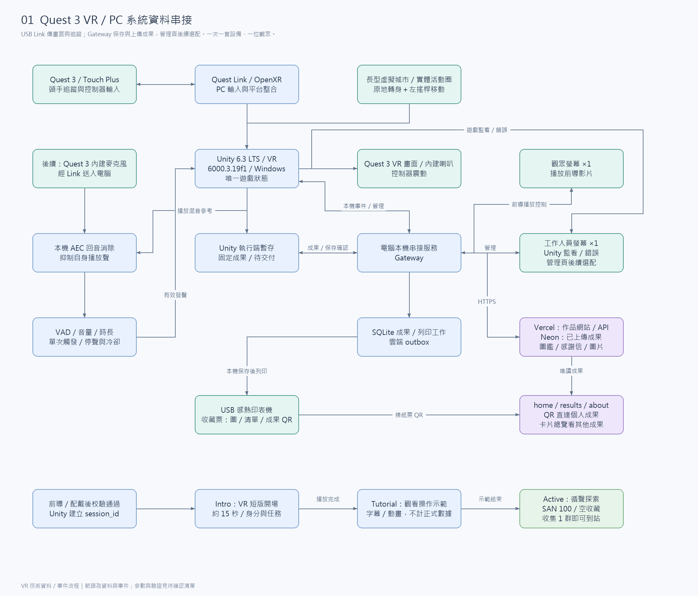
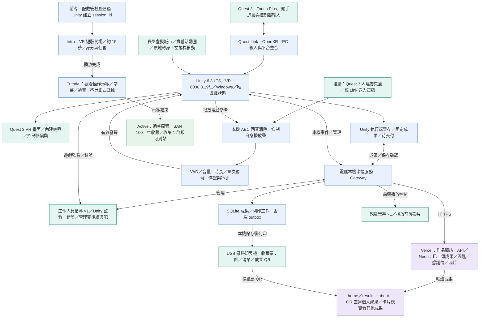
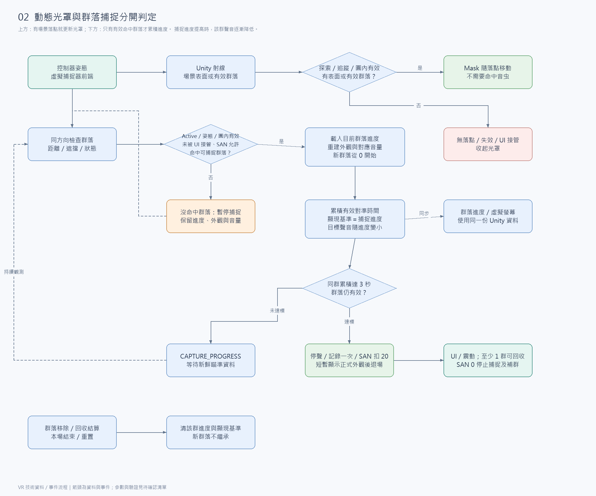
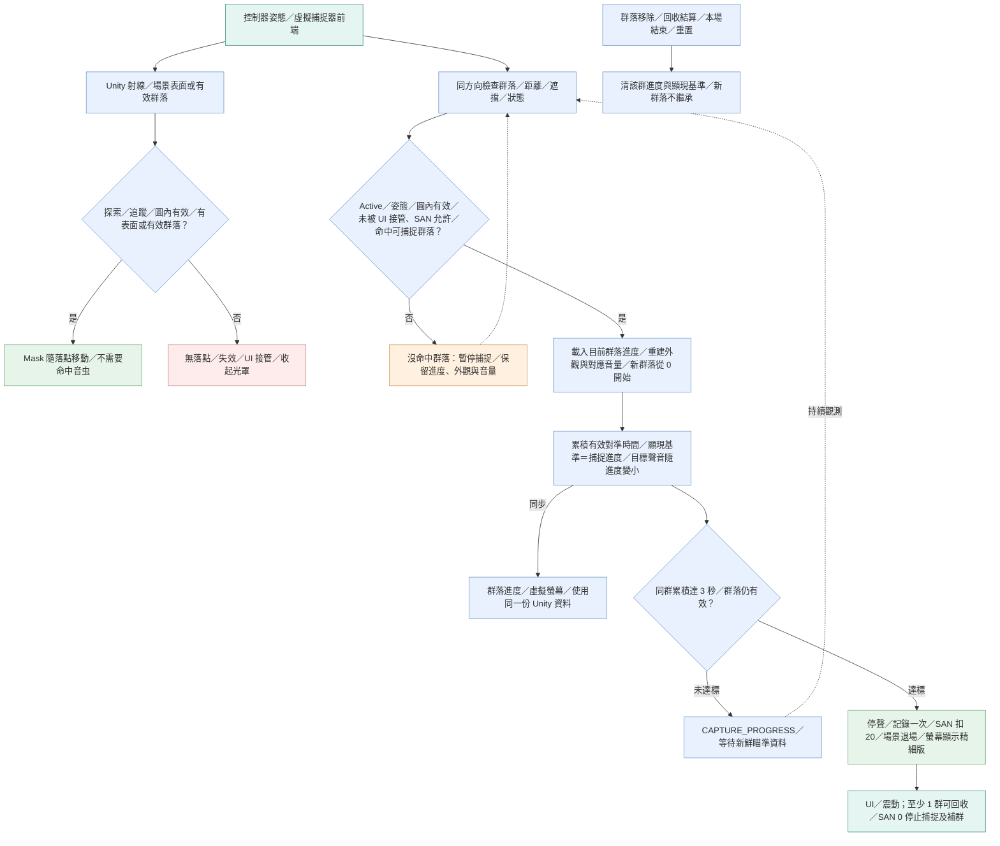
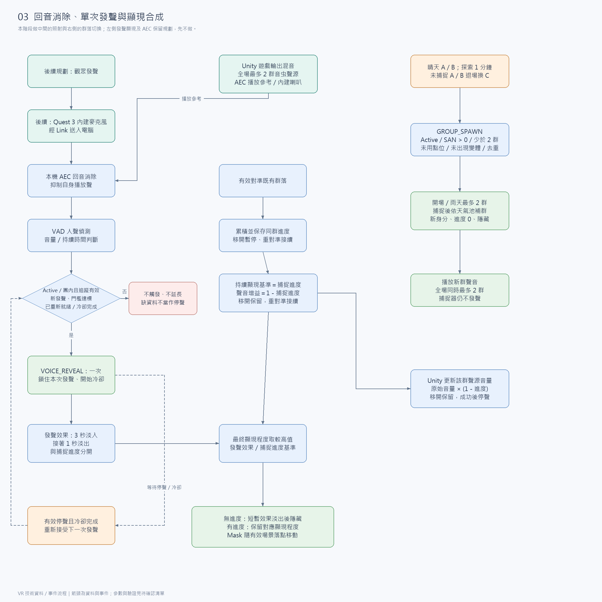
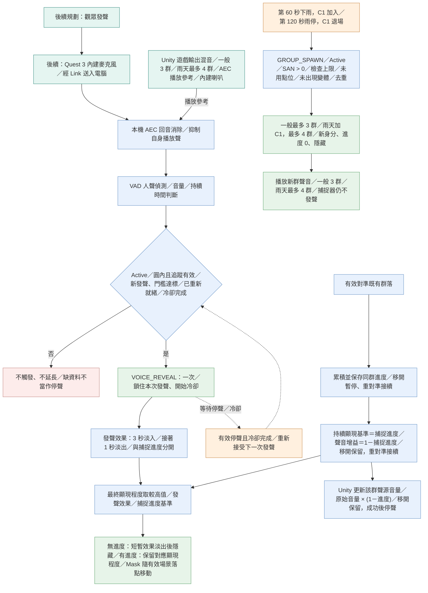
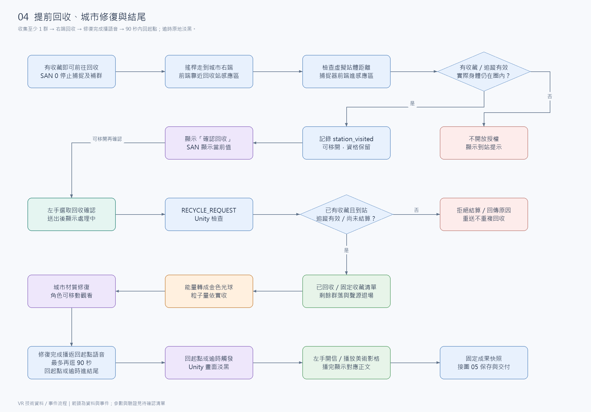
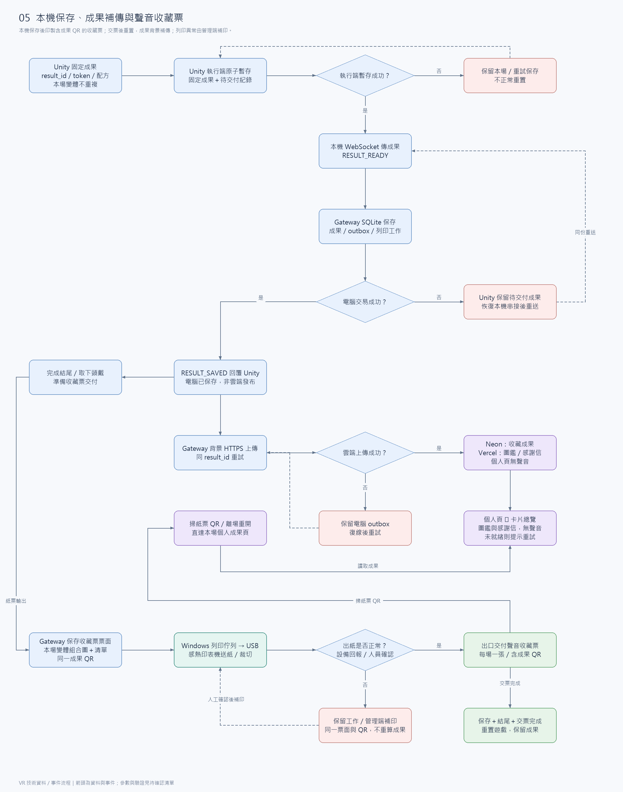
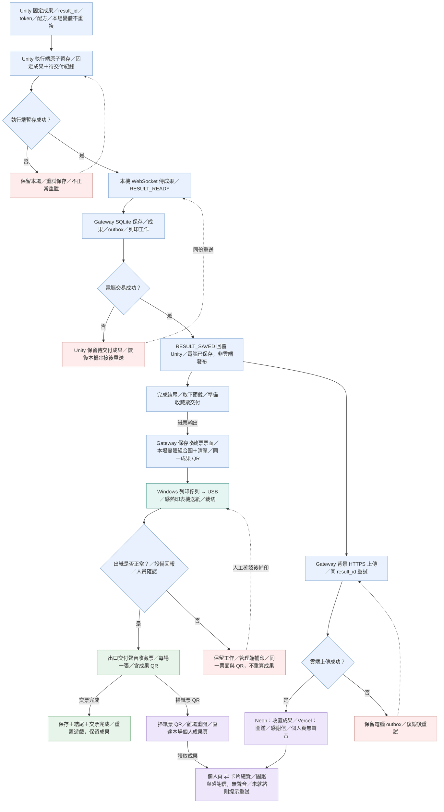

# 音虫 VR｜技術資料與事件流程圖

日期：2026-11-24｜版本：VR v0.31

- 依[技術架構](技術架構.md)與[開發規格](開發規格.md)繪製：技術資料／事件流程，非觀眾任務圖。
- 從各圖左上起點沿箭頭讀，順序為 **01 → 02 → 03 → 04 → 05**。

| 閱讀重點 | 內容 |
| --- | --- |
| 箭頭 | 實線：資料／事件；虛線：重試／持續觀測；雙向：來回通訊。 |
| Unity／Gateway | Unity：唯一遊戲狀態；Gateway：電腦上的本機串接服務。 |
| 群落／SAN | 群落為一隻或一群，整群算一次捕捉；SAN 為遊戲精神值。 |
| outbox／token | outbox：待上傳佇列；token：唯讀成果網址代碼。 |

| 閱讀重點 | 內容 |
| --- | --- |
| 資料路徑 | 畫面與追蹤走 USB Quest Link；管理與成果走本機 WebSocket。成果另行背景上傳。 |
| 收集規則 | 海天使 3 款、海蛞蝓 4 款、魟魚 1 款。A／B 全程，雨天加 C1；收集 1 群可回收，最多 5 群，各變體對應來源聲音。 |
| 操作教學 | 循聲、照射捕捉與回收用字幕搭配動畫。 |
| 聲音配置 | 預設開場屋內 1 群、屋外 2 群。一般音虫最多 3 群，雨天加魟魚最多 4 群。SAN 歸零停止補群。 |

未定參數見[待確認清單](待確認與驗證清單.md)，呈現方式比較見[功能覆蓋](方案對照與功能覆蓋.md)。圖為規劃，非實機驗證。

## 1. Quest 3 VR／PC 系統資料串接

| 閱讀重點 | 內容 |
| --- | --- |
| 開發模式 | Quest 3 於 2026/12/22 歸還，寒假無法借用，2027/2/15 起可再借用。首測用嘉的 Windows 電腦；寒假採桌面，頭戴結果獨立記錄。 |
| 從哪裡讀 | 左上 Quest 3／控制器 → USB Link／XR Runtime → 電腦 Unity。<br>下方接本機暫存、Gateway／SQLite 與線上紀念品。 |
| 雙螢幕 | 同一 PC 延伸顯示：觀眾端播放前導影片，工作人員端監看 Unity／錯誤；管理頁後續選配。<br>成果 QR 僅印在收藏票上。 |
| 收音與播放 | 本階段用內建喇叭播放。麥克風、AEC／VAD 與發聲顯現保留後續規劃。 |
| 空間 | 長型虛擬城市與實體活動圈分開。原地轉身，左手搖桿移動虛擬角色。 |
| 教學 | 循聲、對準捕捉及回收用字幕搭配動畫。發聲教學後續再排。 |
| 開場階段 | 前導、配戴校正、VR 短版開場與教學後進探索。至少收集 1 群可到站回收，最多 5 群。 |
| 收藏票 | USB 印表機輸出本場變體組合圖、名稱／來源聲音與成果 QR。 |
| 線上原型 | Vercel Hobby 提供網站／API，Neon Free 保存成果；預製素材版本化部署。<br>SQLite、管理與即時互動留在本機。 |



[SVG](assets/技術流程圖/01.svg) · [PNG](assets/技術流程圖/01.png) · [Mermaid 原始碼](assets/技術流程圖/01.mmd)

<details>
<summary>展開 Mermaid 原始碼</summary>



</details>

## 2. 動態光罩與群落捕捉分開判定

| 閱讀重點 | 內容 |
| --- | --- |
| 從哪裡讀 | 左上控制器姿態分成兩路。光罩依場景或有效群落更新；捕捉需另通過群落條件。 |
| 動態 Mask | 探索中命中場景表面就顯示，不必先照到音虫；依落點與法線移動。 |
| 捕捉判定 | 另檢查遮擋、SAN、活動範圍與有效輸入。室內群落須進入該屋；門外聲音較小，仍可用來找入口。有效對準同群累積 3 秒即可捕捉。 |
| 進度回饋 | 顯現基準與進度線性相等，該群音量隨進度降低；移開保留進度、外觀與音量，Mask 仍跟著新落點。 |
| 收起光罩 | 場景與有效群落都沒命中、追蹤／連線失效、暫停或 UI 接管時收起。 |
| 成功與後續 | 捕捉時停聲、收集／SAN 各結算一次並震動。場景群落退場，螢幕顯示精細模型。SAN 歸零時進 Return。 |
| 音量回饋 | 只降低目前被捕捉群落的聲音；係數為 1－捕捉進度。移開後保留，再對準接續；成功停聲，新群以自己的原始音量開始。 |



[SVG](assets/技術流程圖/02.svg) · [PNG](assets/技術流程圖/02.png) · [Mermaid 原始碼](assets/技術流程圖/02.mmd)

<details>
<summary>展開 Mermaid 原始碼</summary>



</details>

## 3. 回音消除、單次發聲與顯現合成

| 閱讀重點 | 內容 |
| --- | --- |
| 左側：後續發聲 | 麥克風＋完整播放混音 → AEC → VAD／音量／持續時間 → VOICE_REVEAL，作用於前方範圍內多群。<br>通過本場條件後，一段發聲只觸發一次。 |
| 再接受發聲 | 確認有效停聲且冷卻完成才重新就緒；缺資料不算停聲，持續聲音／回音不刷新顯現。 |
| 中間：外觀合成 | 發聲效果以 3 秒由 0 淡入至 1，立即以 1 秒淡出至 0；與 0～1 線性捕捉進度取較高值。<br>無進度回隱藏，有進度保留基準。 |
| 變體去重 | 初始化／群落補充均排除本場已出現變體；捕捉／移除不清集合，暫停／重連保留，本場結束／重置才清除。 |
| 右側：補充 | A／B 全程照常補群並保留進度。第 60 秒 C1 加入，第 120 秒雨停，未捕捉的 C1 退場。收集與 SAN 保留。 |
| 隨機與去重 | 從有效空閒區域隨機生成，使用新群身分／進度。同次捕捉重送不重複補出；觀眾發聲不生成音虫。 |
| 中間：聲音輸出 | 同群捕捉進度同時驅動外觀與音量；顯現基準＝進度，聲音增益＝1－進度。音量與進度一起保留，發聲效果不重設音量。 |



[SVG](assets/技術流程圖/03.svg) · [PNG](assets/技術流程圖/03.png) · [Mermaid 原始碼](assets/技術流程圖/03.mmd)

<details>
<summary>展開 Mermaid 原始碼</summary>



</details>

## 4. 提前回收、城市修復與結尾

| 閱讀重點 | 內容 |
| --- | --- |
| 起點：Return | 至少捕捉 1 群可回收；SAN 100，每群扣 20。歸零只停止捕捉及補群。 |
| 站體位置 | 回收站在虛擬長街右端；起點結尾定點在修復後才啟用。 |
| 到站 | 用搖桿到站；虛擬頭戴距離與捕捉器 Tip 進入感應區皆須符合，另核對真實邊界。 |
| 確認資格 | 到站後，左手控制器點選「確認回收」。可移開捕捉器再確認；確認時重新檢查追蹤與活動區。 |
| 結算順序 | 只結算一次，固定本場實收，清除剩餘群落與聲源。 |
| 演出 | 金色粒子數依實收變化，搭配城市材質修復。觀眾可移動觀看，完成後返回起點結尾區。 |
| 共用結尾 | 定點自動淡黑。左手點選後播放美術的開信影格，播完顯示 1／2～3／4～5 群對應的正文。閱讀完畢後保存。 |
| 返回起點 | 修復完成後才開始 90 秒；語音只播一次。返回起點或超時都進結尾，暫停時凍結。 |



[SVG](assets/技術流程圖/04.svg) · [PNG](assets/技術流程圖/04.png) · [Mermaid 原始碼](assets/技術流程圖/04.mmd)

<details>
<summary>展開 Mermaid 原始碼</summary>

```mermaid
flowchart TD
  returning["有收藏即可前往回收／SAN 0 停止捕捉及補群"]
  near["搖桿走到城市右端／前端靠近回收站感應區"]
  zone["檢查虛擬站體距離／捕捉器前端進感應區"]
  valid{"有收藏／追蹤有效／實際身體仍在圈內？"}
  deny["不開放授權／顯示到站提示"]
  auth["記錄 station_visited／可移開，資格保留"]
  screen["顯示「確認回收」／SAN 顯示當前值"]
  click["左手選取回收確認／送出後顯示處理中"]
  request["RECYCLE_REQUEST／Unity 檢查"]
  check{"已有收藏且到站／追蹤有效／尚未結算？"}
  reject["拒絕結算／回傳原因／重送不重複回收"]
  commit["已回收／固定收藏清單／剩餘群落與聲源退場"]
  convert["能量轉成金色光球／粒子量依實收"]
  repair["城市材質修復／角色可移動觀看"]
  result["固定成果快照／接圖 05 保存與交付"]
  exit["修復完成播返回起點語音／最多再逛 90 秒／回起點或逾時進結尾"]
  video["回起點或逾時觸發／Unity 畫面淡黑"]
  letter["左手開信／播放美術影格／播完顯示對應正文"]
  returning --> near
  near --> zone
  zone --> valid
  valid -->|"否"| deny
  valid -->|"是"| auth
  auth --> screen
  screen -->|"可移開再確認"| click
  click --> request
  request --> check
  check -->|"否"| reject
  check -->|"是"| commit
  commit --> convert
  convert --> repair
  repair --> exit
  exit --> video
  video --> letter
  letter --> result
  style returning fill:#e8f1fd,stroke:#7099c9
  style near fill:#e8f1fd,stroke:#7099c9
  style zone fill:#e8f1fd,stroke:#7099c9
  style valid fill:#e8f1fd,stroke:#7099c9
  style deny fill:#fdeceb,stroke:#c58b86
  style auth fill:#e8f1fd,stroke:#7099c9
  style screen fill:#eee7fb,stroke:#9a7ac7
  style click fill:#e5f5f1,stroke:#459489
  style request fill:#e8f1fd,stroke:#7099c9
  style check fill:#e8f1fd,stroke:#7099c9
  style reject fill:#fdeceb,stroke:#c58b86
  style commit fill:#e7f4e9,stroke:#69a977
  style convert fill:#fff0df,stroke:#cc9154
  style repair fill:#eee7fb,stroke:#9a7ac7
  style result fill:#e8f1fd,stroke:#7099c9
  style exit fill:#e8f1fd,stroke:#7099c9
  style video fill:#eee7fb,stroke:#9a7ac7
  style letter fill:#e7f4e9,stroke:#69a977
```

</details>

## 5. 本機保存、成果補傳與聲音收藏票

| 閱讀重點 | 內容 |
| --- | --- |
| 從哪裡讀 | Unity 固定成果、<br>result_id／token／配方 → 執行端暫存 → Gateway 以 SQLite 交易保存成果、<br>outbox 與列印工作。 |
| 本機保存 | RESULT_SAVED 只代表電腦保存。結尾、本機保存與收藏票交付完成才重置，不需等待掃碼；<br>成果、待同步與列印工作保留。 |
| 背景補傳 | 斷網仍將相同固定連結印在紙票上；恢復後依同 result_id 補傳。<br>Next.js 提供圖鑑與感謝信，無聲音；尚未就緒則提示重試。 |
| 個人成果 | 保存實收圖鑑與圖片版本，個人頁顯示編號與感謝信，不播放聲音。 |
| 固定票面 | 本場實收變體組成黑白主圖，下方列名稱及聲音來源，底部印同一成果 QR。 |
| USB 列印 | 結尾交付階段，由 Gateway → Windows 列印佇列 → USB 印表機送紙／裁切 → 出口交票。<br>每場一張，不另加 Arduino／ESP32。 |
| 出紙異常 | 缺紙、卡紙、USB 斷線或狀態不明，保留成果及列印工作，由管理端核對補印。<br>沿用同一票面與連結，不重複結算；交票完成後才正常重置。 |
| 線上原型 | Vercel 部署 home／results／about，Neon 保存成果；卡片總覽每頁 12 張，只列已上傳成果。 |



[SVG](assets/技術流程圖/05.svg) · [PNG](assets/技術流程圖/05.png) · [Mermaid 原始碼](assets/技術流程圖/05.mmd)

<details>
<summary>展開 Mermaid 原始碼</summary>



</details>
