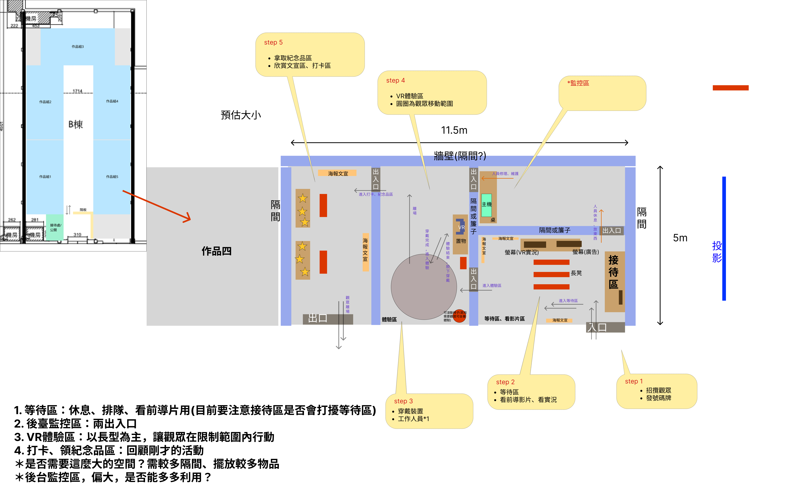

# 音虫 VR｜開發規格

日期：2026-11-18｜版本：VR v0.30

- 適用：Windows Unity＋Meta Quest 3／Touch Plus 的單人 VR。
- 本文件整理本方案已確認的遊戲規則、設備與實作介面。
- 先讀[技術架構](技術架構.md)，資料路徑見[技術流程圖](技術流程圖.md)；未定細節集中於[待確認與驗證清單](待確認與驗證清單.md)。
- 本文為規劃，非已完成實作。

## 1. 功能與遊戲狀態

- 觀眾在展場原地轉身。右手持虛擬捕捉器，左手搖桿控制角色沿長型城市移動。
- 左端為出生位置，右端為虛擬回收站與獨立結尾區；部分房屋可進入。
- 變體、聲音及展後流程依[本週會議紀錄](https://docs.google.com/document/d/1UPgab6DDWDEvj7d_XypOyjKA11wd0t6zCan4WgU-vFs/edit?tab=t.f5j8j833uf1a)與美術配置。畫面與聲音細節見[待確認清單](待確認與驗證清單.md)。

### 音虫與城市配置

[聲音配置表](assets/音虫聲音配置.png) · [城市動線圖](assets/VR城市設計圖.png) · [城市尺寸圖](assets/VR城市設計圖-2.png)

城市外框 65 × 25 m。左端出生，經主街與支路探索，右端回收並前往結尾區。城市圖供尺寸與動線定位。依美術確認的聲音配置圖，A／E 棟可探索 1F 與 2F，D 棟可探索 1F，B／C 棟的音虫在外部循聲捕捉。

| 代號 | 類型 | 來源聲 | 場景掛點 | 素材陣列 Element |
| --- | --- | --- | --- | --- |
| A1 | 海天使 1 | 鬧鐘 | A 棟 2F 房間床頭櫃 | 0 |
| A2 | 海天使 2 | 廣播壞掉 | E 棟 2F 書房桌上廣播 | 1 |
| A3 | 海天使 3 | 警報 | B 棟外側警報器 | 2 |
| B1 | 海蛞蝓 1 | 電視雜訊 | A 棟 1F 客廳電視 | 3 |
| B2 | 海蛞蝓 2 | 飆仔 | E 棟 1F 客廳窗邊，循馬路傳入的聲音 | 4 |
| B3 | 海蛞蝓 3 | 玩具 | D 棟 1F 幼稚園唱歌玩具 | 5 |
| B4 | 海蛞蝓 4 | 冷氣 | C 棟外側冷氣 | 9 |
| C1 | 魟魚 | 下雨 | 戶外雨天點，靠近鐵棚 | 6 |

同時最多 3 群海天使／海蛞蝓，雨天加 1 群 C1。把聲源分在不同方向，避免同棟上下樓的聲音難以分辨。可捕捉聲從掛點發出，戶外活動聲與雨打鐵棚的背景聲另外混音。Source Clips、Variant Prefabs、VariantCatalog 和捕捉成功預覽共用上表的素材索引，7／8 留給舊成果 C2／C3。場景的生成陣列順序見 [U2 固定聲源接線](開發文件/工作包/U2.md#綁定正式城市的聲源)。

### 群落、顯現、進度與 SAN

本階段只實作循聲、照射顯現與捕捉。下文的發聲顯現、麥克風與 AEC／VAD 為後續保留規格，先不做，也不列入當前交付或驗收。

同一變體及點位每場最多使用一次。海天使／海蛞蝓全程可出現。

| 規則 | 內容 |
| --- | --- |
| 群落單位 | 每場單人。point_id 是固定出現區；每點同時最多一個群落，可為單隻或一群，整群只算一次捕捉。<br>個體維持固定小範圍內的活動，類型、變體及判定範圍由配置管理。 |
| 類型與變體 | 海天使 A1～A3、海蛞蝓 B1～B4、魟魚 C1，共 8 款；<br>同類共用基礎外形，以配色或局部造形區分，每個變體都有不同來源聲音與預製聲部。<br>本場可遇到相同類型，但不重複同一變體；按實際回收的變體數量結算，最多 5 群。<br>同群可含多個同變體個體，仍只算一群；暫時隱藏、再顯現或重新對準不算新的出現。 |
| 本場變體去重 | Unity 保存「本場已出現變體集合」；初始化與捕捉後補出群落時，都先排除集合內變體，啟用成功才記入。<br>捕捉／移除群落不清除此集合；暫停、重連及換備機保留，僅本場結束／重置後清除。<br>從本場未使用的有效點位抽取，C1 保留給雨天事件。正式場景各點綁定變體，單場依捕捉速度不保證 8 款全部出現。 |
| 建立群落 | 初始化或捕捉結算後補出群落時，建立 target_instance_id／revision、<br>初始隱藏、播放群落聲音，保留捕捉 Collider。群落存在與畫面顯現分開；短暫現形與隱藏都不建立新身分。 |
| 發聲顯現（後續） | 發聲讓頭戴觀看方向前方互動範圍內仍存在的多群音虫短暫顯現，不限於最近一群，也不需先精準瞄準。<br>沒有捕捉進度時，其效果會逐漸消退回隱藏；發聲不修改捕捉進度、數量或 SAN。 |
| 累積捕捉 | 同群累積有效對準 **3 秒**完成捕捉，時長由配置管理；按累積有效時間提高捕捉進度，音虫依進度連續線性顯現。<br>移開、換群、遮擋、暫停或追蹤／連線無效時，保留原群進度及對應顯現程度；再次對準同群就繼續。捕捉不需按鈕。 |
| 捕捉音量 | 該群音量隨進度降低；移開保留對應音量，再對準接續。成功後停聲；新群以自己的原始音量開始。 |
| 捕捉結算 | 按 session_id＋target_instance_id 保存進度；<br>首次建立 capture_attempt_id，暫停／恢復沿用同筆。<br>驗證完成後停聲、關閉捕捉、收集加一次、扣一次 SAN 並回饋 UI／震動。場景群落退場，精細版顯示於捕捉器螢幕。<br>捕捉器靜音。SAN 大於 0 且海天使／海蛞蝓仍有未出現變體時補 1 群。 |
| 清除與新進度 | 成功／移除／回收結算／本場結束／重置才清除該群進度與顯現基準。同點重新啟用屬新群落，新進度起始為 0；<br>舊收集變體／旋律資料不回寫。 |
| SAN 與結束 | SAN = max(0, 100 − 成功捕捉次數 × 20)。至少捕捉 1 群即可到站回收，最多 5 群。SAN 歸零只停止捕捉與補群。 |

### 隨機出現與數量控制

| 項目 | 採用規則 |
| --- | --- |
| 開場 | 從海天使／海蛞蝓的 7 款選 3 群，分散生成。各群起初隱藏並各自發聲。預設 CaptureLab 固定 1 群在灰盒屋內、2 群在室外。 |
| 同時存在 | 最多 3 群海天使／海蛞蝓。雨天加 1 群魟魚，最多 4 群。隱藏群落計入上限。 |
| 捕捉後補充 | 未達上限時，從未出現的海天使／海蛞蝓補群，使用本場未用點位，最多 3 群。變體或點位用完後保留剩餘群落，引導前往回收。 |
| 生成位置 | 在長型城市有效出現區內分散生成，可包含部分開放建物；避開回收站、結尾區與遮擋死角。 |
| 身分與進度 | 新群使用新身分，進度從 0 開始。已出現變體本場不重複。 |
| 停止條件 | SAN 歸零進 Return，不再補充；暫停／失效期間不生成，恢復時核對既有群落。 |
| 去重 | 同次成功捕捉只結算、扣 SAN 與補出一次；重送不重複生成。補充由 Unity 處理，不是捕捉器發聲造成。 |

- 有效探索第 60 秒開始雨粒子與雨聲，C1 在戶外定點打轉。第 120 秒雨停，尚未捕捉的 C1 退場。C1 一場只出現一次。
- 海天使／海蛞蝓、對應聲源與進度跨天氣保留，仍照常補群。暫停或追蹤失效時停止計時，確認回收或達捕捉上限後結束探索計時。
- 確認回收後，剩餘群落與聲源退場；保留本場實際收集的變體供修復、成果及紀念品使用。

### 場次流程

```text
待機 → 配戴校正 → Intro → Tutorial → Active
→ 在左端開始循聲探索，以左手搖桿移動、右手照射捕捉
→ 遊戲仍在探索時，第 60 秒加入魟魚，第 120 秒雨停且未捕捉魟魚退場
→ 可提前到右端回收站確認；達捕捉上限時只保留前往回收
→ Recycling：登錄收藏 → 金色光球＋城市材質修復，可移動觀看
→ ExitRoute：前往右端結尾定點 → EndingVideo：Unity 淡黑（程式沿用既有狀態名稱）
→ ThankYou：用左手控制器打開感謝信 → Ending：固定成果
→ 本機保存 → 離場交付含成果 QR 的紙票 → 下一場
```

- 感謝信依成功捕捉次數分三版：1、2～3、4～5；VR 與網頁依同一份收藏數選版。
- 離場使用紙票 QR，桌面驗收先用模擬交票。
- 中止場次不產生成功成果；教學不計入正式資料。

### VR 開場、示範與正式探索

| 項目 | 內容 |
| --- | --- |
| Intro | 約 15 秒，沿用前導素材簡述觀眾身分與任務；播放完成後進入 Tutorial。<br>觀眾保持自由轉頭的頭部追蹤視角。 |
| Tutorial | 循聲、自由照射、對準捕捉及回收以字幕搭配動畫示範。本階段教學不含發聲操作。<br>各段呈現完畢後推進，觀眾不需實際捕捉或操作過關。<br>展示物件與 UI 使用教學資料，不送正式捕捉、回收或成果結算事件。 |
| Active | 初始化 SAN 100、空收藏與群落。玩家可在有收藏後前往回收站；達上限停止捕捉。 |
| 暫停與重置 | Intro 播放位置與 Tutorial 段落由同一場次保存；<br>Link／追蹤無效或工作人員暫停時一起暫停，恢復後接續。新場重置開場、教學段落及正式資料。<br>只接受當前階段的播放完成事件；重送不重播、不重新初始化正式資料。 |

## 2. 部署、主要軟體與設備

### PC 執行基線

- 全組統一使用 **Unity 6.3 LTS（6000.3.19f1）＋URP**；開發設備為 2 台 Windows、1 台 Mac M3（Apple Silicon）。
- 正式執行與 Quest Link 實機整合使用 Windows；Mac M3 以電腦模擬開發共用遊戲功能、Gateway 與網頁。
- XR 套件採下表固定版本；起步採 OpenXR＋XRI，不另裝第二套 Meta 相機／互動系統。

### 電腦模擬與頭戴連線

| 模式 | 輸入與開場檢查 | 能驗證的內容 |
| --- | --- | --- |
| DesktopSimulation | 鍵鼠或 XR Interaction Simulator 測試輸入；用電腦音訊輸出。 | 群落、捕捉／Mask、SAN、UI、回收、保存與網頁串接。 |
| QuestLink | Quest 3／Touch Plus 經 USB Link；檢查實際追蹤及頭戴音訊輸出。 | 實際操作、循聲、震動、配戴、邊界及雙眼效能。 |

- 兩種模式共用場次與遊戲規則，只切換輸入／音訊來源；每次僅啟用一種輸入。
- 發聲顯現保留為後續功能。開發除錯鍵與收音範例僅在啟用該功能時測試。
- 模擬通過後，Link、頭戴播放、震動和實機效能仍需獨立驗證；Meta XR Simulator 不列為本版必裝工具。

### 固定開發版本

發聲收音、AEC／VAD 延後實作。以下為選定的開發基線，安裝與實機整合尚需驗證；版本選擇不列為組員討論題。

| 項目 | 採用版本／設定 |
| --- | --- |
| Unity | 6.3 LTS（6000.3.19f1） |
| 套件管理 | web／gateway 統一使用 pnpm 11.9.0，各自提交 package.json 與 pnpm-lock.yaml；與 unity-vr 同一 repo、分資料夾管理。 |
| 收藏票產生 | qrcode 1.5.4、@resvg/resvg-js 2.6.2；Gateway 本機產生 QR 與 SVG／PNG |
| URP | 使用此編輯器範本對應的核心套件版本，隨專案鎖定 |
| OpenXR Plugin | 1.16.1；Windows 啟用 OpenXR Provider |
| XR Interaction Toolkit | 3.3.2；控制器、射線、World Space UI 與震動 |
| Input System | 1.20.1 |
| Meta XR Core SDK | 平台擴充保留版本 207.0；目前 OpenXR 起步範例不安裝 |
| 無頭戴流程測試 | XRI 3.3.2 的 XR Interaction Simulator 樣本；使用 Starter Assets 的 XR Origin |
| 展出作業系統 | Windows 11 Home、64 位元，主機內含授權及安裝；<br>原型以 25H2 為基線，記錄實際出貨版本並驗證 |
| 顯示卡驅動 | NVIDIA Studio Driver 621.14 WHQL，適用 RTX 5060 Ti 候選機 |
| Link 與頭戴系統 | 正式發行通道；首次取得設備時記錄完整版本與測試結果 |

- 展出主機選定為[技嘉平台電馭游俠 II](https://24h.pchome.com.tw/prod/DSAURK-A900J5PWO)：i5-14400F、RTX 5060 Ti 8GB、32GB RAM、<br>1TB SSD、Wi-Fi，含 Windows 11 Home 64 位元及安裝。
- 主機為組裝整機出貨；收到後依隨附金鑰完成 Windows 啟用。
- 選型完成，採購及實機驗證另行完成。

- 建立 Unity 專案時依本表安裝，將 `ProjectVersion.txt`、<br>`manifest.json` 與 `packages-lock.json` 一併納入 Git；<br>依賴套件使用解析後的鎖定版本。
- 每次變更套件、驅動、Link 或頭戴系統後重新驗證。
- 正式接待前確認使用已測組合；頭戴系統若被更新，記錄新版本並重測。

- 版本依據：[Unity OpenXR](https://docs.unity3d.com/6000.3/Documentation/Manual/com.unity.xr.openxr.html)、[XRI](https://docs.unity3d.com/6000.3/Documentation/Manual/com.unity.xr.interaction.toolkit.html)、[Input System](https://docs.unity3d.com/6000.3/Documentation/Manual/com.unity.inputsystem.html)、[URP](https://docs.unity3d.com/6000.3/Documentation/Manual/com.unity.render-pipelines.universal.html)、<br>[Meta Core 207.0](https://developers.meta.com/vr/downloads/package/meta-xr-core-sdk/)、[Windows 支援版本](https://learn.microsoft.com/en-us/windows/release-health/supported-versions-windows-client)、[NVIDIA 621.14](https://www.nvidia.com/en-eu/geforce/drivers/details/283990/)。

- 編輯器版本記錄於 `ProjectSettings/ProjectVersion.txt`；<br>套件版本由 `Packages/manifest.json` 與 `Packages/packages-lock.json` 管理，<br>一併納入 Git，供組員重現相同開發環境。

```text
Quest 3／Touch Plus ↔ Meta Horizon Link ↔ Windows Unity VR
（後續）Quest 3 內建麥克風 → Windows 音訊輸入 → 本機 AEC → VAD／音量／持續時間 → 單次觸發控制 → Unity
（後續）Unity 遊戲輸出混音 → AEC 播放參考
Unity → Link → Quest 3 畫面／內建喇叭；控制器震動
Unity ↔ localhost WebSocket ↔ Gateway／SQLite ↔ localhost HTTP ↔ 本機 Next.js 管理頁
Unity → localhost HTTP／交票狀態 → Gateway（I2 教學範例，需本機驗證金鑰）
Gateway → HTTPS → Vercel Next.js API／Neon PostgreSQL／版本化素材
觀眾手機 → HTTPS → /results/:token
```

| 模組 | 責任 |
| --- | --- |
| Unity 6.3 LTS（6000.3.19f1）、C#、URP、Windows Build Support | 唯一遊戲狀態、雙眼渲染、群落／SAN／回收、音訊及本機暫存 |
| OpenXR、Input System、XR Interaction Toolkit | 頭手姿態、捕捉器射線、UI 選取、追蹤與震動 |
| Meta Horizon Link | Quest 3 電腦連接；頭手輸入由 OpenXR／XRI 處理 |
| 場景射線／光罩投射 | 計算表面落點與法線，更新動態 Mask；群落命中與計時另行判斷 |
| 活動區設定 | 單一城市場景、實際圓形活動區與圈內可操作的回收站 |
| Unity Audio／Audio Mixer | 城市與音虫聲源、遊戲輸出混音。麥克風輸入與播放參考留給後續發聲功能。 |
| 本機 AEC／VAD 音訊處理介面（後續） | AEC 消除自身播放回音；處理後交人聲／音量／時長判斷及單次觸發控制 |
| Node.js 24 LTS、TypeScript、WebSocket | Gateway、管理指令、狀態快照、成果與列印工作 |
| Next.js App Router、React、TypeScript | 必做成果頁／API，以及本機工作人員管理頁 |
| SQLite／PostgreSQL／Web Audio API | 本機與雲端成果、outbox、預製聲部共同時間軸播放 |
| Blender、聲音工具、Git／Git LFS | 模型、動畫、音檔與版本管理 |

- 一台 Windows 展出電腦執行 Unity、Gateway 及管理頁，採雙螢幕延伸顯示：觀眾螢幕播放前導影片；<br>工作人員螢幕顯示管理頁、Unity 遊戲監看與錯誤紀錄。成果 QR 僅印在收藏票上。
- 開發時可在工作人員螢幕使用 Editor／Console；<br>正式 VR 展出以 Windows 執行檔及其錯誤紀錄監看。
- Unity 與 Gateway 同機時走 localhost；<br>Quest 的影像與追蹤走 Link，不能誤寫成經 Next.js／雲端轉送。
- Gateway WebSocket 只傳管理／狀態／成果，不傳逐幀影片或控制器姿態。

- 以 USB Link 連接 Quest 3 與電腦，供實機開發與正式展出。沒有頭戴時，使用電腦模擬模式。
- 電腦使用展場共用 Wi-Fi 連網、上傳成果。
- Link 丟失影響互動；單純網際網路連線中斷只影響成果發布。
- 實際執行模式記錄於版本配置，不能用 Editor Play 的成功推定 Windows 執行檔支援。
- 正式展出目標為 Windows 64 位元 VR 執行檔；同樣須驗證打包後的輸入、音訊、效能、啟動與重置。

- 依固定版本表建立專案，記錄實測 Link／頭戴版本，只啟用一套 Camera Rig；<br>不疊用不同範例的 XR Origin／OVRCameraRig。
- 11/20 前以模擬器測流程。Quest 3、控制器及 Link 線於 11/20 取得，11/24 前用嘉的 Windows 電腦首次實機驗證。

## 3. 場次、活動區與追蹤

- 正式接待以 QuestLink 的實際追蹤座標判定活動圈；DesktopSimulation 僅測試相同邊界邏輯。

| 空間項目 | 原型配置 |
| --- | --- |
| 場地外框 | 約 11.5 × 5 公尺，依目前配置圖估算。 |
| 活動圈 | 直徑 3 公尺、半徑 1.5 公尺；外加 0.5 公尺淨空緩衝，共占直徑 4 公尺。 |
| 圓心 | 以 11/14 實體配置圖的中央 VR 區為準，圓心及隔間尺寸待場勘。 |
| 邊界 | 原型距圓心 1.2 公尺開始提示，超過 1.5 公尺暫停互動；實際依伸手、線材及場勘驗證。 |
| 回收站 | 虛擬城市右端站體，角色靠近並將 Tip 伸入感應區才顯示確認。 |
| 群落 | 在城市有效出現區隨機分散；避開活動圈與回收操作區，不要求真實走到聲源。 |

| 步驟 | 處理內容 |
| --- | --- |
| 1 | 觀眾在小型實體活動區內原地轉身；外圍保留淨空與工作人員看護區。<br>地面標示配合頭戴系統邊界，不在圓內擺回收外殼、桌椅或線材障礙。 |
| 2 | 開場站在圓心校正地面、活動半徑與初始朝向，保存為 physical_layout。<br>虛擬城市另保存 virtual_layout、point_id、聲源及回收站位置；<br>搖桿平移 XR Origin；真實邊界用校正時的本地追蹤座標判定，不使用移動後的世界座標。 |
| 3 | 體驗維持同一長型場景。以左搖桿移動角色，右手探索遮擋與可進入空間。虛擬站體與右端結尾點使用場景座標，不依頭部方向移動。 |
| 4 | 安全範圍使用實際追蹤座標：將頭戴世界位置換回 XR Origin 的追蹤空間後取水平座標，與校正圓心比較。<br>緩衝涵蓋身體、手臂及控制器範圍，不以頭部中心當作全身邊界。 |
| 5 | 接近圓形區邊緣先提示；越界或追蹤無效時暫停遊戲、捕捉、光罩、發聲與群落生成，提示回中心並由工作人員協助。<br>取得有效姿態、回到允許範圍並確認後恢復；不以移動虛擬世界取代真實回中心。 |
| 6 | 摘頭戴、XR 輸入失焦或 Link 中斷時暫停並保留 SAN、收集、各群進度與對應外觀；遊戲暫停不凍結視角；<br>USB Link 中斷時先等待連接恢復，不假設電腦能持續更新頭戴畫面。重連核對原場次及新鮮資料；<br>重設圓心或換機後重新校正活動區，並清除到站資格。 |
| 7 | 管理端依執行模式確認輸入、音訊、活動區與保存服務後建立單一 session_id；<br>配戴後依 Intro → Tutorial → Active 推進。<br>前導在觀眾螢幕播放，頭戴內短版開場約 15 秒，接著觀看操作教學。本階段教學不含發聲操作。 |

- 回收站為同一虛擬場景內的模型，不設可觸碰的實體外殼。
- 場景碰撞不能阻止真實身體走動；活動區、系統邊界、淨空與看護須配合配置。
- 活動區採本節原型尺寸；實際可及範圍列入實機驗證。

## 4. 瞄準、Mask、發聲顯現與自動捕捉

Mask 可落在場景表面或有效群落前方。顯示光罩與累積捕捉進度各自判斷。

| 步驟 | 處理內容 |
| --- | --- |
| 1 | Unity 每幀讀取捕捉器前端位置與方向。優先把光罩放在射線命中的有效群落前方，其次使用場景表面的落點和法線。<br>兩者皆未命中、追蹤失效、越界、暫停或 UI 接管時收起光罩。 |
| 2 | 同一指向另檢查群落 Collider、距離、最近有效目標及環境遮擋。室內群落還須確認玩家頭部位於同一建物的室內區域。<br>在門外即使能直接照到，也只顯示 Mask，不累積捕捉進度。 |
| 3 | 隱藏群落仍保留 Collider、聲源及進度。照射時，顯現程度隨有效捕捉進度增加。 |
| 4 | 有效對準群落時，在該群顯示捕捉進度，虛擬螢幕使用同一份資料。<br>按 session_id＋target_instance_id 累積時間，首次建立 capture_attempt_id，暫停／恢復沿用。<br>只有 Active、SAN > 0、目標及姿態有效、人在活動圈內且未被 UI 接管時才累積。 |
| 5 | 音虫依捕捉進度提高顯現程度。移開或換群時，只暫停原群計時並保留進度及對應外觀；<br>Mask 仍跟著新指向的場景落點移動。再對準同群就接續；UI 操作使瞄準失效時不計時。 |
| 6 | 同群累積達 3 秒後再驗證，關閉該群可捕捉狀態、停聲，記錄一次並扣 SAN，更新 UI 與震動。場景群落退場，精細版顯示於捕捉器螢幕。<br>捕捉器保持靜音，Mask 可繼續照向場景。SAN 大於 0 且海天使／海蛞蝓還有未出現變體、本場還有未用點位才補群。 |
| 7 | 初始化及捕捉結算後補充可在空閒點啟用本場未出現變體的新群，使用新身分／版本及進度 0；<br>不修改既有收藏或旋律配方。重連後先核對場次及取得新鮮姿態，再恢復光罩與捕捉判定。 |

### 光罩呈現與捕捉進度

- 場景射線與群落判定分開處理，避免隱藏群落的 Collider 使光罩停在錯誤表面。<br>以落點與法線驅動光罩投射材質；採 URP Decal 時，場景接收面需符合其非透明材質限制。
- Mask 顯示照射落點；群落側進度與螢幕數值顯示捕捉狀態。<br>Mask 的位置不鎖在群落固定出現點，也不以 Mask 是否顯示來判定捕捉成功。
- 捕捉進度與顯現基準按群保存，移開、換群、遮擋或暫停都保留。<br>只有群落被收走／移除、回收結算或場次結束／重置才清除對應狀態，新群落不繼承舊進度。

### 捕捉進度與聲音

| 項目 | 採用規則 |
| --- | --- |
| 目標聲音 | 捕捉進度越高，該群聲音越小；其他群落與城市環境聲維持原混音。 |
| 原型音量曲線 | `capture_gain = 1 - capture_progress`，進度與係數皆為 0～1。 |
| 聲源輸出 | 該群原始音量乘以捕捉音量係數與室內外音量係數，保留空間音訊的距離與方向感。 |
| 室內群落 | 玩家在該屋外時，室內聲源仍播放，但音量降低，隔牆時加低通濾波。進入該屋後平滑恢復清晰度，保留該群目前的捕捉音量與進度。 |
| 移開／中斷 | 保留同群進度及對應音量；再對準接續變小，不恢復原音量。暫停期間不累積進度。 |
| 發聲顯現（後續） | 只改變顯現效果，不恢復或重設已降低的目標音量。 |
| 成功／新群 | 捕捉完成時停聲並結算。場景群落退場，精細版顯示於捕捉器螢幕。補出的新群進度為 0，使用自己的原始音量。 |
| 資料來源 | 音量係數由 Unity 依已保存的進度計算，不另存獨立音量進度或增加裝置音訊通訊。 |

### 發聲顯現與捕捉進度（後續規劃）

- 捕捉進度與持續顯現基準都以 0～1 表示，`progress_visibility = capture_progress`，採連續線性顯現；<br>例如進度 30% 對應 30% 的顯現基準。移開後兩者保留，短暫發聲效果仍按 max 規則另行合成。

- VOICE_REVEAL 有效觸發後，發聲顯現效果用 **3 秒**由 0 淡入至 1，達到峰值後立即用 **1 秒**淡出至 0，全段 **4 秒**；<br>從有效觸發起算。此時間軸與累積捕捉的 3 秒分開，僅改變短暫發聲效果，捕捉進度顯現基準保留。
- 發聲效果原型採線性時間包絡：觸發後 `0 ≤ t < 3` 時為 `t / 3`；<br>`3 ≤ t < 4` 時為 `4 - t`；`t ≥ 4` 時為 0。最終外觀仍取發聲效果與捕捉進度基準的較高值。

- 發聲作用於目前觀看方向前方互動範圍內仍存在的多群；不需先命中音虫。<br>有效發聲以 3 秒淡入、再用 1 秒淡出，不修改捕捉進度、SAN 或數量。
- `最終顯現程度 = max(發聲顯現效果, 捕捉進度對應程度)`。純發聲且無進度時，效果淡出後回到隱藏；<br>已有進度時只回落到該進度基準。
- 光罩移動、顯現動畫與捕捉計時分開；不等待動畫播完才計時。<br>再次有效對準同群接續累積，沒有有效瞄準資料的時間不增加進度。
- 發聲、光罩移動、短暫隱藏及重新對準都不建立新群落；只有初始化或捕捉結算後補充建立新身分。

## 5. Unity、Gateway 與網頁串接

| 焦點情況 | 處理原則 |
| --- | --- |
| 工作人員切到管理頁 | Unity 啟用 Run In Background；Windows 視窗失焦不直接當作摘頭戴。 |
| 頭戴／XR 執行階段失效 | 摘頭戴、失去 XR 輸入焦點、Link 或追蹤無效，仍暫停互動並保留狀態。 |
| 實機驗證 | 核對管理頁切換時的 XR 焦點及輸入；背景執行設定不取代追蹤有效性檢查。 |

- Unity 是遊戲權威；Gateway 不射線判定、不更改 SAN 或收集。
- 管理頁只提出開始／暫停／恢復／中止／重置等指令，等待 Unity 回覆。
- 網路回呼排入 Unity 主執行緒；UI 切頁本機處理，不經 Gateway。
- I2 教學範例用已驗證的本機 HTTP 查詢同一 result_id 的票面／交票狀態；不以列印已送出替代實際交票確認。

- PC 版 Unity 與 Gateway 使用本機 WebSocket，管理頁需工作人員驗證；<br>依 session_id、revision 與操作識別檢查順序／去重，丟棄過期命令。
- 控制器姿態在 XR Runtime 與 Unity 內處理，不建立每幀 Gateway 請求。
- 一次只接受一套啟用輸入，備用頭戴／控制器不得同時操作。

Gateway 中斷時 Unity 可保留遊戲狀態並暫存成果，結尾等本機保存確認；重連先同步原場次，不自行建立新場次。

音量、控制器與布局只供當下互動；原始觀眾錄音與逐幀移動軌跡不預設保存或上傳。日誌不記完整憑證。

## 6. 聲音、到站授權與回收確認

### 聲音來源與發聲顯現

**發聲顯現本階段先不做。** 後續由觀眾本人發聲觸發顯現，展出流程不設工作人員替代發聲按鈕。實作順序見 [U2 後續流程](開發文件/工作包/U2.md#5-發聲顯現後續規劃本階段先不做)。

- 平時最多 3 群，雨天最多 4 群。城市環境聲另外混音。

- 開場生成 3 群，各自播放可循聲定位的聲音；隱藏中的群落也計入同時存在上限。
- 捕捉後停止該群的捕捉與聲源並扣 SAN。若 SAN > 0 且海天使／海蛞蝓仍有可用變體，就從未出現變體隨機補 1 群，維持最多 3 群海天使／海蛞蝓。

| 來源／操作 | 資料與作用 |
| --- | --- |
| 城市與音虫聲音 | 場景／群落聲源與種類，讓觀眾在音虫隱藏時先循聲探索 |
| 觀眾發聲（後續） | 內建麥克風 → AEC → VAD／音量／時長 → 單次觸發控制 → 既有群落短暫顯現 |
| 遊戲播放參考（後續） | 完整輸出混音送 AEC，抑制收音中的自身播放聲；與觀眾發聲分開處理 |
| 捕捉器對準 | 累積該群進度，外觀逐漸顯現、聲音逐漸降低；移開保留外觀與對應音量 |
| 捕捉成功 | 該群立即停聲並結算，場景群落退場，精細版顯示於捕捉器螢幕。捕捉器以 UI／震動回饋。 |
| 群落補充 | 初始化／捕捉結算後在本場未用點位生成群落，觀眾發聲不觸發 |
| 回收／結尾 | 城市修復演出及依種類組合的預製聲部旋律 |

```text
遊戲輸出混音 → AEC 播放參考
觀眾發聲 → Quest 3 內建麥克風 → AEC → VAD／音量／持續時間 → 單次觸發控制 → VOICE_REVEAL
         → 前方範圍內多群既有音虫短暫顯現 → 隨時間回落至捕捉進度顯現基準
有效對準 → 捕捉進度累積 → 外觀逐漸顯現／該群聲音逐漸降低；移開後保留進度、外觀與對應音量
成功捕捉 → 停聲／SAN 扣一次 → UI／震動 → 場景退場／捕捉器螢幕顯示精細模型
初始化 3 群／捕捉結算後 SAN > 0 → 從本場未用點位隨機補出未出現變體 → 初始隱藏／群落聲音播放
```

- 目前探索範圍由頭戴位置、觀看方向與出現配置決定；同一次有效發聲可讓前方範圍內多群短暫現形，不只選最近一群。
- 觀眾依空間聲源轉頭或轉身，再輕聲呼喚取得既有群落的視覺回應；實際身體仍在圓形活動區內。
- Quest 3 內建麥克風隨身收音，不需要在真實展場找固定收音點。

### 回音消除、有效發聲與單次觸發（後續規劃）

- AEC 播放參考包含捕捉進度造成的實際音量衰減，與最終輸出混音一致。

| 項目 | 內容 |
| --- | --- |
| 本機音訊路徑 | Quest 3 內建麥克風經 Link 送入電腦；<br>本機音訊處理模組先做聲學回音消除（AEC），再做人聲活動偵測（VAD）、音量平滑與持續時間判斷。<br>Unity Microphone 負責取得收音，不代表 AEC 已啟用；<br>AEC／VAD 經本機音訊介面整合，不經 Gateway 或雲端逐段判斷。 |
| 播放參考 | 將送往 Quest 3 內建喇叭的遊戲輸出混音提供給 AEC，涵蓋城市、音虫、旁白與其他遊戲音訊；<br>以完成混音與音量調整後的實際輸出作參考，按音訊時間軸對齊播放參考與收音，抑制麥克風收到的自身播放聲。<br>不可只比對音效名稱或單一音軌，也不以一般音量門檻代替 AEC。每幀音訊僅在記憶體處理，不保存或上傳原始錄音。 |
| 有效發聲 | 對 AEC 處理後的訊號，以 VAD、相對背景音門檻與最短持續時間共同判斷；<br>不做語意辨識，不要求預設台詞或大喊。<br>只有本場 Active、前方互動範圍內存在可回應群落、追蹤／連線及收音處理有效時，才允許 VOICE_REVEAL。<br>VAD 不能單獨排除旁白或其他人的說話。 |
| 一次發聲只觸發一次 | 新發聲達標且觸發控制已就緒時，送出一次 VOICE_REVEAL，立即鎖住本次發聲並開始冷卻。<br>必須在有效收音中確認停聲，且冷卻完成，才重新就緒；開場或重新接入音訊時也先確認有效停聲。<br>同一段持續聲音、殘留回音或重送都不刷新／延長顯現。再次有效發聲可啟動新的有限時長效果，不清除捕捉進度；<br>純發聲效果消退到目前捕捉進度的顯現基準。 |
| 階段與恢復 | 暫停、XR 輸入失焦、追蹤／Link 無效、實際越界或回收階段停用發聲觸發；<br>探索時仍持續播放循聲線索，不因遊戲有聲就整段關閉收音。<br>音訊遺失、AEC 參考缺失或處理未就緒不視為停聲，不重新開放觸發；<br>恢復後先取得有效資料並確認停聲，再接受新發聲。這些處理不修改既有捕捉進度、顯現基準、SAN 或群落數量。 |

### 群落生成

- GROUP_SPAWN 由 Unity 群落管理器處理：開場最多 3 群；捕捉後 SAN > 0 才補海天使／海蛞蝓。第 60 秒獨立加入 C1。<br>驗證本場、Active、未使用位置、同時群數與變體未出現；新 target_instance_id／revision、進度 0。<br>同一事件重送回傳原結果，不重抽變體或重複補出；觀眾發聲不觸發生成。
- 同點同時最多一個群落；有多個外觀個體仍算整群一次捕捉。<br>進入 Return 即停止新群落啟用並取消尚未執行的群落生成。捕捉器及捕捉成功不播放捕捉器音效。

### VR 的發聲位置引導（後續規劃）

- 觀眾先聽音虫的空間聲源，在同一活動圈內轉頭或轉身尋找。
- Tutorial 的發聲步驟只用字幕示意，觀看即可；不要求實際發聲或觸發過關。
- 進入 Active 後才接受有效發聲；字幕提示「輕聲呼喚，看看附近有沒有回應」，並以收音指示回饋。
- 後續以聲源與少量情境提示延續，不要求照固定台詞說話。

- 目前可回應群落由頭戴位置、觀看方向及互動範圍決定，同次發聲可回應多群，不需先精準對準。
- 內建麥克風隨身收音；前方角度／距離與遮擋參數見待確認清單；回應有效範圍內的既有群落；範圍見待確認清單。

### 到站、修復及結尾

| 階段 | 判定與效果 |
| --- | --- |
| 到站 | 在有收藏的 Active 或 Return，角色需靠近右端回收站，且捕捉器 Tip 進感應區才取得資格。仍要通過真實邊界及追蹤檢查。 |
| 確認 | UI 顯示「確認回收」。只接受一次，固定本場收藏、停止捕捉與補群，清理剩餘音虫及聲源。 |
| 修復 | 金色光球覆蓋受損模型，材質由破敗轉為修復。美術在 Blender 設計材質動態，技術在 Unity 接入與依實收調整粒子量。觀眾保留轉向與搖桿移動，修復完成才開放結尾點。 |
| 前往結尾區 | 修復完成才啟用右端回收站附近的結尾定點。角色站進範圍後，由 Unity 淡黑。 |
| 感謝信／成果 | 淡黑完畢後顯示信封，左手控制器點選開信。先播美術交付的拆信影格，再顯示對應本場捕捉數的正文。技術組接播放和完成事件。閱讀完再進入 Ending，固定成果與離場網址。 |

## 7. 場景、美術與虛擬介面



| 交付 | 必要內容 |
| --- | --- |
| 虛擬場景與實際活動區 | 虛擬城市座標與實際圓形活動區、配置版本、地面／圓心／半徑／緩衝／群落與回收站位置 |
| 城市素材 | 3D 建築、環境動態、修復前後、能量轉化物品與特效，圖層分開 |
| 點位與音虫 | point_id、朝向、種類、群落範圍／聲源、初始隱藏、局部活動、發聲短暫顯現、進度對應外觀與保留、群落生成／捕捉／移除 |
| Mask／進度 | 控制器射線落點、法線、大小、柔邊與投射材質；捕捉進度另按群落保存並同步 UI |
| 虛擬捕捉器 | 原型固定右手；左手搖桿移動。首版進場後可直接看到捕捉器狀態。 |
| 回收站 | 虛擬城市右端站體，角色靠近並將 Tip 伸入感應區才顯示確認。 |
| 聲音／網頁／紙本 | 空間聲音、劇情／回收／結尾音效、共同節拍聲部、手機成果、QR 與聲音收藏票 |

介面視覺參考：[主畫面／收藏／回收確認](assets/介面示意/捕捉器介面示意_2026-11-08_v5.png)。數值與圖樣為示例；回收頁顯示當時的 SAN，「類型數」按實際收藏計算，不固定為圖中的 3 類。

| 介面項目 | 操作／顯示 |
| --- | --- |
| 慣用手 | 原型右手持捕捉器，左手搖桿移動。 |
| 另一手操作 | 左手搖桿平移角色；用左手控制器的游標與扳機確認回收、開啟感謝信。操作 UI 時不累積捕捉。 |
| 主畫面 | 虛擬螢幕採 Unity World Space UI：首版主畫面顯示 SAN、目前目標與該目標的捕捉進度。沒有目標時顯示待瞄準。 |
| 收藏分頁（後續） | 收藏分頁只呈現本場已收集變體，每張卡片顯示「音虫圖像、名稱、來源聲音」三項。 |
| 回收確認 | 取得到站資格後顯示「確認回收」。 |
| 顯示範圍 | 不顯示音虫方向、距離或位置雷達；收音與捕捉狀態保留。 |
| UI 接管 | 介面操作期間由 UI 接管輸入，暫停捕捉及 Mask，原群進度、顯現基準與對應音量保留，結束操作後再恢復瞄準判定。 |

- UI 使用實際可讀的頭戴／控制器電量，來源與更新時間需可辨認；無資料顯示未知，不偽造電量。
- 卡片版面與美術配置見討論清單。
- UI、捕捉目標與回收互動不引導觀眾走出實際圓圈；不要把物件擺在需要真實跨步或躲閃才能操作的位置。

依實際執行組合量測雙眼效能、透明材質／粒子、聲音定位及 UI 可讀性；高效能電腦也要實測最重場景。

## 8. 線上紀念品與聲音收藏票

### 頁面與個人旋律

- Next.js 成果頁 `/results/:token` 不需登入或安裝，可離場重開；<br>必備感謝信、成功捕捉次數、類型／變體／群落摘要、修復結果、旋律播放／暫停、載入狀態、複製／分享連結與保存資訊。
- 群落次數不標成音虫個體總數，沒有資料不虛構統計。

- 現行 8 款各有自己的來源聲及一個預製聲部。新素材包使用 prototype-2，舊成果依原版本載入。
- 每場可提前回收，依實際收藏啟用對應數量的聲部；同類型的不同變體仍是不同聲部。
- 不同變體組合可形成不同旋律，相同組合沿用同一配方。
- 音軌共用 BPM、拍號、循環長度與起點，以 Web Audio 同一時間軸播放。
- 保存 recipe_version、素材／音軌版本與編排資料，使離場重開仍是同份旋律；<br>各聲部音色與素材見討論清單。

- 手機版驗證 iOS Safari／Android Chrome；由觀眾點擊啟用聲音。
- 音檔載入失敗、播放失敗、服務離線、成果未同步／尚未就緒、無效／過期連結均有狀態與重試；<br>音訊失敗仍能讀感謝信／摘要。
- 長期保留依預算及服務政策顯示保存或到期資訊。

### 保存、發布及交付

| 步驟 | 處理內容 |
| --- | --- |
| 1 | Unity 固定成果快照、result_id、不可猜測唯讀 token 與旋律配方，寫入執行端持久化暫存／待交付檔案；<br>PC 路徑不是頭戴資料夾。重試沿用相同識別與連結，不用 UI 數值重新拼成果。 |
| 2 | Gateway 在同一 SQLite 交易保存成果、token、配方、outbox 與列印工作，成功回覆 RESULT_SAVED。<br>未保存不得正常重置，失敗維持結尾保存狀態並重試。outbox 是本機待上傳佇列。 |
| 3 | Gateway 用認證 HTTPS 上傳，雲端依 result_id 冪等寫入，成功才標記發布。<br>版本化音軌／美術與成果分開儲存但共同維護，舊配方不可因更新素材而失效。 |
| 4 | 觀眾取下頭戴後取得聲音收藏票，掃票上的本場成果 QR 開啟線上紀念品；QR 僅印在紙票上。<br>結尾、電腦保存與收藏票交付完成後才正常重置，不需等待觀眾掃碼。 |
| 5 | 網際網路連線中斷仍保存／交付固定連結，outbox 復線補傳；<br>雲端還沒該 token 時顯示「成果尚未就緒或連結無效，請稍後重試」，不假裝知道尚未上傳的本機紀錄。<br>觀眾手機不取得遊戲控制權。 |
| 6 | 遊戲重置不刪成果、待交付檔案、outbox 或列印工作。<br>雲端服務獨立於展場主機長期運作，維護成果、配方、音軌版本及舊網址。 |

### 原型線上部署

| 項目 | 原型採用方式 |
| --- | --- |
| 網站與成果 API | [Vercel Hobby](https://vercel.com/docs/plans/hobby) 部署 Next.js，使用個人／非商業原型的免費額度 |
| 成果資料庫 | [Neon Free](https://neon.com/docs/introduction/plans) 提供 PostgreSQL，保存成果、唯讀 token、收集摘要及旋律配方 |
| 預製音軌與美術 | 隨網站部署至版本化 `public/assets/<版本>/`；更新時保留既有成果需要的素材版本 |
| 本機服務 | Unity、Gateway、SQLite 與管理頁留在展場電腦；即時互動不依賴雲端 |
| 上傳與讀取 | Gateway 經認證 HTTPS 上傳，Next.js API 冪等寫入 Neon；<br>觀眾只用 token 讀取成果，資料庫憑證留在伺服器 |
| 成果網址 | 使用固定 Production 網址，紙票 QR 使用本場唯讀 token，補印沿用相同連結 |
| 原型備份 | 保留本機 SQLite 成果、票面與版本素材；原型測試完成後匯出備份 |

- `public` 只放部署前準備的素材；每場動態成果存 Neon，本機列印票面由 Gateway 保存。
- 免費服務的額度與休眠喚醒以官方方案為準；驗證首次載入、上傳重試及網站用量。

### 聲音收藏票與 USB 列印

- 取得方式：優先借用；<br>核對借用型號的 80 mm 紙寬、自動裁刀、USB、Windows 11 驅動、電源及線材。

- 每場交付一張 80 mm 紙寬的黑白聲音收藏票。
- 上方以本場實際收集的變體組成主圖，下方列出各變體的名稱與來源聲音，底部放同一成果的 QR Code，<br>掃碼開啟 Next.js 感謝信、摘要與個人旋律。

- 主圖使用預製黑白圖像，由 Gateway 依固定成果排版組合；同一成果固定組合順序並保存票面，補印沿用原圖。
- 黑白圖像以輪廓、眼形或紋理區分同類變體，清單保留名稱與來源聲音。

[聲音收藏票版面示意](assets/紀念品示意/聲音收藏票_2026-11-08.png)

| 步驟 | 處理內容 |
| --- | --- |
| 1 | Unity 固定本場成果並完成本機保存後，Gateway 依相同 result_id／token 產生票面；<br>保存票面圖像及版面版本，補印沿用原圖與網址。圖像、清單及 QR 均取自同一固定成果，避免混用不同場次。 |
| 2 | 結尾交付階段，由 Gateway 將票面送至 Windows 列印佇列，透過 USB 連接具自動裁刀的感熱印表機，完成列印、送紙與裁切。<br>觀眾取下頭戴，工作人員清潔設備。觀眾前往打卡區領取印有個人成果網頁 QR Code 的成果票及觀看製作展示。 |
| 3 | 每份成果在本機保存時預設建立一筆持久化列印工作，記錄待列印、已送出及失敗狀態；管理端可查看及補印。<br>Windows 接受工作不代表觀眾已取票，出紙異常或狀態不明時由工作人員核對，不因重送自動多印。 |
| 4 | 缺紙、卡紙或 USB 斷線時保留工作及成果；修復後由管理端補印，沿用同一票面與成果 QR。<br>不重新結算或重播遊戲；本機保存、結尾與交票完成後才正常重置。<br>成果可繼續背景上傳，列印工作不隨場次清除。 |

- 紙票輸出由電腦直接控制印表機，不另設 Arduino／ESP32、NFC 寫入器或出物馬達。
- 設備含印表機、相容紙捲、電源與 USB 線，外殼保留出紙口、換紙及維修空間。

## 9. 事件與資料模型

| 資料 | 用途 |
| --- | --- |
| session_id | 本場唯一識別，拒絕上一場延遲要求 |
| layout_id／配置版本 | 核對單一城市場景、回收站位置與實際活動區；不混用不同配置座標 |
| point_id | 虛擬城市中的固定群落出現區 |
| target_instance_id／capture_attempt_id | 當次生成群落／該群捕捉紀錄，暫停沿用、新群重建 |
| mask_hit／capture_target | 目前場景落點／法線與目前群落目標，逐幀更新且分開判斷，不經 Gateway 轉送 |
| 音虫類型／變體設定 | 同類可共用模型與動作。各款對應名稱、來源聲、收藏圖及聲部。正式場景點位綁定變體代號 |
| 本場已出現變體集合／收集卡片資料 | Unity 排除本場重複變體；已收集變體保存圖像、名稱與來源聲音；總捕捉群數另存，供介面與成果使用 |
| 存在群落集合／生成數量 | Unity 統一計數，一般音虫上限 3 群，雨天加 1 群 C1。隱藏群落也計入。 |
| capture_progress／progress_visibility／voice_reveal | 同群捕捉進度、與進度相等的線性顯現基準及短暫發聲效果；最終外觀取兩者較高值，移開不清除前兩者 |
| capture_gain（派生值） | `1 - capture_progress`；只作用於該群聲源，從既有進度重建，不另存可分歧狀態。 |
| audio_ready／speech_latched／cooldown_until | 收播與 AEC 處理有效、本次發聲是否已觸發、冷卻截止時間；停聲與冷卻都成立才重新就緒 |
| result_id／唯讀 token／recipe_version | 同一成果保存、補傳、去重、重開與相同旋律 |
| 收藏票版面版本／票面圖像／列印狀態 | 保留同份成果的列印內容，管理待列印、已送出、失敗與人工補印 |
| revision／操作識別 | 狀態順序與去重；只在需要的程式模組中使用，不額外編列控制器硬體標籤 |

| 方向 | 事件／資料 | 作用 |
| --- | --- | --- |
| 管理頁 → Gateway → Unity | SESSION_START／PAUSE／RESUME／ABORT／RESET | 單一場次控制，等 Unity 確認 |
| XR Runtime → Unity | 頭手姿態、追蹤／XR 輸入焦點／Link 狀態 | 應用內更新，不逐幀送 Gateway |
| Unity 內部 | TARGET_ACQUIRED／TARGET_LOST、CAPTURE_PROGRESS／CAPTURE_RESULT | 目標、顯隱、同群累積時間、SAN／收集、UI／震動 |
| Unity 內部 | VOICE_REVEAL | 經 AEC／VAD 與單次觸發控制確認的有效發聲；<br>帶本場／探索區／前方既有群落集合，單次可回應多群、有限時長、不改捕捉進度／SAN／群落數量 |
| Unity 群落管理器 → 群落系統 | GROUP_SPAWN | 初始化、有效捕捉結算或雨天開始時提出。驗證 Active、SAN > 0、本場未用點位、一般 3 群及雨天 4 群上限及本場未出現變體；同次捕捉不重複補出。 |
| Unity 內部 | STATION_VISITED／RECYCLE_AUTHORIZED／RECYCLE_REQUEST | 近距離到站、自動顯示確認、回收單次結算 |
| Unity → Gateway | STATE_SNAPSHOT | 階段、SAN、群落／進度、追蹤／活動區、回收、可讀電量與版本 |
| Unity → Gateway | RESULT_READY | 固定成果、token、配方與素材版本 |
| Gateway → Unity | RESULT_SAVED | 已持久化本機保存，不表示雲端已發布 |
| Gateway → 雲端 | RESULT_UPLOAD／ACK | 同 result_id 重試，成功才完成同步工作 |

另有 Unity 內部 PLAY_AREA_WARNING／EXIT：接近邊界提示；越界時暫停捕捉、光罩與到站判定，保留進度。

- 瞄準資料使用 XR Runtime 當前幀與有效姿態；過期、重連前殘留或暫停期間資料不計時。
- 若出現非同步外部輸入，固定 schema／時間對應，不直接比較不同裝置原始時鐘。

- Unity 保存即時場次／已出現變體集合／群落／各群進度／SAN／收集／到站／回收；執行端暫存固定成果；<br>Gateway 保存成果、outbox 及收藏票列印。
- 設定檔保存布局、輸入、素材及版本。
- 重送不能重扣 SAN、重複震動、重複啟用群落、重複回收或列印。

## 10. 異常與備援

| 情況 | 處理 |
| --- | --- |
| 移開／換群／目標被遮擋 | 暫停原群捕捉，保留進度、對應外觀與音量；Mask 隨新的有效場景落點移動，再對準同群接續 |
| 無表面與有效群落落點／UI 接管 | 收起 Mask，保留捕捉進度。 |
| 音虫隱藏／新群取代舊群 | 隱藏保留聲源／Collider；新群驗身分與版本，拒絕舊完成事件 |
| 摘頭戴／XR 輸入失焦／Link／控制器追蹤遺失 | 暫停遊戲、捕捉／群落生成，保留已確認狀態；新鮮姿態及原場次核對後恢復 |
| 接近圓形邊緣／越界 | 先提示、越界暫停；保持原群進度，由工作人員協助回到實際圈內 |
| 備機接手／重新校正 | 停舊輸入，保留群進度／SAN／收集，清瞄準及到站；核對配置再接續 |
| 重複開始／回收／重送 | 只允許一場，回傳原結果，不重扣或重演 |
| 未具回收資格 | 未捕捉、尚未到站或不在 Active／Return 時，不開確認並顯示原因。移開捕捉器時保留有效到站資格。 |
| SAN 歸零（捕捉上限） | 正常停止捕捉、引導回收，不中止或自動結算 |
| 麥克風無資料／音訊權限錯誤（後續） | 顯示未就緒、檢查裝置與路由，不把缺資料當作觀眾安靜 |
| 系統聲音漏入麥克風（後續） | AEC 以實際播放混音作參考，處理後再做 VAD／門檻與單次觸發；同一聲音不延長效果 |
| AEC 參考缺失／音訊處理未就緒（後續） | 停用發聲觸發並顯示收音未就緒，缺資料不算停聲；恢復後確認有效停聲再重新就緒，保留捕捉進度與顯現基準 |
| Gateway／本機通訊中斷 | 保留 Unity 狀態／待交付成果；恢復原場次，結尾等本機保存確認 |
| 網際網路連線／雲端失敗 | 本機成果／outbox 保留，交固定連結並補傳，網頁可重試 |
| Unity 當機／Editor 停止 | 先停入場，讀回已存成果；只依可核對快照恢復，無法恢復則中止，不用 UI 數值造成功成果 |
| 頭戴低電／過熱／控制器電池不足 | 暫停、充電／換機或中止，已存成果不刪除；USB 連接不等於可持續滿電 |
| 保存／重置失敗 | 停止下一場，先排除再回報 EXHIBIT_READY |
| 網頁音軌／列印失敗 | 文字成果可讀、音訊可重試、紙本可補印，不重新結算 |

VR 不需把真實回收外殼對齊虛擬站；操作區及線材管理須按真實追蹤空間驗證，虛擬城市 Collider 不保護真實身體。

## 11. 管理與結束重置

- 管理頁顯示單一場次、啟用頭戴／輸入、Link／追蹤、活動區／場景／回收站位置、可讀電量、群落／進度、SAN、到站／已回收、成果保存／同步及收藏票列印狀態。<br>後續啟用發聲功能時，再加入收音／AEC 就緒及發聲鎖定／冷卻。
- 提供開始、暫停／恢復、中止、備機接手、布局檢查、測試點位、重置及補印，限工作人員使用。

**正常重置順序**

| 步驟 | 系統處理 |
| --- | --- |
| 1 | 成果本機保存 |
| 2 | 完成結尾、列印並交付含成果 QR 的收藏票；列印異常先補印交票 |
| 3 | 撤銷本場操作 |
| 4 | 清 Intro／Tutorial 段落／群落／聲源／Mask／發聲短暫效果／發聲鎖定與冷卻／進度與顯現基準／<br>SAN／收集／待執行生成事件／到站及已回收 |
| 5 | 保留布局／成果／待同步工作 |
| 6 | Unity 回覆 EXHIBIT_READY |
| 7 | 才開下一場 |

- 中止另存必要故障紀錄，不標成功。

- 啟動確認 Gateway／SQLite、音訊、Unity／目前輸入模式與管理頁；<br>未知設備／追蹤／布局狀態不開場。
- 監看使用同一遊戲或受支援鏡像，確認電腦視窗與頭戴內的遊戲階段一致。
- 版本、錯誤與重啟程序記錄於操作手冊，不記完整 token／憑證。

## 12. 開發文件與驗收

| 項目 | 採用安排 |
| --- | --- |
| 測試目標 | **2026/12/8** 捕捉主功能 → **2027/1/7** 桌面可試玩 → **1/31 Windows Alpha**；整合實際美術、成果頁及票面檔。 |
| 開發成員 | 2 台 Windows、1 台 Mac M3；Mac 使用 Apple Silicon 版 Editor。C# 以入門起點教學。 |
| 分工 | 工作包由成員認領，每包確認一位主責與本次交付範圍，由主責開發、自測並記錄結果；三人前期均可投入 Unity。 |
| 串接順序 | 先約定成果資料，核心流程可玩後再接 Gateway／Next.js；網站仍為必要功能。 |
| Windows 整合 | 使用 Windows 設備實測；各工作包主責共同整合與除錯。 |

| 開發入口 | 內容 |
| --- | --- |
| [開發文件](開發文件/README.md) | 教學順序、環境、範例、Unity、Gateway、Next.js 與驗收。 |
| [工作包與認領](開發文件/01_工作包與認領.md) | 功能、前置、交付及認領欄位。 |
| [里程碑與美術期限](開發文件/02_里程碑與美術期限.md) | 依 PM 時程安排工作包、美術、Alpha 測試與展前交付。 |
| [網頁開發慣例](開發文件/共用/網頁開發慣例.md) | 目錄、型別位置、UI／HTTP 套件使用方式。 |

### 功能驗收條件

- 下表是既定規則的驗收標準，不是待決策項目。
- 通過結果依實作測試紀錄；必要實機測試見[待確認與驗證清單](待確認與驗證清單.md)。

<details>
<summary>展開功能驗收表</summary>

| 功能 | 驗收條件 |
| --- | --- |
| VR 開場階段 | 配戴校驗 → 約 15 秒 Intro → 觀看 Tutorial → Active；<br>正式 SAN 100／空收藏，暫停保留開場位置與教學段落；完成事件重送不重新初始化。 |
| 教學與正式數據 | 教學只播放循聲、照射、捕捉與回收示範。展示資料不寫入正式 SAN、進度、收藏、旋律或成果。 |
| 任務與 SAN | 至少捕捉 1 群可回收，至多 5 群；SAN 從 100 起算，每群扣 20。驗收 1、2～3、4～5 群三版感謝信。 |
| 自動捕捉與 Mask | 同群累積有效對準 3 秒完成；場景 Mask 與群落判定分開，沒命中群落不累積；<br>UI 接管／失效時暫停，保留原進度與外觀。 |
| 顯現與捕捉進度 | 照射時，場景中的正式簡化材質版隨捕捉進度顯現。移開、換群或中斷保留進度與相應外觀。成功立刻停聲並結算，場景群落退場，捕捉器螢幕顯示同造型的精緻材質版。兩版可共用網格。 |
| 捕捉音量 | 隨同群進度降低，移開／恢復後維持相同係數；發聲不重設音量，其他群不受影響，新群原始音量不繼承舊值。 |
| 循聲與數量 | 平時最多 3 群 A／B。第 60 秒 C1 加入，最多 4 群。第 120 秒雨停且未抓的 C1 退場，其他群落進度與聲音保留。 |
| 發聲觸發（後續） | 同一段發聲只觸發一次；有效停聲與冷卻都完成才重備，缺資料不算停聲；持續聲音／重送不延長效果。 |
| 群落生成 | 初始化最多 3 群；捕捉後 SAN > 0 才補一般群落。驗證本場未用點位、平時 3 群及雨天 4 群上限、未出現變體及事件去重；新群進度 0。 |
| 回收退場 | 以 1 群提早回收，剩餘群落與聲源清除，晚於 1 分鐘也不觸發雨天。 |
| 控制器與到站 | 開場選慣用手，另一手游標＋扳機操作；到站由頭戴距離與捕捉器前端判定，遠距射線不授權；<br>移開保留資格，重校正／換機清除。 |
| 收藏卡片（後續） | 只呈現本場已收集變體的圖像、名稱、來源聲音；不列單卡群數，同類不同變體可分別收藏。 |
| 事件與重連 | 只接受本場啟用輸入及新鮮資料；過期事件不計時，重送不重扣 SAN、震動、啟用群落、回收或列印。 |
| 成果保存 | 固定同一 result_id／token／配方；本機持久化成功才正常重置，outbox 復線補傳；<br>RESULT_SAVED 不等於雲端已發布。 |
| 線上紀念品 | 每個已收集變體啟用一個聲部；BPM／拍號／循環起點同步；相同成果重開沿用配方與素材版本，音訊失敗仍可讀摘要。 |
| 收藏票與列印 | 本場已收集變體黑白組合圖＋名稱／來源聲音清單＋成果 QR，每場一張，QR 僅印在紙票上；<br>保存票面後列印，故障保留成果與工作，補印沿用同一票面與連結。 |
| 結束與重置 | 修復後前往右端結尾定點 → 自動淡黑 → 左手開信並讀完。成果保存及紙票交付後重置。 |

</details>

## 13. 來源與技術參考

- [Meta Link 開發](https://developers.meta.com/vr/documentation/unity/unity-link/)：PC VR 執行、開發功能與限制。
- [Unity XR Interaction Toolkit](https://docs.unity3d.com/Packages/com.unity.xr.interaction.toolkit@3.3/manual/index.html)：控制器射線、UI 與震動。
- [Meta 邊界](https://developers.meta.com/vr/documentation/unity/unity-ovrboundary/)：活動區與系統邊界職責。
- [Unity Microphone](https://docs.unity3d.com/6000.3/Documentation/ScriptReference/Microphone.html)／[Next.js](https://nextjs.org/docs/app)／[Web Audio API](https://developer.mozilla.org/en-US/docs/Web/API/Web_Audio_API)：收音與必要線上成果。

完整連結見[重要連結](重要連結.md)。本機 VR 圖稿為本版依據，Figma 保持既有版本。
