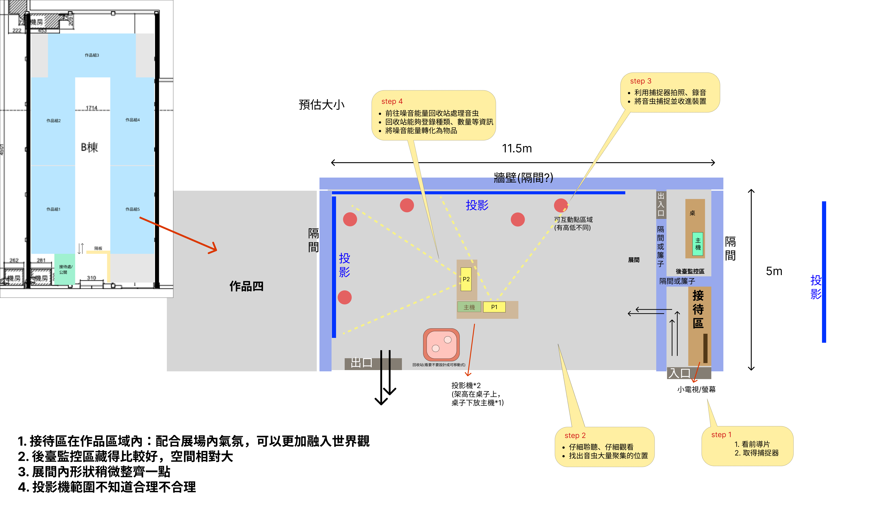

# 音虫互動投影技術架構

日期：2026-11-01

版本：v1.15

用途：供組員了解作品運作方式、軟硬體分工與交付內容。本文件描述規劃架構，不代表已完成實作。

圖解見[技術流程圖](技術流程圖.md)，開發細節見[開發規格](開發規格.md)，參考資料見[重要連結](重要連結.md)。需求討論、零件選型與技術驗證統一收錄於[待確認與驗證清單](待確認與驗證清單.md)。

## 1. 專案概述與功能範圍

本作品為單人城市互動投影。觀眾觀看前導、領取無線捕捉器，在 L 形兩面投影間自由走動，聆聽城市聲音、發聲擾動音虫，持續對準同一群音虫一段時間，辨識有效且達設定時間後自動捕捉，不需按鈕。

一小群音虫在固定出現點周圍的小範圍快速、不規則亂動，視覺近似布朗運動；每點附近設一顆固定紅外線發射燈。Unity 協調音虫與燈的出現／消失，音虫畫面只同步生成／消失，不跟隨識別編碼閃爍；燈啟用期間各點以不同的紅外線亮暗編碼提供身分，捕捉器解碼後判斷是否對準。每次成功捕捉整群收走，SAN 扣一次；SAN 達限制即停止捕捉、前往回收。

NFC 感應成功後，回收資格保留到本場回收或結束；觀眾可移開捕捉器，再按其確認按鈕完成回收，由兩面主投影呈現回收、轉化與城市修復。每位完成體驗的觀眾取得線上紀念品，包含感謝信、收集摘要與個人旋律，離場後仍可開啟。

## 2. 系統連接架構

```text
Unity → 本機串接服務 → 固定燈控板 → 各點紅外線燈
紅外線相機 → ESP32-S3 捕捉器：點位辨識／LCD／震動／聲音
                            ↕ 展場 Wi-Fi
本機串接服務（Gateway） ↔ Unity：音虫／SAN／投影／聲音／回收
捕捉器 NFC 標籤 → 回收座讀取器 → 回收座 ESP32 → Wi-Fi／Gateway

現場麥克風 → 音訊介面 → Unity 分析 → 既有音虫擾動
捕捉成功 → Unity 捕捉噪音事件 → 音響播放／新音虫生成控制
捕捉器確認按鈕 → Wi-Fi／Gateway → 回收確認事件 → Unity 檢查本場回收資格／階段 → 結算及演出
Unity 成果 → Gateway 保存／上傳 → 雲端資料與音樂素材 → Next.js 線上紀念品網頁
```

本機串接服務（Gateway）是展場電腦上的程式，連接捕捉器、燈控板、回收座與 Unity，並處理成果同步。Unity 統一決定捕捉、SAN 與回收結果；裝置回報操作，收到確認後提供回饋。

即時互動在展場區域網路完成，雲端負責離場成果。外網中斷時保存本機成果，復線後上傳。

## 3. 主要開發軟體

| 軟體／技術 | 用途 |
| --- | --- |
| Unity、C# | 音虫、捕捉、SAN、雙投影、聲音、回收與城市修復 |
| ESP32 韌體、相機驅動 | 紅外線光點讀取、點位辨識、LCD、回收確認按鈕、震動與音效 |
| 固定燈控韌體 | 輸出各點紅外線識別編碼，控制啟用／停用並回報執行狀態 |
| Node.js、WebSocket | 本機串接服務、裝置雙向通訊、場次與成果同步 |
| Next.js、React、TypeScript | 線上紀念品、成果 API 與本機管理頁 |
| SQLite／PostgreSQL、Web Audio API | 本機紀錄、雲端成果與預製音軌播放 |
| Blender、聲音工具、Git／Git LFS | 美術、聲音素材與版本管理 |

## 4. 設備與展場配置



圖示估算範圍約 **11.5 × 5 公尺**，為配置示意。長牆與側牆構成 L 形投影；右側接待與後台，中央為 P1／P2 投影設備，回收座靠近左下出口。

| 設備 | 用途 |
| --- | --- |
| Windows 主機、獨顯及管理螢幕 | 執行 Unity、Gateway、音訊與管理介面 |
| 兩面主投影、幕面與支架 | 城市場景、音虫及回收／轉化／城市修復演出 |
| 無線捕捉器（2～3 支輪替，每場啟用 1 支） | 原型主板／螢幕候選為 Sunton 4827S043 系列；搭配紅外線相機、回收確認按鈕、震動、聲音與電池 |
| 各點紅外線燈、驅動及固定燈控板 | 對應音虫出現點的光學訊號 |
| NFC 回收座 | 捕捉器貼被動式標籤，座端讀取器與 ESP32 回報感應；演出由兩面主投影呈現 |
| 分享器、主機有線網路及外網 | 本地互動與雲端成果同步 |
| 麥克風、音訊介面及喇叭 | 現場收音、城市聲音與互動回饋 |
| 電源、充電設備、支架及線材 | 設備供電與展場布線 |

## 5. 點位識別與捕捉流程

1. **點位設定：**如 A01、B01，對應牆面、紅外線燈及音虫群落。
2. **呈現與燈控：**Unity 協調音虫出現／消失與該點紅外線發射燈的狀態。
3. **辨識與對準：**捕捉器讀取各點不同的紅外線閃爍編碼，取得點位與牆面，再依光點與瞄準中心的偏移判斷是否鎖定。
4. **自動捕捉：**持續對準同一群音虫，系統辨識有效目標後自動累積進度，LCD／投影同步顯示；達設定時間且群落仍有效才結算，不需按鈕。移開或改對其他目標時進度歸零。
5. **回饋：**成功後整群消失、SAN 扣一次，LCD 更新並提供震動及聲音；無有效目標則提示重新對準。捕捉器產生的噪音促使新音虫誕生；同一點可再次出現不同種類，以新群落身分判定，點位編碼不隨種類改變。

捕捉以固定小範圍內的群落為單位，紅外線燈位置不隨個體亂動改變；不逐像素追蹤群內個體。觀眾可自由選擇操作位置，捕捉期間維持穩定瞄準，不需站在固定地點。每點編號對應所屬牆面，裝置不以光點在相機中的左右順序當永久編號。

## 6. 聲音、NFC 回收與紀念品

| 環節 | 運作方式 |
| --- | --- |
| 聆聽與發聲 | 預製城市聲音引導探索；麥克風經音訊介面送入 Unity，分析音量與持續時間，觸發既有音虫在固定小範圍內的擾動 |
| 捕捉回饋 | 成功後整群收走、扣一次 SAN 並震動；音響播放代表捕捉器產生的噪音，該事件促使新音虫誕生 |
| NFC 到站 | 座端讀取捕捉器標籤，經 ESP32、Gateway 傳給 Unity，建立本場回收資格；移開後仍保留，到本場回收或結束時清除 |
| 回收與修復 | 感應後可移開，再按捕捉器確認按鈕；Unity 檢查本場回收資格，結算後標記已回收，並由兩面主投影播放回收、轉化與城市修復 |
| 線上紀念品 | Next.js 顯示感謝信、收集摘要與個人旋律，成果連結可離場重開 |
| 實體列印（選配） | 列印紀念品及同一成果 QR Code，線上成果不依賴列印設備 |

觀眾聲音由麥克風分析，只擾動既有音虫；捕捉器噪音由 Unity 在捕捉成功後觸發，可交由現場音響播放，並進入新音虫生成控制。新音虫誕生由該次捕捉噪音事件驅動，與觀眾聲音造成的擾動分開處理。精神啃食就是成功捕捉後扣除 SAN，防護器具損害以成功捕捉時的震動呈現，不另設耐久度或削弱捕捉能力。Unity 的音虫控制模組處理生成、活動與消失，聲音事件與群落、燈控狀態使用同一份遊戲資料。回收操作與 NFC 到站判定分開處理，回收確認不等同捕捉操作。

每支捕捉器的設備編號對照其 NFC 標籤，用來確認到站的是本場使用的捕捉器；回收資格只記為本場「已感應」狀態。SAN 與收集資料由 Unity／本機資料庫管理；標籤不儲存成果，也不提供充電。個人旋律依收集種類組合預製音軌，不同種類音虫各對應一個聲部。

## 7. 美術與網頁交付需求

| 項目 | 交付內容 |
| --- | --- |
| 城市與雙牆畫面 | 各牆比例、場景、接縫與固定出現點 |
| 音虫 | 種類、群落外觀、固定小範圍內快速不規則運動、出現／消失及捕捉動畫 |
| 實體安裝 | 發射燈固定、走線、捕捉器外殼與 NFC 感應位置 |
| 捕捉器 UI | SAN、搜尋、鎖定、捕捉進度、成功、失效、電量及回收確認提示 |
| 聲音 | 城市、音虫、操作與捕捉器噪音音效，以及各種類對應的預製旋律聲部，音軌使用共同節拍 |
| 線上紀念品 | 手機版感謝信、收集摘要、旋律播放、成果 QR 與狀態提示 |

## 8. 場次與資料流程

準備 2～3 支捕捉器，每場由管理端選定並啟用一支，其他待機。換備機時停用舊機操作、保留收集紀錄並清除捕捉進度與 NFC 已感應狀態；新機須重新感應。結尾與成果 QR 交付完成、本機成果保存成功後才重置並開放下一場。Unity 是狀態來源，裝置不自行修改 SAN 或收集數量。

Gateway 保存 Unity 提供的每場成果與同步佇列，遊戲重置不刪除紀念品。觀眾以獨立成果 QR Code 開啟唯讀網頁，雲端服務讓展場主機關機後仍可查看成果，並以長期保留為服務目標。管理頁供工作人員查看連線、電量、場次、回收與成果同步狀態。
