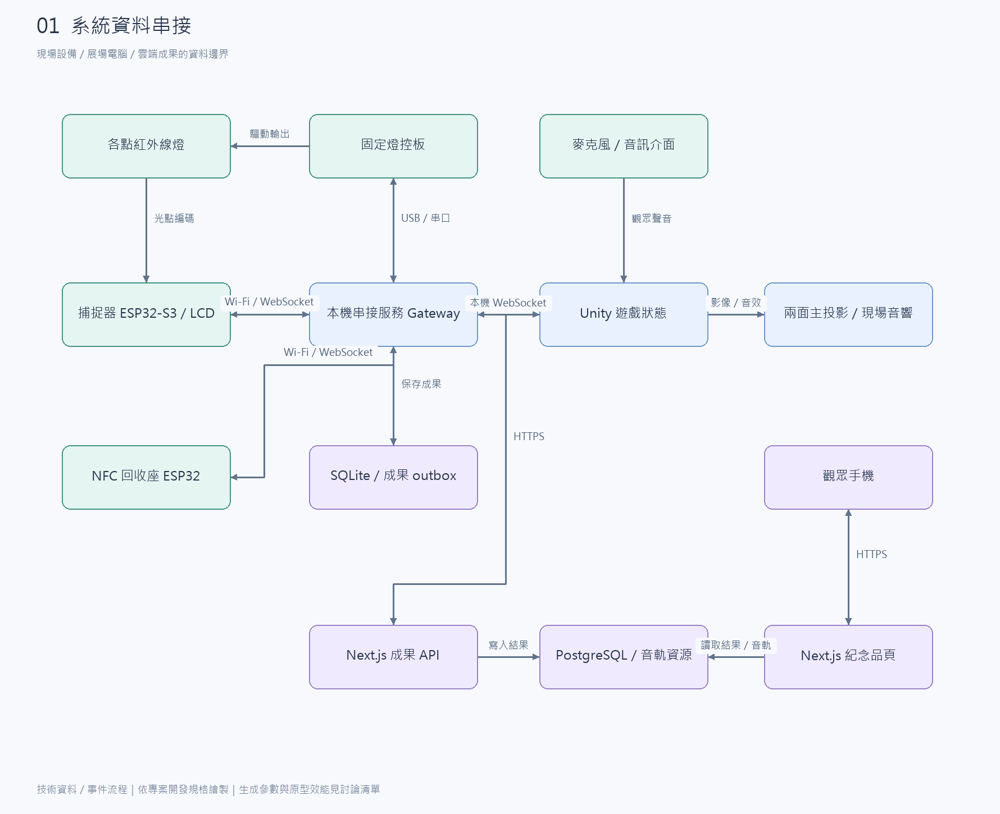
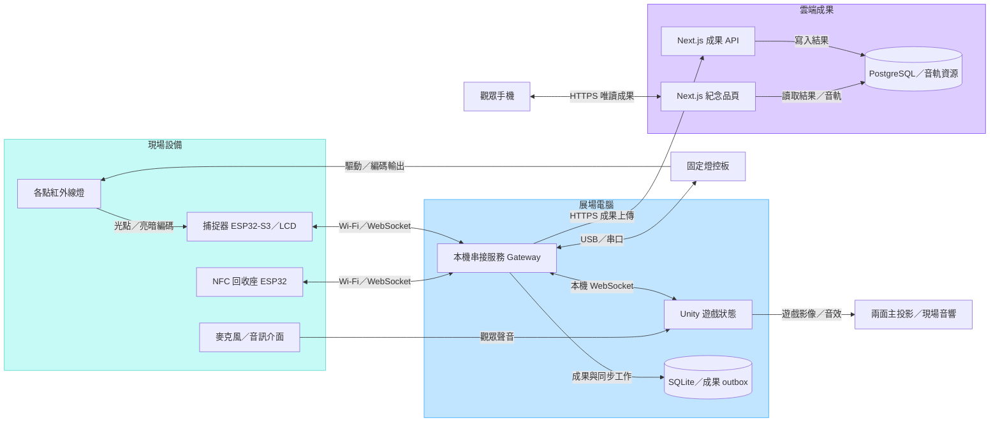
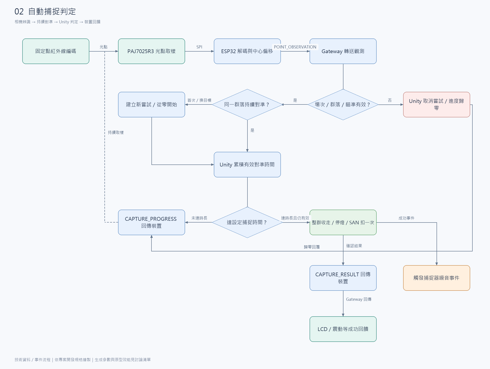
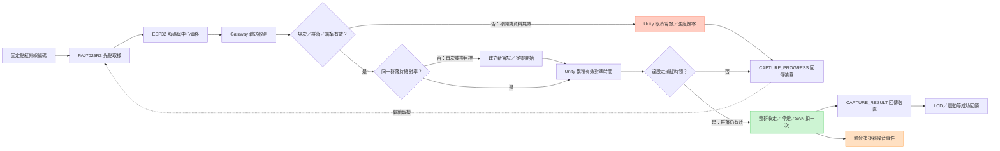
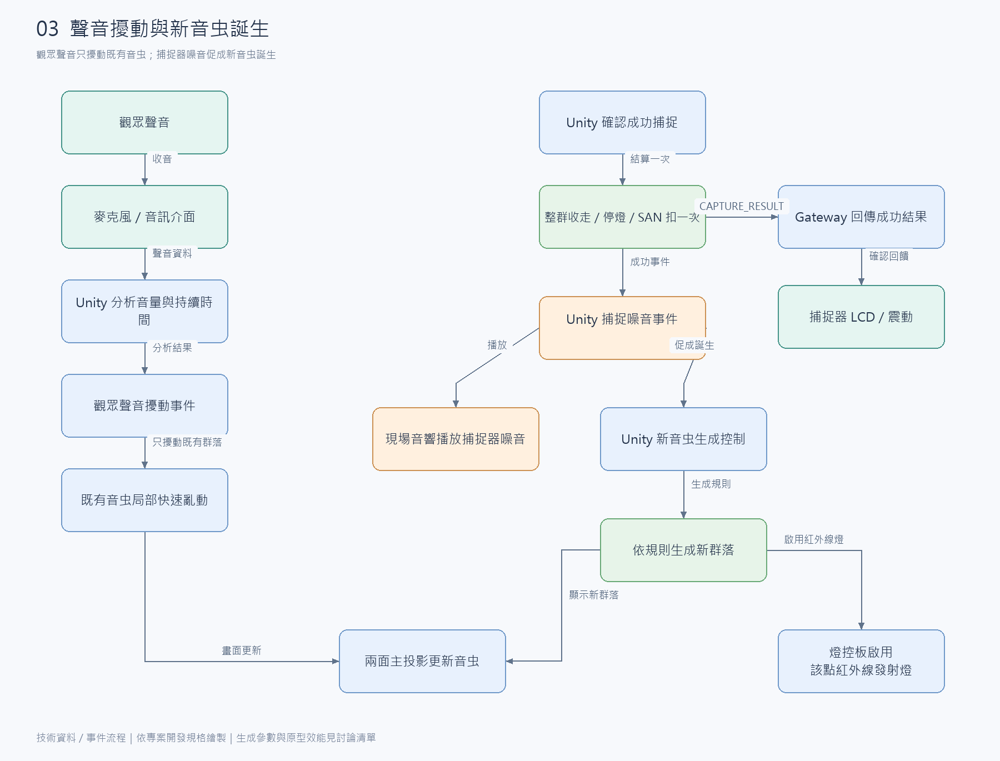
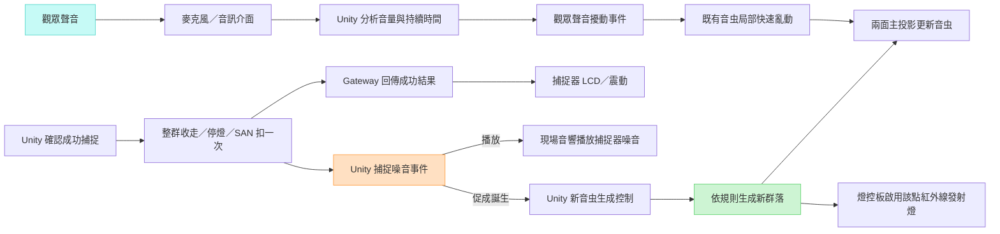
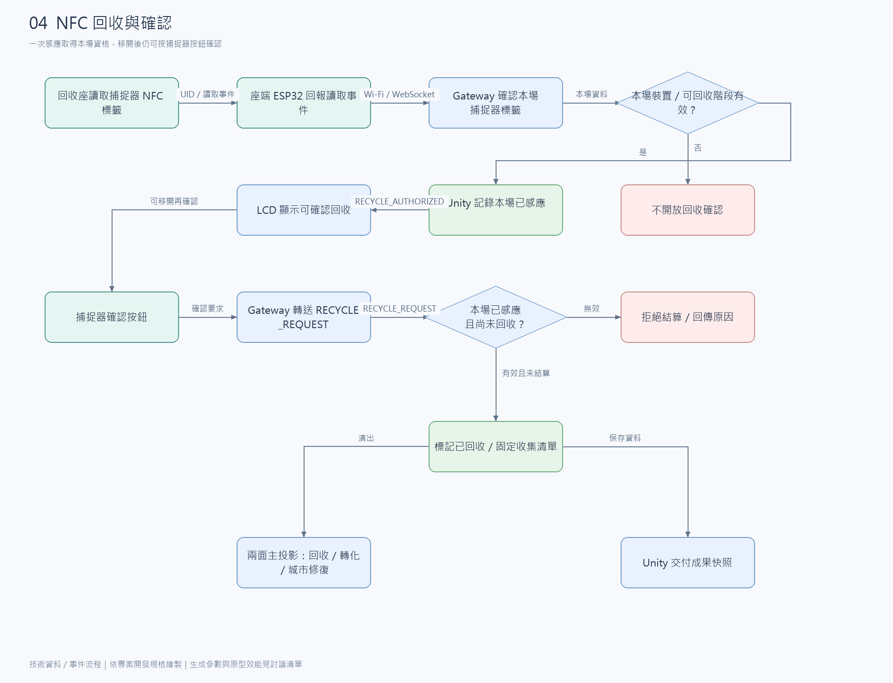
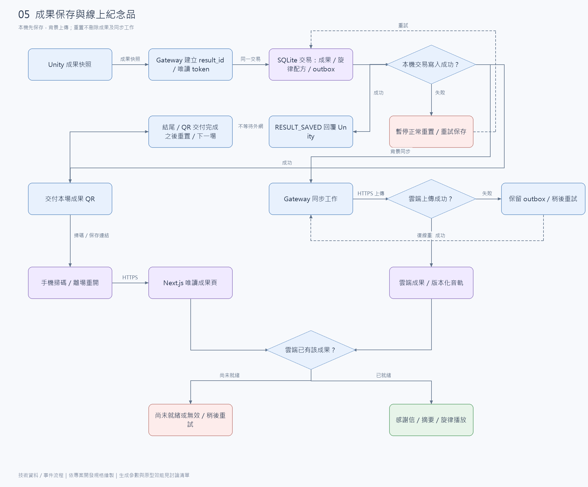
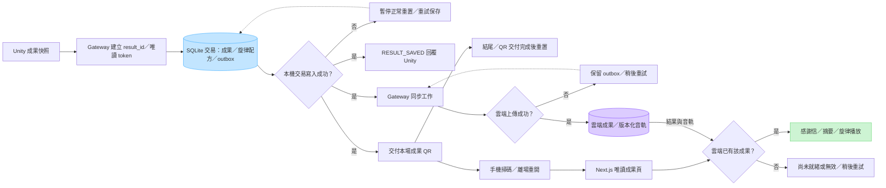

# 音虫互動投影｜技術資料與事件流程圖

日期：2026-11-01

本文件依[技術架構](技術架構.md)與[開發規格](開發規格.md)繪製，標示設備、資料、判定責任及事件回饋。圖為開發設計，不代表已完成實作。未定參數與原型驗證統一見[討論清單](待確認與驗證清單.md)。

[FigJam 技術組頁面](https://www.figma.com/board/j93T69TyTOM0QT6mHK8DeO/?node-id=226-313)｜[開啟全部圖稿](assets/技術流程圖/index.html)｜每張皆附 PNG、SVG 與 Mermaid 原始碼。

預備 2～3 支捕捉器，每場只啟用一支；設備編號只用於選機與 NFC 標籤對照。固定音虫點位另以紅外線編碼辨識。

圖中 Gateway 指展場電腦上的「本機串接服務」；Unity 統一決定捕捉、SAN、回收及音虫狀態。箭頭文字是資料或事件，不是要求觀眾依序執行的任務。

## 1. 系統資料串接

看現場設備、展場電腦與雲端成果之間的資料傳遞。即時捕捉不經雲端。

[SVG 向量圖](assets/技術流程圖/01.svg) · [PNG 圖片](assets/技術流程圖/01.png) · [Mermaid 原始碼](assets/技術流程圖/01.mmd)

展開 Mermaid 原始碼

捕捉器方塊包含紅外線接收相機與韌體；Sunton 4827S043 系列為主板／LCD 的原型候選。圖中的 NFC 回收座經讀取器取得捕捉器被動式標籤，並非遠距定位音虫。

## 2. 自動捕捉判定

看韌體如何回報對準資料，以及 Unity 如何累積進度、歸零與結算。捕捉不需按鈕。

[SVG 向量圖](assets/技術流程圖/02.svg) · [PNG 圖片](assets/技術流程圖/02.png) · [Mermaid 原始碼](assets/技術流程圖/02.mmd)

展開 Mermaid 原始碼

觀測資料含點位、目前目標版本、取樣序號／時間及中心偏移；目標版本由 Unity 同步，紅外線只提供固定點位識別。capture_attempt_id 用於同一次捕捉的進度與結果去重；新群落不繼承舊進度。圖中的繼續取樣表示資料循環，相機持續運作，不是收到回覆才拍下一幀。

## 3. 聲音擾動與新音虫誕生

核心因果是：**成功捕捉 → 捕捉器產生噪音（現場音響播放）→ 促使新音虫誕生。**觀眾發聲則走另一條路，只擾動既有音虫。

[SVG 向量圖](assets/技術流程圖/03.svg) · [PNG 圖片](assets/技術流程圖/03.png) · [Mermaid 原始碼](assets/技術流程圖/03.mmd)

展開 Mermaid 原始碼

Unity 以同一次捕捉噪音事件協調音響播放與誕生演出；圖中的分支是兩項軟體輸出，不是兩個獨立的生成來源。不經麥克風重收音效觸發。事件綁定場次與 capture_attempt_id，避免重送造成重複音效或生成。原群落捕捉成功時先停用原點的紅外線發射燈；新群落生成後才協調顯示與該點紅外線發射燈啟用。投影音虫不跟隨識別編碼閃爍。

## 4. NFC 回收與確認

看「感應事件」如何變成本場回收資格，再與捕捉器按鈕的確認事件合併判定。

[SVG 向量圖](assets/技術流程圖/04.svg) · [PNG 圖片](assets/技術流程圖/04.png) · [Mermaid 原始碼](assets/技術流程圖/04.mmd)

```mermaid
flowchart LR
  tagRead["回收座讀取捕捉器 NFC 標籤"]
  seatReport["座端 ESP32 回報讀取事件"]
  deviceMap["Gateway 確認本場捕捉器標籤"]
  checkPresence{"本場裝置／可回收階段有效？"}
  rejectRead["不開放回收確認"]
  issueAuthorization["Unity 記錄本場已感應"]
  authorizationUi["LCD 顯示可確認回收"]
  confirmButton["捕捉器確認按鈕"]
  recycleRequest["Gateway 轉送 RECYCLE_REQUEST"]
  validateAuthorization{"本場已感應且尚未回收？"}
  rejectRequest["拒絕結算／回傳原因"]
  commitRecycle["標記已回收／固定收集清單"]
  repairDisplay["兩面主投影：回收／轉化／城市修復"]
  resultSnapshot["Unity 交付成果快照"]
  tagRead --> seatReport --> deviceMap --> checkPresence
  checkPresence -->|"否"| rejectRead
  checkPresence -->|"是"| issueAuthorization --> authorizationUi
  authorizationUi -->|"移開後資格仍保留"| confirmButton
  confirmButton --> recycleRequest --> validateAuthorization
  validateAuthorization -->|"否"| rejectRequest
  validateAuthorization -->|"是：尚未結算"| commitRecycle
  commitRecycle --> repairDisplay
  commitRecycle --> resultSnapshot
  style issueAuthorization fill:#C2E5FF,stroke:#3DADFF
  style commitRecycle fill:#CDF4D3,stroke:#66D575
  style rejectRequest fill:#FFCDC2,stroke:#FF7556
```

展開 Mermaid 原始碼

Unity 在本場記錄「已感應」，感應後可移開，狀態保留到回收或本場結束；換備機時清除並重新感應。確認當下不要求仍感應到標籤。重複讀取不自動回收；按確認後先標記已回收，再結算一次，重複按鈕不重複演出或產生成果。回收後直接進入結尾。

## 5. 成果保存與線上紀念品

看 SQLite、outbox、雲端成果與手機成果頁如何串接。本機保存成功且結尾、成果 QR 交付完成後才重置；外網同步在背景進行。

[SVG 向量圖](assets/技術流程圖/05.svg) · [PNG 圖片](assets/技術流程圖/05.png) · [Mermaid 原始碼](assets/技術流程圖/05.mmd)

展開 Mermaid 原始碼

雲端 API 依 result_id 去重，同一成果始終使用同一唯讀 token。不同種類音虫各對應一個聲部，保存旋律配方與音軌版本，離場重開時播放同一成果。QR 的實際顯示設備不在本圖指定；實體列印為選配，使用同一成果連結。
